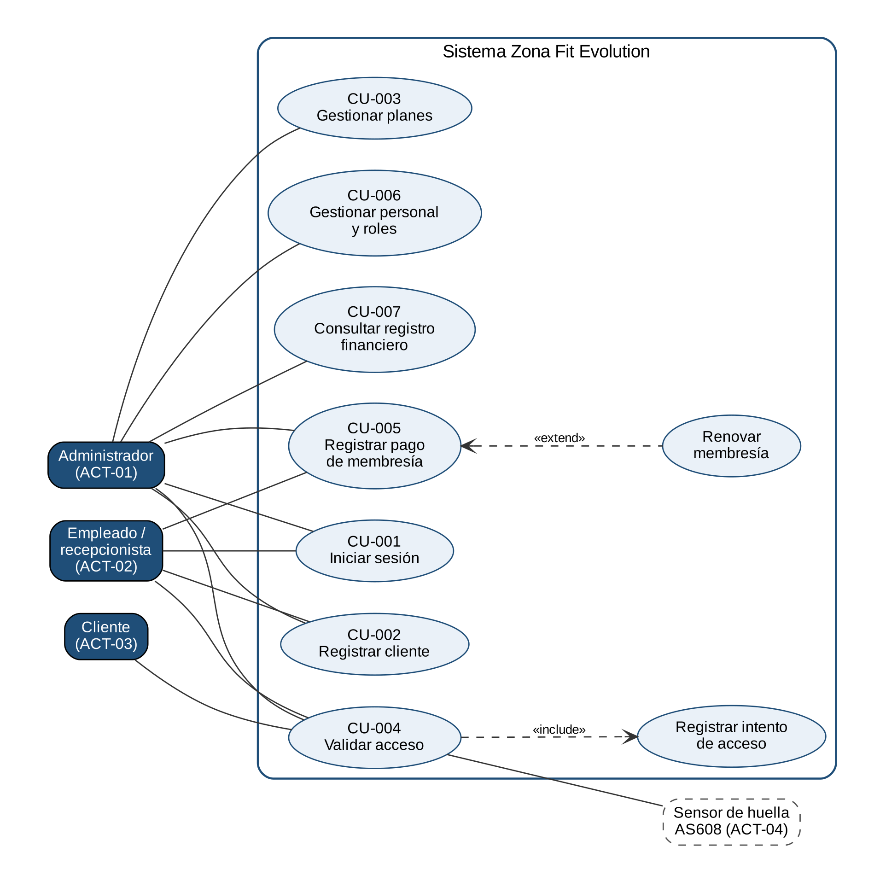

# Backlog, historias de usuario y casos de uso

> Proyecto **Zona Fit Evolution** · SENA ADSO · ficha 3223873.  
> Versión formal entregable: [`entregables/02_Requerimientos/Backlog_HU_y_Casos_de_Uso_ZonaFitEvolution.pdf`](entregables/02_Requerimientos/Backlog_HU_y_Casos_de_Uso_ZonaFitEvolution.pdf). Este Markdown es la versión viva: se actualiza en el mismo PR que cambia el código.

## Control documental

| **Elemento**             | **Detalle**                                                                                              |
| ------------------------ | -------------------------------------------------------------------------------------------------------- |
| Código documental        | ADSO-BAC-01                                                                                              |
| Nombre                   | Backlog, Historias de Usuario y Casos de Uso                                                             |
| Clasificación            | Documento de análisis funcional y planificación                                                          |
| Estado                   | En revisión                                                                                              |
| Propietario              | Liliana Sofía Panesso Méndez (Product Owner) y Juan Diego Mejía Llano (analista)                         |
| Revisor funcional        | Liliana Sofía Panesso Méndez (Product Owner, en representación del propietario)                          |
| Revisor técnico          | Liliana Sofía Panesso Méndez (desarrollo backend)                                                        |
| Revisor académico        | Instructor(a) responsable                                                                                |
| Ubicación oficial        | Repositorio ZonaFitEvolution03, carpeta /docs/analisis (por crear), y tablero de Jira del proyecto SCRUM |
| Periodicidad de revisión | En cada refinamiento, iteración o cambio aprobado                                                        |

### Historial de versiones

| **Versión** | **Fecha**  | **Descripción**                                                                                                         | **Responsable**        | **Aprobado por** |
| ----------- | ---------- | ----------------------------------------------------------------------------------------------------------------------- | ---------------------- | ---------------- |
| 0.1         | 20/10/2026 | Estructura y backlog inicial a partir del documento maestro integrado (v2.3) y de Jira                                  | Juan Diego Mejía Llano |                  |
| 1.0         | 03/11/2026 | Versión para revisión: épicas, backlog, historias detalladas, criterios, casos de uso, plan de iteración y trazabilidad | Juan Diego Mejía Llano |                  |

### Registro de aprobaciones

| **Rol**                 | **Nombre**                   | **Decisión**        | **Fecha**  | **Observaciones** |
| ----------------------- | ---------------------------- | ------------------- | ---------- | ----------------- |
| Product Owner / cliente | Liliana Sofía Panesso Méndez | Aprobado / Devuelto |            |                   |
| Analista                | Juan Diego Mejía Llano       | Elaborado           | 03/11/2026 |                   |
| Líder técnico           |                              | Aprobado / Devuelto |            |                   |
| Instructor              |                              | Aprobado / Devuelto |            |                   |

##   
Tabla de Contenido

[Control documental 2](#control-documental)

[Historial de versiones 2](#historial-de-versiones)

[Registro de aprobaciones 2](#registro-de-aprobaciones)

[1. Propósito y principios 5](#propósito-y-principios)

[1.1 Objetivos específicos 5](#objetivos-específicos)

[1.2 Principios de consistencia 5](#principios-de-consistencia)

[2. Relación con otros artefactos 6](#relación-con-otros-artefactos)

[2.1 Información que no debe repetirse 6](#información-que-no-debe-repetirse)

[3. Glosario y convenciones 6](#glosario-y-convenciones)

[3.1 Convenciones de identificación 7](#convenciones-de-identificación)

[4. Modelo de producto: épicas y funcionalidades 8](#modelo-de-producto-épicas-y-funcionalidades)

[4.1 Mapa de épicas 8](#mapa-de-épicas)

[4.2 Catálogo de funcionalidades 8](#catálogo-de-funcionalidades)

[4.3 Criterios para dividir el producto 8](#criterios-para-dividir-el-producto)

[5. Backlog del producto 9](#backlog-del-producto)

[5.1 Backlog maestro 9](#backlog-maestro)

[5.2 Estados recomendados 9](#estados-recomendados)

[5.3 Políticas del backlog 9](#políticas-del-backlog)

[6. Historias de usuario 10](#historias-de-usuario)

[6.1 Plantilla detallada 10](#plantilla-detallada)

[6.2 Redacción efectiva 10](#redacción-efectiva)

[6.3 Criterios INVEST 11](#criterios-invest)

[7. Criterios de aceptación y escenarios BDD 12](#criterios-de-aceptación-y-escenarios-bdd)

[7.1 Catálogo de criterios por historia 12](#catálogo-de-criterios-por-historia)

[7.2 Formato Given / When / Then 12](#formato-given-when-then)

[7.3 Cobertura mínima de criterios 12](#cobertura-mínima-de-criterios)

[8. Definition of Ready y Definition of Done 13](#definition-of-ready-y-definition-of-done)

[8.1 Definition of Ready 13](#definition-of-ready)

[8.2 Definition of Done 14](#definition-of-done)

[9. Casos de uso 15](#casos-de-uso)

[9.1 Cuándo elaborar un caso de uso 15](#cuándo-elaborar-un-caso-de-uso)

[9.2 Catálogo de casos de uso 15](#catálogo-de-casos-de-uso)

[9.3 Ficha detallada de caso de uso 15](#ficha-detallada-de-caso-de-uso)

[9.4 Plantilla de flujo principal y alternativos 17](#plantilla-de-flujo-principal-y-alternativos)

[9.5 Ejemplo resumido 17](#ejemplo-resumido)

[10. Diagramas y relaciones UML 17](#diagramas-y-relaciones-uml)

[10.1 Diagrama de contexto de casos de uso 17](#diagrama-de-contexto-de-casos-de-uso)

[10.2 Registro de diagramas 18](#registro-de-diagramas)

[11. Refinamiento, estimación y priorización 19](#refinamiento-estimación-y-priorización)

[11.1 Lista de refinamiento 19](#lista-de-refinamiento)

[11.2 Métodos de estimación 19](#métodos-de-estimación)

[11.3 Priorización 19](#priorización)

[12. Planificación por iteraciones o versiones 20](#planificación-por-iteraciones-o-versiones)

[12.1 Roadmap funcional 20](#roadmap-funcional)

[12.2 Plan de iteración 20](#plan-de-iteración)

[12.3 Seguimiento de bloqueos 20](#seguimiento-de-bloqueos)

[13. Gestión de cambios 20](#gestión-de-cambios)

[13.1 Solicitud y análisis 20](#solicitud-y-análisis)

[13.2 Reglas de actualización 20](#reglas-de-actualización)

[14. Trazabilidad, validación y aceptación 21](#trazabilidad-validación-y-aceptación)

[14.1 Matriz resumida 21](#matriz-resumida)

[14.2 Cobertura de historias y casos de uso 21](#cobertura-de-historias-y-casos-de-uso)

[14.3 Registro de aceptación 21](#registro-de-aceptación)

[15. Indicadores y lista de verificación 22](#indicadores-y-lista-de-verificación)

[15.1 Indicadores sugeridos 22](#indicadores-sugeridos)

[15.2 Lista de verificación final 22](#lista-de-verificación-final)

[Anexo A. Plantilla rápida de historia de usuario 24](#anexo-a.-plantilla-rápida-de-historia-de-usuario)

[Anexo B. Plantilla rápida de caso de uso 24](#anexo-b.-plantilla-rápida-de-caso-de-uso)

[Anexo C. Convención de carpetas sugerida 25](#anexo-c.-convención-de-carpetas-sugerida)

[Anexo D. Aprobación del documento 25](#anexo-d.-aprobación-del-documento)

## 

## 1\. Propósito y principios

El documento organiza el trabajo funcional del producto, preserva la relación con los requisitos aprobados y ofrece el nivel de detalle necesario para diseño, construcción y pruebas. Debe mantenerse actualizado durante el desarrollo y reflejar únicamente funcionalidades reales o planificadas.

### 1.1 Objetivos específicos

  - Organizar el producto en épicas, funcionalidades e historias de usuario.

  - Priorizar el trabajo de acuerdo con valor, riesgo, dependencia y esfuerzo.

  - Redactar historias claras, pequeñas, negociables y verificables.

  - Definir criterios de aceptación que permitan diseñar pruebas.

  - Documentar casos de uso solo cuando el proceso requiera mayor detalle.

  - Establecer condiciones de preparación y terminado.

  - Mantener trazabilidad con requisitos, reglas de negocio, diseño, código y pruebas.

### 1.2 Principios de consistencia

| **Principio**             | **Aplicación**                                                                                     |
| ------------------------- | -------------------------------------------------------------------------------------------------- |
| Una fuente de verdad      | Los requisitos y reglas se definen en su documento central; aquí se referencian por código.        |
| Sin duplicación narrativa | Una historia no repite un caso de uso completo y un caso de uso no reescribe todos los requisitos. |
| Valor visible             | Cada historia explica para quién y para qué existe.                                                |
| Prueba desde el análisis  | Todo criterio debe poder convertirse en uno o más casos de prueba.                                 |
| Detalle proporcional      | Los procesos simples usan historias; los complejos pueden requerir casos de uso.                   |
| Actualización continua    | Estados, prioridades y relaciones deben coincidir con la herramienta de gestión y el producto.     |

<table>
<tbody>
<tr class="odd">
<td>
<strong>Regla de oro</strong>

Una historia de usuario describe una necesidad y su valor. Un criterio de aceptación define cuándo se considera satisfecha. Un caso de uso detalla la interacción completa de un proceso complejo. Un caso de prueba comprueba el comportamiento. Son artefactos relacionados, no sinónimos.
</td>
</tr>
</tbody>
</table>

## 2\. Relación con otros artefactos

| **Artefacto**              | **Aporta a este documento**                              | **Recibe de este documento**                            |
| -------------------------- | -------------------------------------------------------- | ------------------------------------------------------- |
| Formulación y Constitución | Problema, objetivos e indicadores.                       | Capacidades priorizadas que materializan los objetivos. |
| Gestión del Proyecto       | Metodología, responsables, roadmap y gestión de cambios. | Backlog, estimaciones, estados y dependencias.          |
| Alcance y Requisitos       | RF, RNF, reglas, roles y límites aprobados.              | Desglose funcional, criterios y procesos detallados.    |
| Diseño UX/UI               | Prototipos, navegación y restricciones de interacción.   | Flujos, estados y pantallas necesarias.                 |
| Arquitectura               | Restricciones y viabilidad técnica.                      | Escenarios críticos y necesidades técnicas.             |
| Plan de Pruebas            | Estrategia y formatos de evidencia.                      | Criterios, escenarios y cobertura funcional.            |
| Matriz de Trazabilidad     | Relaciones maestras.                                     | HU, CU, criterios, versiones y estado.                  |

### 2.1 Información que no debe repetirse

  - Descripción completa de requisitos funcionales y no funcionales.

  - Catálogo oficial de reglas de negocio.

  - Diseño detallado de pantallas y componentes.

  - Contratos técnicos de API.

  - Casos de prueba con pasos y resultados ejecutados.

  - Decisiones arquitectónicas y estructura interna del código.

## 3\. Glosario y convenciones

| **Término**             | **Definición**                                                               |
| ----------------------- | ---------------------------------------------------------------------------- |
| Épica                   | Objetivo o capacidad amplia que agrupa varias funcionalidades e historias.   |
| Funcionalidad / Feature | Capacidad coherente del producto que entrega valor y se divide en historias. |
| Historia de usuario     | Necesidad breve descrita desde la perspectiva de un actor.                   |
| Criterio de aceptación  | Condición observable que debe cumplirse para aceptar una historia.           |
| Caso de uso             | Descripción estructurada de la interacción entre actores y sistema.          |
| Escenario               | Recorrido específico de un caso de uso o criterio.                           |
| Backlog                 | Lista priorizada y cambiante del trabajo del producto.                       |
| Refinamiento            | Actividad para aclarar, dividir, estimar y priorizar elementos.              |
| Definition of Ready     | Condiciones para iniciar una historia.                                       |
| Definition of Done      | Condiciones para declarar terminado un incremento.                           |

### 3.1 Convenciones de identificación

| **Elemento**           | **Formato**        | **Ejemplo**   |
| ---------------------- | ------------------ | ------------- |
| Épica                  | EP-\#\#\#          | EP-001        |
| Funcionalidad          | FEAT-\#\#\#        | FEAT-004      |
| Historia de usuario    | HU-\#\#\#          | HU-017        |
| Caso de uso            | CU-\#\#\#          | CU-006        |
| Escenario BDD          | ESC-HU-\#\#\#-\#\# | ESC-HU-017-02 |
| Criterio de aceptación | CA-HU-\#\#\#-\#\#  | CA-HU-017-01  |
| Tarea técnica          | TT-\#\#\#          | TT-038        |

## 4\. Modelo de producto: épicas y funcionalidades

### 4.1 Mapa de épicas

| **ID** | **Épica**                                       | **Objetivo de negocio o usuario**                                             | **Stakeholders**       | **Indicador asociado**                                               | **Estado**    |
| ------ | ----------------------------------------------- | ----------------------------------------------------------------------------- | ---------------------- | -------------------------------------------------------------------- | ------------- |
| EP-001 | Gestión integral de usuarios y control de roles | Autenticación segura, cuentas del personal y separación de funciones por rol. | STK-01, STK-02         | IND-01: 0 accesos al sistema sin autenticación                       | En validación |
| EP-002 | Administración de planes y membresías           | Tarifas flexibles, asignación y renovación de membresías.                     | STK-01, STK-02         | IND-02: registro y renovación en menos de 2 minutos                  | En validación |
| EP-003 | Sistema de control de acceso automatizado       | Identificar al cliente por huella, y validar su membresía al ingresar.        | STK-01, STK-02, STK-03 | IND-03: 0 ingresos con membresía vencida; validación en menos de 2 s | En progreso   |
| EP-004 | Gestión financiera y registro de ingresos       | Registro del pago de cada membresía y resumen por cliente.                    | STK-01                 | IND-04: 100 % de membresías con pago registrado                      | En progreso   |
| EP-005 | Calidad, seguridad y disponibilidad del sistema | Seguridad de los datos, disponibilidad y mantenibilidad.                      | STK-01, STK-04         | IND-05: disponibilidad de 99,9 % en horario de atención              | En progreso   |

### 4.2 Catálogo de funcionalidades

| **ID**   | **Funcionalidad**                              | **Épica** | **Descripción de valor**                               | **Requisitos asociados**           | **Prioridad** | **Versión** |
| -------- | ---------------------------------------------- | --------- | ------------------------------------------------------ | ---------------------------------- | ------------- | ----------- |
| FEAT-001 | Inicio de sesión y roles                       | EP-001    | Solo el personal autorizado usa el sistema.            | RF-007                             | Alta          | MVP         |
| FEAT-002 | Gestión del personal                           | EP-001    | El Administrador controla quién trabaja en el sistema. | RF-007                             | Alta          | MVP         |
| FEAT-003 | Registro y gestión de clientes                 | EP-001    | Base confiable de socios.                              | RF-001                             | Alta          | MVP         |
| FEAT-004 | Catálogo de planes                             | EP-002    | Tarifas ajustables sin cambiar el código.              | RF-002                             | Alta          | MVP         |
| FEAT-005 | Asignación y renovación de membresías          | EP-002    | Renovación rápida sin perder días pagados.             | RF-005                             | Media         | MVP         |
| FEAT-006 | Registro biométrico                            | EP-003    | Ingreso sin tarjetas.                                  | RF-004                             | Media         | MVP         |
| FEAT-007 | Validación de acceso                           | EP-003    | Solo ingresan socios vigentes.                         | RF-003                             | Alta          | MVP         |
| FEAT-008 | Historial de accesos                           | EP-003    | Auditoría de ingresos.                                 | RF-008                             | Media         | MVP         |
| FEAT-009 | Registro de pagos y resumen financiero         | EP-004    | Ingresos reales por cliente.                           | RF-006                             | Alta          | MVP         |
| FEAT-010 | Comprobante digital de pago                    | EP-004    | Soporte de pago para el cliente.                       | RF-006                             | Baja          | MVP / V1.1  |
| FEAT-011 | Seguridad, disponibilidad y calidad del código | EP-005    | Protección de datos y operación continua.              | RNF-001, RNF-004, RNF-005, RNF-006 | Alta          | MVP         |
| FEAT-012 | Interfaz usable y responsive                   | EP-005    | Atención ágil en la recepción.                         | RNF-002, RNF-007                   | Media         | MVP         |

### 4.3 Criterios para dividir el producto

  - Una épica no debería ejecutarse como una sola unidad de trabajo.

  - Una funcionalidad debe entregar una capacidad coherente y demostrable.

  - Una historia debe ser suficientemente pequeña para completarse dentro de una iteración razonable.

  - La división debe preservar valor; evitar historias organizadas únicamente por capas técnicas.

  - Las tareas técnicas apoyan historias o requisitos, pero no sustituyen el valor funcional.

<table>
<tbody>
<tr class="odd">
<td>
<strong>Ejemplo de división</strong>

Épica: Administración de planes y membresías (EP-002). Funcionalidades: catálogo de planes (FEAT-004) y asignación y renovación de membresías (FEAT-005). Historias: crear y gestionar planes (HU-003) y renovar membresía por cédula (HU-004); la tabla de pagos se separó como tarea técnica (TT-005). Cada historia puede probarse y demostrarse.
</td>
</tr>
</tbody>
</table>

## 5\. Backlog del producto

### 5.1 Backlog maestro

| **Orden** | **ID** | **Tipo** | **Título**                                                            | **Épica / módulo** | **Valor** | **Prioridad** | **Estimación** | **Dependencias**       | **Estado**                                        | **Versión** |
| --------- | ------ | -------- | --------------------------------------------------------------------- | ------------------ | --------- | ------------- | -------------- | ---------------------- | ------------------------------------------------- | ----------- |
| 1         | HU-005 | Historia | Registrar huella del cliente                                          | EP-003             | Alto      | Must          | 13 pts         | HU-001, INT-01         | En progreso                                       | MVP         |
| 2         | HU-008 | Historia | Registrar pagos y ver resumen                                         | EP-004             | Alto      | Must          | 5 pts          | HU-003, HU-004, TT-005 | En progreso                                       | MVP         |
| 3         | HU-010 | Historia | Protección de datos                                                   | EP-005             | Alto      | Must          | 8 pts          | HU-002                 | En progreso                                       | MVP         |
| 4         | HU-011 | Historia | Disponibilidad en horario                                             | EP-005             | Alto      | Must          | 8 pts          | TT-009                 | Planificada                                       | MVP         |
| 5         | TT-005 | Técnica  | Crear la tabla de pagos con monto y método                            | EP-004             | Alto      | Must          | 5 pts          | HU-008                 | Planificada                                       | MVP         |
| 6         | TT-007 | Técnica  | Pruebas automatizadas de backend y frontend                           | EP-005             | Alto      | Must          | 8 pts          | —                      | Planificada                                       | MVP         |
| 7         | TT-009 | Técnica  | Despliegue de la API en hosting (por definir) y base MySQL en la nube | EP-005             | Alto      | Must          | 5 pts          | —                      | Planificada                                       | MVP         |
| 8         | TT-010 | Técnica  | Adaptador del sensor AS608 (CP2102) en la capa hardware               | EP-003             | Alto      | Must          | 8 pts          | INT-01                 | Planificada                                       | MVP         |
| 9         | TT-004 | Técnica  | Restringir CORS al dominio del frontend                               | EP-005             | Medio     | Should        | 1 pts          | TT-009                 | Planificada                                       | MVP         |
| 10        | TT-006 | Técnica  | Tarea programada de vencimiento en el servidor                        | EP-002             | Medio     | Should        | 3 pts          | HU-006                 | Planificada                                       | MVP         |
| 11        | TT-008 | Técnica  | Pipeline de integración continua                                      | EP-005             | Medio     | Should        | 3 pts          | TT-007                 | Planificada                                       | MVP         |
| 12        | HU-009 | Historia | Comprobante digital de pago                                           | EP-004             | Bajo      | Could         | 3 pts          | HU-008, TT-005         | Planificada                                       | MVP         |
| 13        | HU-001 | Historia | Registrar clientes                                                    | EP-001             | Alto      | Must          | 3 pts          | HU-002                 | En validación                                     | MVP         |
| 14        | HU-002 | Historia | Asignar roles al personal                                             | EP-001             | Alto      | Must          | 5 pts          | —                      | En validación                                     | MVP         |
| 15        | HU-003 | Historia | Gestionar planes                                                      | EP-002             | Alto      | Must          | 5 pts          | HU-002                 | En validación                                     | MVP         |
| 16        | HU-006 | Historia | Validar vigencia al ingresar                                          | EP-003             | Alto      | Must          | 8 pts          | HU-005                 | En validación                                     | MVP         |
| 17        | HU-004 | Historia | Renovar membresía por cédula                                          | EP-002             | Medio     | Should        | 3 pts          | HU-001, HU-003         | En validación                                     | MVP         |
| 18        | HU-007 | Historia | Validación inmediata                                                  | EP-003             | Medio     | Should        | 5 pts          | HU-006                 | En validación                                     | MVP         |
| 19        | HU-012 | Historia | Interfaz sencilla                                                     | EP-005             | Medio     | Should        | 3 pts          | —                      | En validación                                     | MVP         |
| 20        | HU-013 | Historia | Código con patrones de diseño                                         | EP-005             | Bajo      | Could         | 5 pts          | —                      | En validación                                     | MVP         |
| 21        | TT-001 | Técnica  | Validar en el backend la regla del último administrador               | EP-005             | Alto      | Must          | 2 pts          | HU-002                 | En progreso (rama feature/correcciones-seguridad) | MVP         |
| 22        | TT-002 | Técnica  | Quitar la ruta de borrado de clientes                                 | EP-001             | Alto      | Must          | 1 pts          | HU-001                 | En progreso (rama feature/correcciones-seguridad) | MVP         |
| 23        | TT-003 | Técnica  | Límite de intentos de inicio de sesión                                | EP-005             | Alto      | Must          | 3 pts          | HU-002                 | En progreso (rama feature/limite-intentos-login)  | MVP         |

### 5.2 Estados recomendados

| **Estado**      | **Significado**                                 | **Condición para avanzar**                    |
| --------------- | ----------------------------------------------- | --------------------------------------------- |
| Propuesta       | Necesidad identificada sin análisis suficiente. | Debe revisarse fuente y relación con alcance. |
| En refinamiento | Se está aclarando, dividiendo o estimando.      | Cumplir Definition of Ready.                  |
| Preparada       | Lista para ser seleccionada.                    | Aprobación funcional y viabilidad técnica.    |
| Planificada     | Asignada a iteración o versión.                 | Capacidad y dependencias confirmadas.         |
| En progreso     | Trabajo iniciado.                               | Evidencia de rama, tarea o PR.                |
| En validación   | Implementada y pendiente de revisión.           | Pruebas y demostración disponibles.           |
| Terminada       | Cumple Definition of Done.                      | Aceptación y trazabilidad actualizadas.       |
| Bloqueada       | No puede avanzar por impedimento.               | Registrar causa, responsable y acción.        |
| Descartada      | No se desarrollará.                             | Justificación y aprobación del cambio.        |

### 5.3 Políticas del backlog

  - El orden representa prioridad real, no solo numeración.

  - No deben planificarse elementos sin responsable de validación.

  - Las historias bloqueadas conservan su estado y registran el impedimento.

  - Los cambios relevantes se documentan con impacto en alcance, plazo, arquitectura y pruebas.

  - La herramienta digital es la fuente operativa; este documento conserva estructura, reglas y cortes aprobados.

## 6\. Historias de usuario

### 6.1 Plantilla detallada

**HU-001 – Registrar clientes**

| **Campo**                    | **Contenido**                                                                                                                                                      |
| ---------------------------- | ------------------------------------------------------------------------------------------------------------------------------------------------------------------ |
| ID y título                  | HU-001 – Registrar clientes                                                                                                                                        |
| Épica / funcionalidad        | EP-001 / FEAT-003                                                                                                                                                  |
| Narrativa                    | Como Administrador, quiero registrar a los clientes con sus datos personales (nombre, cédula, correo y teléfono) para integrarlos formalmente en la base de datos. |
| Contexto y problema          | Hoy los socios se anotan a mano y no hay forma de saber quién está inscrito.                                                                                       |
| Valor esperado               | Base de clientes confiable para asignar membresías y validar accesos.                                                                                              |
| Actor principal              | ACT-01 Administrador (también ACT-02)                                                                                                                              |
| Requisitos relacionados      | RF-001                                                                                                                                                             |
| Reglas relacionadas          | RN-001, RN-007                                                                                                                                                     |
| Prioridad                    | Must                                                                                                                                                               |
| Estimación                   | 3 puntos de historia                                                                                                                                               |
| Dependencias                 | HU-002                                                                                                                                                             |
| Riesgos                      | Cédulas mal digitadas.                                                                                                                                             |
| Prototipo relacionado        | UI-03                                                                                                                                                              |
| Criterios de aceptación      | CA-HU-001-01, CA-HU-001-02, CA-HU-001-03                                                                                                                           |
| Casos de prueba              | CP-001 a CP-003                                                                                                                                                    |
| Versión / iteración objetivo | MVP – Sprints 3 y 4                                                                                                                                                |
| Responsable de validación    | Liliana Sofía Panesso Méndez (Product Owner)                                                                                                                       |
| Estado                       | En validación                                                                                                                                                      |
| Evidencia de aceptación      | Pull Requests en GitHub y demostración en la sprint review                                                                                                         |

**HU-002 – Asignar roles al personal**

| **Campo**                    | **Contenido**                                                                                                                                                                |
| ---------------------------- | ---------------------------------------------------------------------------------------------------------------------------------------------------------------------------- |
| ID y título                  | HU-002 – Asignar roles al personal                                                                                                                                           |
| Épica / funcionalidad        | EP-001 / FEAT-001, FEAT-002                                                                                                                                                  |
| Narrativa                    | Como Administrador, quiero asignar roles específicos (Administrador y Empleado) para restringir el acceso a la información financiera y proteger la integridad de los datos. |
| Contexto y problema          | Todo el personal tenía acceso a la misma información.                                                                                                                        |
| Valor esperado               | Separación de funciones y protección de las finanzas.                                                                                                                        |
| Actor principal              | ACT-01 Administrador                                                                                                                                                         |
| Requisitos relacionados      | RF-007                                                                                                                                                                       |
| Reglas relacionadas          | RN-011, RN-012                                                                                                                                                               |
| Prioridad                    | Must                                                                                                                                                                         |
| Estimación                   | 5 puntos de historia                                                                                                                                                         |
| Dependencias                 | —                                                                                                                                                                            |
| Riesgos                      | Permisos controlados solo en la interfaz.                                                                                                                                    |
| Prototipo relacionado        | UI-01, UI-08                                                                                                                                                                 |
| Criterios de aceptación      | CA-HU-002-01, CA-HU-002-02, CA-HU-002-03, CA-HU-002-04                                                                                                                       |
| Casos de prueba              | CP-016 a CP-018, CP-020, CP-021                                                                                                                                              |
| Versión / iteración objetivo | MVP – Sprint 3                                                                                                                                                               |
| Responsable de validación    | Liliana Sofía Panesso Méndez (Product Owner)                                                                                                                                 |
| Estado                       | En validación                                                                                                                                                                |
| Evidencia de aceptación      | Pull Requests en GitHub y demostración en la sprint review                                                                                                                   |

**HU-003 – Gestionar planes**

| **Campo**                    | **Contenido**                                                                                                                                               |
| ---------------------------- | ----------------------------------------------------------------------------------------------------------------------------------------------------------- |
| ID y título                  | HU-003 – Gestionar planes                                                                                                                                   |
| Épica / funcionalidad        | EP-002 / FEAT-004                                                                                                                                           |
| Narrativa                    | Como Administrador, quiero crear y gestionar los planes (diario, quincenal, mensual y trimestral) para ofrecer flexibilidad en las opciones de suscripción. |
| Contexto y problema          | Las tarifas estaban fijas en el código.                                                                                                                     |
| Valor esperado               | El propietario ajusta precios sin cambiar el sistema.                                                                                                       |
| Actor principal              | ACT-01 Administrador                                                                                                                                        |
| Requisitos relacionados      | RF-002                                                                                                                                                      |
| Reglas relacionadas          | RN-006                                                                                                                                                      |
| Prioridad                    | Must                                                                                                                                                        |
| Estimación                   | 5 puntos de historia                                                                                                                                        |
| Dependencias                 | HU-002                                                                                                                                                      |
| Riesgos                      | Borrar un plan con historial.                                                                                                                               |
| Prototipo relacionado        | UI-04                                                                                                                                                       |
| Criterios de aceptación      | CA-HU-003-01, CA-HU-003-02, CA-HU-003-03                                                                                                                    |
| Casos de prueba              | CP-004 a CP-006                                                                                                                                             |
| Versión / iteración objetivo | MVP – Sprint 5                                                                                                                                              |
| Responsable de validación    | Liliana Sofía Panesso Méndez (Product Owner)                                                                                                                |
| Estado                       | En validación                                                                                                                                               |
| Evidencia de aceptación      | Pull Requests en GitHub y demostración en la sprint review                                                                                                  |

**HU-004 – Renovar membresía por cédula**

| **Campo**                    | **Contenido**                                                                                                                                                     |
| ---------------------------- | ----------------------------------------------------------------------------------------------------------------------------------------------------------------- |
| ID y título                  | HU-004 – Renovar membresía por cédula                                                                                                                             |
| Épica / funcionalidad        | EP-002 / FEAT-005                                                                                                                                                 |
| Narrativa                    | Como Recepcionista, quiero renovar la membresía de un cliente buscándolo por su cédula, para actualizar la fecha de vencimiento sin volver a registrar sus datos. |
| Contexto y problema          | La renovación obligaba a capturar otra vez al cliente.                                                                                                            |
| Valor esperado               | Atención más rápida en horas pico.                                                                                                                                |
| Actor principal              | ACT-02 Empleado / recepcionista                                                                                                                                   |
| Requisitos relacionados      | RF-005                                                                                                                                                            |
| Reglas relacionadas          | RN-003, RN-004, RN-005                                                                                                                                            |
| Prioridad                    | Should                                                                                                                                                            |
| Estimación                   | 3 puntos de historia                                                                                                                                              |
| Dependencias                 | HU-001, HU-003                                                                                                                                                    |
| Riesgos                      | Perder días pagados al renovar.                                                                                                                                   |
| Prototipo relacionado        | UI-05                                                                                                                                                             |
| Criterios de aceptación      | CA-HU-004-01, CA-HU-004-02                                                                                                                                        |
| Casos de prueba              | CP-012, CP-013                                                                                                                                                    |
| Versión / iteración objetivo | MVP – Sprint 6                                                                                                                                                    |
| Responsable de validación    | Liliana Sofía Panesso Méndez (Product Owner)                                                                                                                      |
| Estado                       | En validación                                                                                                                                                     |
| Evidencia de aceptación      | Pull Requests en GitHub y demostración en la sprint review                                                                                                        |

**HU-005 – Registrar huella del cliente**

| **Campo**                    | **Contenido**                                                                                                    |
| ---------------------------- | ---------------------------------------------------------------------------------------------------------------- |
| ID y título                  | HU-005 – Registrar huella del cliente                                                                            |
| Épica / funcionalidad        | EP-003 / FEAT-006                                                                                                |
| Narrativa                    | Como Administrador, quiero registrar la huella de cada cliente para identificarlo automáticamente en la entrada. |
| Contexto y problema          | Se descartaron las tarjetas (CR-001).                                                                            |
| Valor esperado               | Ingreso sin tarjetas ni filas.                                                                                   |
| Actor principal              | ACT-01 Administrador (también ACT-02)                                                                            |
| Requisitos relacionados      | RF-004                                                                                                           |
| Reglas relacionadas          | RN-008                                                                                                           |
| Prioridad                    | Must                                                                                                             |
| Estimación                   | 13 puntos de historia                                                                                            |
| Dependencias                 | HU-001, INT-01                                                                                                   |
| Riesgos                      | El sensor AS608 aún no está integrado con la API.                                                                |
| Prototipo relacionado        | UI-06                                                                                                            |
| Criterios de aceptación      | CA-HU-005-01, CA-HU-005-02                                                                                       |
| Casos de prueba              | CP-010, CP-011                                                                                                   |
| Versión / iteración objetivo | MVP – Sprint 7                                                                                                   |
| Responsable de validación    | Liliana Sofía Panesso Méndez (Product Owner)                                                                     |
| Estado                       | En progreso                                                                                                      |
| Evidencia de aceptación      | Pendiente                                                                                                        |

**HU-006 – Validar vigencia al ingresar**

| **Campo**                    | **Contenido**                                                                                                                                                 |
| ---------------------------- | ------------------------------------------------------------------------------------------------------------------------------------------------------------- |
| ID y título                  | HU-006 – Validar vigencia al ingresar                                                                                                                         |
| Épica / funcionalidad        | EP-003 / FEAT-007, FEAT-008                                                                                                                                   |
| Narrativa                    | Como Recepcionista, quiero que el sistema valide automáticamente la vigencia de la membresía para permitir el ingreso solo a quienes tengan su cuenta activa. |
| Contexto y problema          | Hoy la recepción revisa a mano y se cuelan socios vencidos.                                                                                                   |
| Valor esperado               | Cero ingresos con membresía vencida.                                                                                                                          |
| Actor principal              | ACT-02 Empleado / recepcionista                                                                                                                               |
| Requisitos relacionados      | RF-003, RF-008                                                                                                                                                |
| Reglas relacionadas          | RN-002, RN-009, RN-010                                                                                                                                        |
| Prioridad                    | Must                                                                                                                                                          |
| Estimación                   | 8 puntos de historia                                                                                                                                          |
| Dependencias                 | HU-005                                                                                                                                                        |
| Riesgos                      | Estado guardado desactualizado.                                                                                                                               |
| Prototipo relacionado        | UI-06, UI-07                                                                                                                                                  |
| Criterios de aceptación      | CA-HU-006-01, CA-HU-006-02, CA-HU-006-03                                                                                                                      |
| Casos de prueba              | CP-007 a CP-009, CP-019                                                                                                                                       |
| Versión / iteración objetivo | MVP – Sprint 8                                                                                                                                                |
| Responsable de validación    | Liliana Sofía Panesso Méndez (Product Owner)                                                                                                                  |
| Estado                       | En validación                                                                                                                                                 |
| Evidencia de aceptación      | Pull Requests en GitHub y demostración en la sprint review                                                                                                    |

**HU-007 – Validación inmediata**

| **Campo**                    | **Contenido**                                                                                                                           |
| ---------------------------- | --------------------------------------------------------------------------------------------------------------------------------------- |
| ID y título                  | HU-007 – Validación inmediata                                                                                                           |
| Épica / funcionalidad        | EP-003 / FEAT-007                                                                                                                       |
| Narrativa                    | Como Recepcionista, quiero que la validación de acceso sea inmediata para evitar filas y asegurar un rendimiento óptimo en tiempo real. |
| Contexto y problema          | Las horas pico generan congestión en la entrada.                                                                                        |
| Valor esperado               | Ingreso fluido.                                                                                                                         |
| Actor principal              | ACT-02 Empleado / recepcionista                                                                                                         |
| Requisitos relacionados      | RF-003, RNF-003                                                                                                                         |
| Reglas relacionadas          | RN-009                                                                                                                                  |
| Prioridad                    | Should                                                                                                                                  |
| Estimación                   | 5 puntos de historia                                                                                                                    |
| Dependencias                 | HU-006                                                                                                                                  |
| Riesgos                      | Latencia del hosting (proveedor por definir).                                                                                           |
| Prototipo relacionado        | UI-06                                                                                                                                   |
| Criterios de aceptación      | CA-HU-007-01                                                                                                                            |
| Casos de prueba              | Medición RNF-003                                                                                                                        |
| Versión / iteración objetivo | MVP – Sprint 8                                                                                                                          |
| Responsable de validación    | Liliana Sofía Panesso Méndez (Product Owner)                                                                                            |
| Estado                       | En validación                                                                                                                           |
| Evidencia de aceptación      | Pull Requests en GitHub y demostración en la sprint review                                                                              |

**HU-008 – Registrar pagos y ver resumen**

| **Campo**                    | **Contenido**                                                                                                                                                                        |
| ---------------------------- | ------------------------------------------------------------------------------------------------------------------------------------------------------------------------------------ |
| ID y título                  | HU-008 – Registrar pagos y ver resumen                                                                                                                                               |
| Épica / funcionalidad        | EP-004 / FEAT-009                                                                                                                                                                    |
| Narrativa                    | Como Administrador, quiero que cada membresía asignada o renovada quede registrada como pago y consultar el resumen de pagos de cada cliente, para mantener un historial financiero. |
| Contexto y problema          | No hay control de los ingresos de la recepción.                                                                                                                                      |
| Valor esperado               | Conocer los ingresos reales por cliente.                                                                                                                                             |
| Actor principal              | ACT-01 Administrador                                                                                                                                                                 |
| Requisitos relacionados      | RF-006                                                                                                                                                                               |
| Reglas relacionadas          | RN-004, RN-011                                                                                                                                                                       |
| Prioridad                    | Must                                                                                                                                                                                 |
| Estimación                   | 5 puntos de historia                                                                                                                                                                 |
| Dependencias                 | HU-003, HU-004, TT-005                                                                                                                                                               |
| Riesgos                      | Cifras estimadas si cambia el precio del plan.                                                                                                                                       |
| Prototipo relacionado        | UI-05, UI-09                                                                                                                                                                         |
| Criterios de aceptación      | CA-HU-008-01, CA-HU-008-02                                                                                                                                                           |
| Casos de prueba              | CP-014, CP-015                                                                                                                                                                       |
| Versión / iteración objetivo | MVP – Sprints 10 a 12                                                                                                                                                                |
| Responsable de validación    | Liliana Sofía Panesso Méndez (Product Owner)                                                                                                                                         |
| Estado                       | En progreso                                                                                                                                                                          |
| Evidencia de aceptación      | Pendiente                                                                                                                                                                            |

**HU-009 – Comprobante digital de pago**

| **Campo**                    | **Contenido**                                                                                           |
| ---------------------------- | ------------------------------------------------------------------------------------------------------- |
| ID y título                  | HU-009 – Comprobante digital de pago                                                                    |
| Épica / funcionalidad        | EP-004 / FEAT-010                                                                                       |
| Narrativa                    | Como Cliente, quiero recibir un comprobante digital de mi pago para tener un soporte de mi transacción. |
| Contexto y problema          | Los socios no reciben soporte de sus pagos.                                                             |
| Valor esperado               | Transparencia con el cliente.                                                                           |
| Actor principal              | ACT-03 Cliente                                                                                          |
| Requisitos relacionados      | RF-006                                                                                                  |
| Reglas relacionadas          | RN-004                                                                                                  |
| Prioridad                    | Could                                                                                                   |
| Estimación                   | 3 puntos de historia                                                                                    |
| Dependencias                 | HU-008, TT-005                                                                                          |
| Riesgos                      | Envío de datos personales por correo.                                                                   |
| Prototipo relacionado        | UI-09                                                                                                   |
| Criterios de aceptación      | Por definir                                                                                             |
| Casos de prueba              | Por definir                                                                                             |
| Versión / iteración objetivo | MVP – Sprint 12                                                                                         |
| Responsable de validación    | Liliana Sofía Panesso Méndez (Product Owner)                                                            |
| Estado                       | Planificada                                                                                             |
| Evidencia de aceptación      | Pendiente                                                                                               |

**HU-010 – Protección de datos**

| **Campo**                    | **Contenido**                                                                                                                                 |
| ---------------------------- | --------------------------------------------------------------------------------------------------------------------------------------------- |
| ID y título                  | HU-010 – Protección de datos                                                                                                                  |
| Épica / funcionalidad        | EP-005 / FEAT-011                                                                                                                             |
| Narrativa                    | Como Administrador, quiero que el sistema cuente con protocolos de seguridad y cifrado para garantizar la protección de los datos personales. |
| Contexto y problema          | Se manejan datos personales y biométricos.                                                                                                    |
| Valor esperado               | Cumplir la Ley 1581 de 2012 y evitar fugas.                                                                                                   |
| Actor principal              | ACT-01 Administrador                                                                                                                          |
| Requisitos relacionados      | RNF-001, RNF-006                                                                                                                              |
| Reglas relacionadas          | RN-008, RN-011, RN-012                                                                                                                        |
| Prioridad                    | Must                                                                                                                                          |
| Estimación                   | 8 puntos de historia                                                                                                                          |
| Dependencias                 | HU-002                                                                                                                                        |
| Riesgos                      | Brechas pendientes (OBS-001 a OBS-003).                                                                                                       |
| Prototipo relacionado        | —                                                                                                                                             |
| Criterios de aceptación      | CA-HU-010-01                                                                                                                                  |
| Casos de prueba              | CP-020, CP-021                                                                                                                                |
| Versión / iteración objetivo | MVP – Sprints 3 a 11                                                                                                                          |
| Responsable de validación    | Liliana Sofía Panesso Méndez (Product Owner)                                                                                                  |
| Estado                       | En progreso                                                                                                                                   |
| Evidencia de aceptación      | Pendiente                                                                                                                                     |

**HU-011 – Disponibilidad en horario**

| **Campo**                    | **Contenido**                                                                                                                                   |
| ---------------------------- | ----------------------------------------------------------------------------------------------------------------------------------------------- |
| ID y título                  | HU-011 – Disponibilidad en horario                                                                                                              |
| Épica / funcionalidad        | EP-005 / FEAT-011                                                                                                                               |
| Narrativa                    | Como Administrador, quiero asegurar la disponibilidad del sistema durante todo el horario de operación para no interrumpir el flujo de ingreso. |
| Contexto y problema          | Sin sistema no se puede validar el ingreso.                                                                                                     |
| Valor esperado               | Operación continua de la recepción.                                                                                                             |
| Actor principal              | ACT-01 Administrador                                                                                                                            |
| Requisitos relacionados      | RNF-004                                                                                                                                         |
| Reglas relacionadas          | —                                                                                                                                               |
| Prioridad                    | Must                                                                                                                                            |
| Estimación                   | 8 puntos de historia                                                                                                                            |
| Dependencias                 | TT-009                                                                                                                                          |
| Riesgos                      | Proveedor de base de datos sin definir.                                                                                                         |
| Prototipo relacionado        | —                                                                                                                                               |
| Criterios de aceptación      | Por definir                                                                                                                                     |
| Casos de prueba              | Monitoreo RNF-004                                                                                                                               |
| Versión / iteración objetivo | MVP – Sprint 13                                                                                                                                 |
| Responsable de validación    | Liliana Sofía Panesso Méndez (Product Owner)                                                                                                    |
| Estado                       | Planificada                                                                                                                                     |
| Evidencia de aceptación      | Pendiente                                                                                                                                       |

**HU-012 – Interfaz sencilla**

| **Campo**                    | **Contenido**                                                                                                         |
| ---------------------------- | --------------------------------------------------------------------------------------------------------------------- |
| ID y título                  | HU-012 – Interfaz sencilla                                                                                            |
| Épica / funcionalidad        | EP-005 / FEAT-012                                                                                                     |
| Narrativa                    | Como Empleado, quiero una interfaz sencilla e intuitiva para realizar las tareas de registro y control de forma ágil. |
| Contexto y problema          | La recepción atiende con prisa.                                                                                       |
| Valor esperado               | Menos errores y capacitación más corta.                                                                               |
| Actor principal              | ACT-02 Empleado                                                                                                       |
| Requisitos relacionados      | RNF-002, RNF-007                                                                                                      |
| Reglas relacionadas          | —                                                                                                                     |
| Prioridad                    | Should                                                                                                                |
| Estimación                   | 3 puntos de historia                                                                                                  |
| Dependencias                 | —                                                                                                                     |
| Riesgos                      | Pantallas sin estados de error claros.                                                                                |
| Prototipo relacionado        | UI-01 a UI-09                                                                                                         |
| Criterios de aceptación      | CA-HU-012-01                                                                                                          |
| Casos de prueba              | Medición RNF-002                                                                                                      |
| Versión / iteración objetivo | MVP – Sprints 2, 4, 9 y 10                                                                                            |
| Responsable de validación    | Liliana Sofía Panesso Méndez (Product Owner)                                                                          |
| Estado                       | En validación                                                                                                         |
| Evidencia de aceptación      | Pull Requests en GitHub y demostración en la sprint review                                                            |

**HU-013 – Código con patrones de diseño**

| **Campo**                    | **Contenido**                                                                                                                       |
| ---------------------------- | ----------------------------------------------------------------------------------------------------------------------------------- |
| ID y título                  | HU-013 – Código con patrones de diseño                                                                                              |
| Épica / funcionalidad        | EP-005 / FEAT-011                                                                                                                   |
| Narrativa                    | Como Desarrollador, quiero que el código esté organizado con patrones de diseño para facilitar el mantenimiento y la escalabilidad. |
| Contexto y problema          | El proyecto debe sostenerse y sustentarse.                                                                                          |
| Valor esperado               | Cambios sin romper otras partes.                                                                                                    |
| Actor principal              | Equipo de desarrollo                                                                                                                |
| Requisitos relacionados      | RNF-005                                                                                                                             |
| Reglas relacionadas          | —                                                                                                                                   |
| Prioridad                    | Could                                                                                                                               |
| Estimación                   | 5 puntos de historia                                                                                                                |
| Dependencias                 | —                                                                                                                                   |
| Riesgos                      | Sobrearquitectura.                                                                                                                  |
| Prototipo relacionado        | —                                                                                                                                   |
| Criterios de aceptación      | Por definir                                                                                                                         |
| Casos de prueba              | Inspección RNF-005                                                                                                                  |
| Versión / iteración objetivo | MVP – Sprints 3 a 8                                                                                                                 |
| Responsable de validación    | Liliana Sofía Panesso Méndez (Product Owner)                                                                                        |
| Estado                       | En validación                                                                                                                       |
| Evidencia de aceptación      | Pull Requests en GitHub y demostración en la sprint review                                                                          |

### 6.2 Redacción efectiva

| **Problema frecuente**                  | **Corrección recomendada**                                                                   |
| --------------------------------------- | -------------------------------------------------------------------------------------------- |
| “Como sistema, quiero guardar datos.”   | Usar un actor real o registrar una tarea técnica si no existe valor directo para usuario.    |
| “Como usuario, quiero gestionar todo.”  | Dividir por objetivo, flujo o resultado verificable.                                         |
| “Para que el sistema funcione.”         | Expresar un beneficio concreto y observable.                                                 |
| Criterios que describen implementación. | Describir comportamiento esperado; los detalles técnicos pertenecen a arquitectura o tareas. |
| Historia demasiado grande.              | Dividir por flujo, regla, rol, dato o escenario, conservando valor.                          |

### 6.3 Criterios INVEST

| **Criterio**    | **Pregunta de revisión**                                             |
| --------------- | -------------------------------------------------------------------- |
| Independiente   | ¿Puede planificarse con pocas dependencias o estas están explícitas? |
| Negociable      | ¿Describe una necesidad sin imponer innecesariamente la solución?    |
| Valiosa         | ¿Entrega valor identificable?                                        |
| Estimable       | ¿Existe suficiente claridad para estimarla?                          |
| Small / Pequeña | ¿Puede completarse dentro de una iteración?                          |
| Testeable       | ¿Sus criterios permiten diseñar pruebas objetivas?                   |

## 7\. Criterios de aceptación y escenarios BDD

### 7.1 Catálogo de criterios por historia

| **ID**       | **Historia** | **Condición de aceptación**                                                         | **Tipo** | **Prioridad** | **Caso de prueba**   |
| ------------ | ------------ | ----------------------------------------------------------------------------------- | -------- | ------------- | -------------------- |
| CA-HU-001-01 | HU-001       | Un cliente con nombre y cédula válidos queda registrado.                            | Éxito    | Alta          | CP-001               |
| CA-HU-001-02 | HU-001       | Una cédula repetida se rechaza con un mensaje claro.                                | Error    | Alta          | CP-002               |
| CA-HU-001-03 | HU-001       | Cédula con letras o fuera de 6 a 15 dígitos no se acepta.                           | Límite   | Media         | CP-003               |
| CA-HU-002-01 | HU-002       | Un usuario con credenciales válidas entra y ve el menú de su rol.                   | Éxito    | Alta          | CP-016               |
| CA-HU-002-02 | HU-002       | Credenciales inválidas muestran un mensaje genérico.                                | Error    | Alta          | CP-017               |
| CA-HU-002-03 | HU-002       | El Empleado no puede usar rutas de Administrador (403).                             | Permiso  | Alta          | CP-021               |
| CA-HU-002-04 | HU-002       | No se puede eliminar al último administrador.                                       | Límite   | Alta          | CP-018               |
| CA-HU-003-01 | HU-003       | El Administrador crea un plan con nombre, duración y precio.                        | Éxito    | Alta          | CP-004               |
| CA-HU-003-02 | HU-003       | Un plan con membresías asociadas no se elimina.                                     | Error    | Alta          | CP-005               |
| CA-HU-003-03 | HU-003       | El Empleado solo consulta los planes.                                               | Permiso  | Media         | CP-006               |
| CA-HU-004-01 | HU-004       | Renovar con membresía vigente encadena la nueva al día siguiente del vencimiento.   | Éxito    | Alta          | CP-012               |
| CA-HU-004-02 | HU-004       | Renovar con membresía vencida empieza el mismo día.                                 | Éxito    | Alta          | CP-013               |
| CA-HU-005-01 | HU-005       | Se registra una huella por cliente y solo se guarda el hash.                        | Éxito    | Alta          | CP-010               |
| CA-HU-005-02 | HU-005       | Una huella ya asignada a otro cliente se rechaza.                                   | Error    | Alta          | CP-011               |
| CA-HU-006-01 | HU-006       | Membresía activa y vigente: acceso permitido.                                       | Éxito    | Alta          | CP-007               |
| CA-HU-006-02 | HU-006       | Membresía vencida o cancelada: acceso denegado con motivo.                          | Error    | Alta          | CP-008               |
| CA-HU-006-03 | HU-006       | Huella no reconocida: acceso denegado y registrado.                                 | Error    | Alta          | CP-009               |
| CA-HU-007-01 | HU-007       | La validación responde en menos de 2 segundos.                                      | Límite   | Media         | Medición RNF-003     |
| CA-HU-008-01 | HU-008       | El resumen muestra el total y los pagos de cada cliente.                            | Éxito    | Alta          | CP-014               |
| CA-HU-008-02 | HU-008       | El Empleado no ve ni consulta el registro financiero.                               | Permiso  | Alta          | CP-015               |
| CA-HU-010-01 | HU-010       | Sin token válido la API responde 401.                                               | Permiso  | Alta          | CP-020               |
| CA-HU-012-01 | HU-012       | Cada formulario muestra el error junto al campo y bloquea el botón mientras guarda. | Éxito    | Media         | Prueba de usabilidad |

### 7.2 Formato Given / When / Then

| **ID escenario** | **Nombre**         | **Dado**                                           | **Cuando**                                | **Entonces**                                                 | **Reglas / datos** |
| ---------------- | ------------------ | -------------------------------------------------- | ----------------------------------------- | ------------------------------------------------------------ | ------------------ |
| ESC-HU-001-01    | Flujo exitoso      | un Empleado autenticado                            | registra un cliente con cédula 1023456789 | el cliente queda guardado                                    | RN-007             |
| ESC-HU-001-02    | Datos inválidos    | un Empleado autenticado                            | registra una cédula ya existente          | se muestra «Ya existe un cliente registrado con esa cédula»  | RN-007             |
| ESC-HU-002-01    | Permiso denegado   | un Empleado autenticado                            | abre el registro financiero               | la opción no aparece y la API responde 403                   | RN-011             |
| ESC-HU-003-01    | Plan con historial | un plan con membresías asociadas                   | el Administrador intenta eliminarlo       | el sistema lo impide y sugiere desactivarlo                  | RN-006             |
| ESC-HU-004-01    | Renovación vigente | un cliente con membresía activa que vence el 30/11 | se renueva con el plan mensual            | la nueva va del 01/12 al 30/12 y la anterior queda cancelada | RN-005             |
| ESC-HU-006-01    | Acceso permitido   | un cliente con membresía activa que vence hoy      | pone su huella                            | el acceso se permite                                         | RN-009             |
| ESC-HU-006-02    | Acceso denegado    | un cliente con membresía vencida ayer              | pone su huella                            | el acceso se niega con el motivo «Membresía vencida»         | RN-002             |
| ESC-HU-006-03    | Huella desconocida | una huella sin cliente asociado                    | se presenta en el lector                  | el acceso se niega y queda en el historial                   | RN-010             |
| ESC-HU-008-01    | Resumen de pagos   | un cliente con dos membresías                      | el Administrador abre su detalle          | aparecen los dos pagos con plan, monto y fecha               | RN-004             |

### 7.3 Cobertura mínima de criterios

  - Flujo exitoso principal.

  - Datos obligatorios, formatos y límites relevantes.

  - Reglas de negocio críticas.

  - Permisos permitidos y denegados.

  - Estados vacíos, carga, error y confirmación cuando exista interfaz.

  - Concurrencia, duplicidad o idempotencia cuando el riesgo lo justifique.

  - Integraciones indisponibles o respuestas inválidas cuando aplique.

<table>
<tbody>
<tr class="odd">
<td>
<strong>Cuidado con el exceso</strong>

BDD es útil para comportamiento y comunicación, pero no es necesario convertir cada detalle visual o técnico en un escenario Given/When/Then. Use el formato donde aporte claridad y automatización.
</td>
</tr>
</tbody>
</table>

## 8\. Definition of Ready y Definition of Done

### 8.1 Definition of Ready

| **N.°** | **Condición**                                            | **Cumple**     | **Observación**                                             |
| ------- | -------------------------------------------------------- | -------------- | ----------------------------------------------------------- |
| 1       | La historia tiene actor, capacidad y beneficio claros.   | Sí / No        | Se revisa en el refinamiento de Jira.                       |
| 2       | Está relacionada con requisitos y reglas aprobadas.      | Sí / No        | Cada HU cita sus RF y RN (sección 6).                       |
| 3       | Cuenta con criterios de aceptación verificables.         | Sí / No        | Criterios CA-HU en la sección 7.                            |
| 4       | Sus dependencias y riesgos están identificados.          | Sí / No        | Se registran en la ficha y en Jira.                         |
| 5       | Existe diseño o aclaración funcional cuando se requiere. | Sí / No / N.A. | Wireframe o prototipo UI-01 a UI-09.                        |
| 6       | El equipo puede estimarla.                               | Sí / No        | Estimación en puntos en el sprint planning.                 |
| 7       | Es suficientemente pequeña para la iteración.            | Sí / No        | Si supera 8 puntos se divide (por ejemplo HU-005 y TT-010). |
| 8       | Tiene responsable funcional de validación.               | Sí / No        | Product Owner: Liliana Sofía Panesso Méndez.                |

### 8.2 Definition of Done

| **N.°** | **Condición**                                      | **Cumple**     | **Evidencia**                                                                |
| ------- | -------------------------------------------------- | -------------- | ---------------------------------------------------------------------------- |
| 1       | Código implementado y revisado.                    | Sí / No        | Pull Request revisado por otro integrante.                                   |
| 2       | Criterios de aceptación cumplidos.                 | Sí / No        | Demostración en la sprint review.                                            |
| 3       | Pruebas creadas y aprobadas.                       | Sí / No        | Pruebas manuales hoy; automatizadas en el sprint 12 (TT-007).                |
| 4       | Lint, compilación y pipeline sin errores críticos. | Sí / No        | npm run lint y npm run build sin errores; pipeline en el sprint 12 (TT-008). |
| 5       | Seguridad y permisos revisados.                    | Sí / No / N.A. | Rutas protegidas con permitirRoles en el backend.                            |
| 6       | Migraciones o cambios de datos incluidos.          | Sí / No / N.A. | Cambios en database/init.sql documentados en el README.                      |
| 7       | Documentación y trazabilidad actualizadas.         | Sí / No        | README, documento maestro y matriz de trazabilidad.                          |
| 8       | Integrada mediante el flujo Git definido.          | Sí / No        | Rama feature → develop → main por Pull Request.                              |
| 9       | Desplegada o disponible en ambiente de prueba.     | Sí / No / N.A. | Ambiente local; despliegue en un hosting por definir en el sprint 13.        |
| 10      | Validada por responsable funcional.                | Sí / No        | Aceptación del Product Owner en la sprint review.                            |

## 9\. Casos de uso

### 9.1 Cuándo elaborar un caso de uso

| **Sí conviene**                                | **No suele ser necesario**                                    |
| ---------------------------------------------- | ------------------------------------------------------------- |
| Proceso con varios actores o sistemas.         | Consulta o formulario simple cubierto por una historia clara. |
| Flujos alternativos y excepciones relevantes.  | Operación CRUD sin reglas especiales.                         |
| Reglas de negocio complejas.                   | Tarea puramente técnica.                                      |
| Operación transaccional o de alto riesgo.      | Cambio visual menor.                                          |
| Integración, autorización o auditoría crítica. | Historia ya pequeña y completamente verificable.              |

### 9.2 Catálogo de casos de uso

| **ID** | **Nombre**                    | **Actor principal** | **Objetivo**                                 | **Historias / requisitos**                      | **Prioridad** | **Estado**                     |
| ------ | ----------------------------- | ------------------- | -------------------------------------------- | ----------------------------------------------- | ------------- | ------------------------------ |
| CU-001 | Iniciar sesión                | ACT-01, ACT-02      | Acceder a los módulos según el rol.          | HU-002 / RF-007                                 | Alta          | Implementado                   |
| CU-002 | Registrar cliente             | ACT-01, ACT-02      | Incorporar un socio al sistema.              | HU-001 / RF-001                                 | Alta          | Implementado                   |
| CU-003 | Gestionar planes de membresía | ACT-01              | Mantener el catálogo de tarifas.             | HU-003 / RF-002                                 | Alta          | Implementado                   |
| CU-004 | Validar acceso                | ACT-02, ACT-03      | Permitir el ingreso solo a socios vigentes.  | HU-005, HU-006, HU-007 / RF-003, RF-004, RF-008 | Alta          | Implementado (lector simulado) |
| CU-005 | Registrar pago de membresía   | ACT-01, ACT-02      | Asignar o renovar una membresía con su pago. | HU-004, HU-008 / RF-005, RF-006                 | Alta          | Implementado                   |
| CU-006 | Gestionar personal y roles    | ACT-01              | Controlar quién usa el sistema.              | HU-002 / RF-007                                 | Alta          | Implementado                   |
| CU-007 | Consultar registro financiero | ACT-01              | Conocer los ingresos por cliente.            | HU-008 / RF-006                                 | Alta          | Implementado parcialmente      |

### 9.3 Ficha detallada de caso de uso

**CU-001 – Iniciar sesión**

| **Campo**                           | **Contenido**                                                    |
| ----------------------------------- | ---------------------------------------------------------------- |
| ID y nombre                         | CU-001 – Iniciar sesión                                          |
| Objetivo                            | Autenticarse para usar los módulos permitidos por su rol.        |
| Alcance / nivel                     | Usuario                                                          |
| Actor principal                     | ACT-01 Administrador, ACT-02 Empleado                            |
| Actores secundarios                 | Servicio de autenticación (JWT)                                  |
| Stakeholders e intereses            | STK-01: que solo el personal autorizado acceda.                  |
| Disparador                          | El usuario abre la aplicación.                                   |
| Precondiciones                      | El usuario está registrado.                                      |
| Garantías mínimas                   | Ante un error no se revela si el correo existe.                  |
| Postcondición de éxito              | Sesión iniciada con token de 8 horas y menú según el rol.        |
| Flujo principal                     | Ver la tabla de flujo de CU-001 en la sección 9.4.               |
| Flujos alternativos                 | A1, E1, E2 (ver sección 9.4)                                     |
| Excepciones                         | Servidor sin conexión.                                           |
| Reglas de negocio                   | RN-011                                                           |
| Datos de entrada y salida           | Entrada: correo y contraseña. Salida: token y datos del usuario. |
| Requisitos especiales               | RNF-001                                                          |
| Frecuencia / volumen                | Varias veces al día por usuario.                                 |
| Historias y requisitos relacionados | HU-002 / RF-007                                                  |
| Pantallas / interfaces              | UI-01                                                            |
| Casos de prueba                     | CP-016, CP-017                                                   |
| Responsable de validación           | Liliana Sofía Panesso Méndez (Product Owner)                     |
| Estado y versión                    | Implementado – MVP                                               |

**CU-002 – Registrar cliente**

| **Campo**                           | **Contenido**                                                       |
| ----------------------------------- | ------------------------------------------------------------------- |
| ID y nombre                         | CU-002 – Registrar cliente                                          |
| Objetivo                            | Registrar un nuevo cliente con sus datos personales.                |
| Alcance / nivel                     | Usuario                                                             |
| Actor principal                     | ACT-02 Empleado (también ACT-01)                                    |
| Actores secundarios                 | Base de datos                                                       |
| Stakeholders e intereses            | STK-02: registro rápido; STK-03: tratamiento correcto de sus datos. |
| Disparador                          | Un socio nuevo se inscribe.                                         |
| Precondiciones                      | Usuario autenticado; la cédula no existe.                           |
| Garantías mínimas                   | No se guardan registros incompletos.                                |
| Postcondición de éxito              | Cliente registrado y disponible para membresía y huella.            |
| Flujo principal                     | Ver la tabla de flujo de CU-002 en la sección 9.4.                  |
| Flujos alternativos                 | A1, E1 (ver sección 9.4)                                            |
| Excepciones                         | Cédula repetida; datos inválidos.                                   |
| Reglas de negocio                   | RN-001, RN-007                                                      |
| Datos de entrada y salida           | Entrada: nombre, cédula, correo, teléfono. Salida: cliente creado.  |
| Requisitos especiales               | RNF-002, RNF-006                                                    |
| Frecuencia / volumen                | Varias inscripciones diarias; de 300 a 400 clientes registrados.    |
| Historias y requisitos relacionados | HU-001 / RF-001                                                     |
| Pantallas / interfaces              | UI-03                                                               |
| Casos de prueba                     | CP-001 a CP-003                                                     |
| Responsable de validación           | Liliana Sofía Panesso Méndez (Product Owner)                        |
| Estado y versión                    | Implementado – MVP                                                  |

**CU-003 – Gestionar planes de membresía**

| **Campo**                           | **Contenido**                                                         |
| ----------------------------------- | --------------------------------------------------------------------- |
| ID y nombre                         | CU-003 – Gestionar planes de membresía                                |
| Objetivo                            | Crear, editar, desactivar y eliminar planes.                          |
| Alcance / nivel                     | Usuario                                                               |
| Actor principal                     | ACT-01 Administrador                                                  |
| Actores secundarios                 | Base de datos                                                         |
| Stakeholders e intereses            | STK-01: ajustar tarifas sin depender del equipo técnico.              |
| Disparador                          | El propietario cambia o crea una tarifa.                              |
| Precondiciones                      | Administrador autenticado.                                            |
| Garantías mínimas                   | No se pierde el historial de membresías.                              |
| Postcondición de éxito              | Catálogo actualizado.                                                 |
| Flujo principal                     | Ver la tabla de flujo de CU-003 en la sección 9.4.                    |
| Flujos alternativos                 | E1, E2 (ver sección 9.4)                                              |
| Excepciones                         | Plan con membresías asociadas; nombre duplicado.                      |
| Reglas de negocio                   | RN-006                                                                |
| Datos de entrada y salida           | Entrada: nombre, duración, precio. Salida: plan creado o actualizado. |
| Requisitos especiales               | RNF-001 (solo Administrador)                                          |
| Frecuencia / volumen                | Ocasional.                                                            |
| Historias y requisitos relacionados | HU-003 / RF-002                                                       |
| Pantallas / interfaces              | UI-04                                                                 |
| Casos de prueba                     | CP-004 a CP-006                                                       |
| Responsable de validación           | Liliana Sofía Panesso Méndez (Product Owner)                          |
| Estado y versión                    | Implementado – MVP                                                    |

**CU-004 – Validar acceso**

| **Campo**                           | **Contenido**                                                              |
| ----------------------------------- | -------------------------------------------------------------------------- |
| ID y nombre                         | CU-004 – Validar acceso                                                    |
| Objetivo                            | Decidir si el cliente puede ingresar.                                      |
| Alcance / nivel                     | Sistema                                                                    |
| Actor principal                     | ACT-03 Cliente; ACT-02 Empleado supervisa                                  |
| Actores secundarios                 | ACT-04 Sensor de huella AS608                                              |
| Stakeholders e intereses            | STK-01: cero ingresos vencidos; STK-02: sin filas; STK-03: ingreso rápido. |
| Disparador                          | El cliente pone su huella en el lector.                                    |
| Precondiciones                      | Cliente con huella registrada; lector operativo.                           |
| Garantías mínimas                   | Ante cualquier error se niega el acceso y el intento queda registrado.     |
| Postcondición de éxito              | Acceso permitido, resultado visible en la recepción e intento registrado.  |
| Flujo principal                     | Ver la tabla de flujo de CU-004 en la sección 9.4.                         |
| Flujos alternativos                 | A1, E1, E2 (ver sección 9.4)                                               |
| Excepciones                         | Huella no reconocida; error de conexión.                                   |
| Reglas de negocio                   | RN-002, RN-009, RN-010                                                     |
| Datos de entrada y salida           | Entrada: captura de huella. Salida: cliente, permitido/denegado y motivo.  |
| Requisitos especiales               | RNF-003 (\< 2 s), RNF-006                                                  |
| Frecuencia / volumen                | Cada ingreso; picos en la mañana y la noche.                               |
| Historias y requisitos relacionados | HU-005, HU-006, HU-007 / RF-003, RF-004, RF-008                            |
| Pantallas / interfaces              | UI-06, UI-07; INT-01                                                       |
| Casos de prueba                     | CP-007 a CP-009                                                            |
| Responsable de validación           | Liliana Sofía Panesso Méndez (Product Owner)                               |
| Estado y versión                    | Implementado (lector simulado) – MVP                                       |

**CU-005 – Registrar pago de membresía**

| **Campo**                           | **Contenido**                                                                        |
| ----------------------------------- | ------------------------------------------------------------------------------------ |
| ID y nombre                         | CU-005 – Registrar pago de membresía                                                 |
| Objetivo                            | Registrar la membresía pagada por el cliente.                                        |
| Alcance / nivel                     | Usuario                                                                              |
| Actor principal                     | ACT-02 Empleado (también ACT-01)                                                     |
| Actores secundarios                 | Base de datos                                                                        |
| Stakeholders e intereses            | STK-01: control de ingresos; STK-03: no perder días pagados.                         |
| Disparador                          | El cliente paga un plan en la recepción.                                             |
| Precondiciones                      | Cliente registrado; plan activo.                                                     |
| Garantías mínimas                   | Nunca quedan dos membresías activas (transacción).                                   |
| Postcondición de éxito              | Membresía activa con fecha de fin calculada; pago visible en el registro financiero. |
| Flujo principal                     | Ver la tabla de flujo de CU-005 en la sección 9.4.                                   |
| Flujos alternativos                 | A1, E1 (ver sección 9.4)                                                             |
| Excepciones                         | Cliente con membresía activa (se usa renovación); plan inactivo.                     |
| Reglas de negocio                   | RN-003, RN-004, RN-005, RN-006                                                       |
| Datos de entrada y salida           | Entrada: cliente o cédula, plan, fecha de inicio. Salida: membresía creada.          |
| Requisitos especiales               | RNF-002                                                                              |
| Frecuencia / volumen                | Diaria.                                                                              |
| Historias y requisitos relacionados | HU-004, HU-008 / RF-005, RF-006                                                      |
| Pantallas / interfaces              | UI-05                                                                                |
| Casos de prueba                     | CP-012 a CP-014                                                                      |
| Responsable de validación           | Liliana Sofía Panesso Méndez (Product Owner)                                         |
| Estado y versión                    | Implementado – MVP                                                                   |

**CU-006 – Gestionar personal y roles**

| **Campo**                           | **Contenido**                                                          |
| ----------------------------------- | ---------------------------------------------------------------------- |
| ID y nombre                         | CU-006 – Gestionar personal y roles                                    |
| Objetivo                            | Crear y eliminar usuarios del personal con su rol.                     |
| Alcance / nivel                     | Usuario                                                                |
| Actor principal                     | ACT-01 Administrador                                                   |
| Actores secundarios                 | Base de datos                                                          |
| Stakeholders e intereses            | STK-01: control del personal.                                          |
| Disparador                          | Ingresa o se retira un empleado.                                       |
| Precondiciones                      | Administrador autenticado.                                             |
| Garantías mínimas                   | Siempre existe al menos un administrador.                              |
| Postcondición de éxito              | Usuario creado o eliminado.                                            |
| Flujo principal                     | Ver la tabla de flujo de CU-006 en la sección 9.4.                     |
| Flujos alternativos                 | E1, E2 (ver sección 9.4)                                               |
| Excepciones                         | Correo duplicado; eliminar la propia cuenta o al último administrador. |
| Reglas de negocio                   | RN-011, RN-012                                                         |
| Datos de entrada y salida           | Entrada: nombre, correo, contraseña, rol. Salida: usuario creado.      |
| Requisitos especiales               | RNF-001                                                                |
| Frecuencia / volumen                | Ocasional.                                                             |
| Historias y requisitos relacionados | HU-002 / RF-007                                                        |
| Pantallas / interfaces              | UI-08                                                                  |
| Casos de prueba                     | CP-018                                                                 |
| Responsable de validación           | Liliana Sofía Panesso Méndez (Product Owner)                           |
| Estado y versión                    | Implementado – MVP                                                     |

**CU-007 – Consultar registro financiero**

| **Campo**                           | **Contenido**                                                     |
| ----------------------------------- | ----------------------------------------------------------------- |
| ID y nombre                         | CU-007 – Consultar registro financiero                            |
| Objetivo                            | Consultar el resumen de pagos de cada cliente.                    |
| Alcance / nivel                     | Usuario                                                           |
| Actor principal                     | ACT-01 Administrador                                              |
| Actores secundarios                 | Membresías y planes                                               |
| Stakeholders e intereses            | STK-01: reportes financieros reales.                              |
| Disparador                          | El Administrador abre el registro financiero.                     |
| Precondiciones                      | Administrador autenticado; existen membresías.                    |
| Garantías mínimas                   | La consulta no modifica datos.                                    |
| Postcondición de éxito              | Resumen mostrado con los filtros aplicados.                       |
| Flujo principal                     | Ver la tabla de flujo de CU-007 en la sección 9.4.                |
| Flujos alternativos                 | A1, E1 (ver sección 9.4)                                          |
| Excepciones                         | Sin datos para el filtro; fechas inválidas.                       |
| Reglas de negocio                   | RN-004, RN-011                                                    |
| Datos de entrada y salida           | Entrada: filtros. Salida: totales, resumen y detalle por cliente. |
| Requisitos especiales               | RNF-001                                                           |
| Frecuencia / volumen                | Diaria o semanal.                                                 |
| Historias y requisitos relacionados | HU-008 / RF-006                                                   |
| Pantallas / interfaces              | UI-09                                                             |
| Casos de prueba                     | CP-014, CP-015                                                    |
| Responsable de validación           | Liliana Sofía Panesso Méndez (Product Owner)                      |
| Estado y versión                    | Implementado parcialmente – MVP                                   |

### 9.4 Plantilla de flujo principal y alternativos

**CU-001 – Iniciar sesión**

| **Paso** | **Actor** | **Acción del actor**         | **Respuesta del sistema**                               | **Regla / dato** |
| -------- | --------- | ---------------------------- | ------------------------------------------------------- | ---------------- |
| 1        | Usuario   | Ingresa correo y contraseña. | Valida los campos en el navegador.                      | —                |
| 2        | Usuario   | Pulsa Iniciar sesión.        | Verifica las credenciales en el servidor.               | bcrypt           |
| 3        | Sistema   | —                            | Emite el token y muestra el Inicio con el menú del rol. | RN-011           |

| **ID alternativo** | **Paso origen** | **Condición**             | **Flujo alternativo**            | **Resultado**           |
| ------------------ | --------------- | ------------------------- | -------------------------------- | ----------------------- |
| A1                 | 1               | Campos vacíos o inválidos | Muestra el error junto al campo. | No se envía la petición |
| E1                 | 2               | Credenciales incorrectas  | Muestra un mensaje genérico.     | Sin sesión              |
| E2                 | 2               | Servidor sin conexión     | Informa que no hay conexión.     | Sin sesión              |

**CU-002 – Registrar cliente**

| **Paso** | **Actor** | **Acción del actor**             | **Respuesta del sistema**                  | **Regla / dato** |
| -------- | --------- | -------------------------------- | ------------------------------------------ | ---------------- |
| 1        | Usuario   | Abre Clientes y elige registrar. | Muestra el formulario.                     | —                |
| 2        | Usuario   | Ingresa los datos del cliente.   | Valida formatos en el navegador.           | RN-007           |
| 3        | Usuario   | Guarda.                          | Verifica que la cédula no exista y guarda. | RN-007           |
| 4        | Sistema   | —                                | Confirma el registro.                      | —                |

| **ID alternativo** | **Paso origen** | **Condición**              | **Flujo alternativo**          | **Resultado** |
| ------------------ | --------------- | -------------------------- | ------------------------------ | ------------- |
| A1                 | 2               | Datos con formato inválido | Marca el campo con su error.   | No se guarda  |
| E1                 | 3               | Cédula ya registrada       | Informa que el cliente existe. | No se guarda  |

**CU-003 – Gestionar planes de membresía**

| **Paso** | **Actor**     | **Acción del actor**             | **Respuesta del sistema** | **Regla / dato** |
| -------- | ------------- | -------------------------------- | ------------------------- | ---------------- |
| 1        | Administrador | Abre Planes.                     | Muestra el catálogo.      | —                |
| 2        | Administrador | Crea, edita o desactiva un plan. | Valida los datos.         | RN-006           |
| 3        | Sistema       | —                                | Guarda los cambios.       | —                |

| **ID alternativo** | **Paso origen** | **Condición**                   | **Flujo alternativo**                         | **Resultado**    |
| ------------------ | --------------- | ------------------------------- | --------------------------------------------- | ---------------- |
| E1                 | 2               | Eliminar un plan con membresías | Impide la eliminación y sugiere desactivarlo. | Plan sin cambios |
| E2                 | 2               | Empleado intenta modificar      | Responde 403.                                 | Sin cambios      |

**CU-004 – Validar acceso**

| **Paso** | **Actor** | **Acción del actor**         | **Respuesta del sistema**                                 | **Regla / dato** |
| -------- | --------- | ---------------------------- | --------------------------------------------------------- | ---------------- |
| 1        | Cliente   | Pone su huella en el lector. | Captura la plantilla.                                     | —                |
| 2        | Sistema   | —                            | Identifica al cliente.                                    | RN-008           |
| 3        | Sistema   | —                            | Consulta la membresía más reciente y evalúa su estado.    | RN-009           |
| 4        | Sistema   | —                            | Permite el acceso y muestra el resultado en la recepción. | —                |
| 5        | Sistema   | —                            | Registra el intento.                                      | RN-010           |

| **ID alternativo** | **Paso origen** | **Condición**                              | **Flujo alternativo**                | **Resultado**                               |
| ------------------ | --------------- | ------------------------------------------ | ------------------------------------ | ------------------------------------------- |
| A1                 | 3               | Membresía vencida, cancelada o inexistente | Niega el acceso y muestra el motivo. | Acceso negado; intento registrado           |
| E1                 | 2               | Huella no reconocida                       | Niega el acceso (404).               | Intento registrado                          |
| E2                 | 3               | Error de conexión                          | Muestra el error.                    | Acceso negado; validación manual por cédula |

**CU-005 – Registrar pago de membresía**

| **Paso** | **Actor** | **Acción del actor**                  | **Respuesta del sistema**                                        | **Regla / dato** |
| -------- | --------- | ------------------------------------- | ---------------------------------------------------------------- | ---------------- |
| 1        | Usuario   | Busca al cliente por nombre o cédula. | Muestra el cliente y su membresía.                               | —                |
| 2        | Usuario   | Elige el plan y la fecha de inicio.   | Valida que el plan esté activo y la fecha no sea anterior a hoy. | RN-006           |
| 3        | Usuario   | Confirma.                             | Calcula la fecha de fin y guarda la membresía.                   | RN-004           |
| 4        | Sistema   | —                                     | Muestra la confirmación.                                         | —                |

| **ID alternativo** | **Paso origen** | **Condición**                        | **Flujo alternativo**                   | **Resultado** |
| ------------------ | --------------- | ------------------------------------ | --------------------------------------- | ------------- |
| A1                 | 1               | El cliente ya tiene membresía activa | Ofrece renovar por cédula (encadenada). | RN-005        |
| E1                 | 2               | Faltan datos                         | Solicita completarlos.                  | No se guarda  |

**CU-006 – Gestionar personal y roles**

| **Paso** | **Actor**     | **Acción del actor**       | **Respuesta del sistema**     | **Regla / dato** |
| -------- | ------------- | -------------------------- | ----------------------------- | ---------------- |
| 1        | Administrador | Abre Personal.             | Lista los usuarios.           | RN-011           |
| 2        | Administrador | Crea o elimina un usuario. | Valida datos y restricciones. | RN-012           |
| 3        | Sistema       | —                          | Guarda el cambio.             | —                |

| **ID alternativo** | **Paso origen** | **Condición**                                       | **Flujo alternativo** | **Resultado** |
| ------------------ | --------------- | --------------------------------------------------- | --------------------- | ------------- |
| E1                 | 2               | Correo ya registrado                                | Informa el duplicado. | Sin cambios   |
| E2                 | 2               | Eliminar la propia cuenta o al último administrador | Lo impide.            | Sin cambios   |

**CU-007 – Consultar registro financiero**

| **Paso** | **Actor**     | **Acción del actor**          | **Respuesta del sistema**              | **Regla / dato** |
| -------- | ------------- | ----------------------------- | -------------------------------------- | ---------------- |
| 1        | Administrador | Abre Registro financiero.     | Calcula totales y resumen por cliente. | RN-011           |
| 2        | Administrador | Aplica filtros.               | Valida las fechas y filtra.            | —                |
| 3        | Administrador | Abre Ver pagos de un cliente. | Muestra el detalle de cada pago.       | RN-004           |

| **ID alternativo** | **Paso origen** | **Condición**            | **Flujo alternativo**           | **Resultado** |
| ------------------ | --------------- | ------------------------ | ------------------------------- | ------------- |
| A1                 | 2               | Sin datos para el filtro | Muestra un mensaje informativo. | —             |
| E1                 | 2               | Rango de fechas inválido | Muestra el error.               | Sin consulta  |

### 9.5 Ejemplo resumido

<table>
<tbody>
<tr class="odd">
<td>
<strong>CU-004: Validar acceso</strong>

Actor: cliente (supervisa la recepción). Disparador: el cliente pone su huella en el lector. Precondición: cliente con huella registrada y lector operativo. Flujo: el sistema identifica al cliente, consulta su membresía más reciente, evalúa su estado, permite o niega el acceso mostrando el resultado en la recepción, y registra el intento. Alternativos: membresía vencida, cancelada o inexistente; huella no reconocida; error de conexión. Postcondición: intento registrado; el acceso solo se permite si la membresía está activa y vigente.
</td>
</tr>
</tbody>
</table>

## 10\. Diagramas y relaciones UML

### 10.1 Diagrama de contexto de casos de uso

Incluya un diagrama legible con actores externos y casos de uso de alto nivel. No convierta el diagrama en una lista de cada botón o pantalla.

*Figura 1. Diagrama general de casos de uso (DIA-CU-01).*

| **Elemento**       | **Criterio**                                                  |
| ------------------ | ------------------------------------------------------------- |
| Actores            | Representan roles o sistemas externos, no personas concretas. |
| Casos de uso       | Se nombran con verbo y resultado.                             |
| Límite del sistema | Muestra qué pertenece al producto.                            |
| Asociaciones       | Indican interacción real.                                     |
| include            | Reutilización obligatoria de comportamiento común.            |
| extend             | Comportamiento opcional o condicionado.                       |
| Generalización     | Especialización real entre actores o casos.                   |

### 10.2 Registro de diagramas

| **ID**     | **Nombre**                             | **Herramienta / fuente**         | **Versión** | **Ubicación**                   | **Artefactos relacionados**      |
| ---------- | -------------------------------------- | -------------------------------- | ----------- | ------------------------------- | -------------------------------- |
| DIA-CU-01  | Diagrama general de casos de uso       | Graphviz (fuente casos\_uso.dot) | 1.0         | /docs/analisis/casos-uso/       | CU-001 a CU-007, ACT-01 a ACT-04 |
| DIA-ACT-01 | Actores y sistemas externos (contexto) | Mermaid (fuente contexto.mmd)    | 1.0         | Documento maestro, sección 5.10 | ACT-01 a ACT-04, INT-01, INT-02  |
| DIA-SEC-01 | Secuencia: validar acceso              | Mermaid (fuente secuencia.mmd)   | 1.0         | Documento maestro, sección 5.10 | CU-004, RF-003                   |

## 11\. Refinamiento, estimación y priorización

### 11.1 Lista de refinamiento

| **ID** | **Pregunta**                             | **Resultado / decisión**                                                                        | **Responsable**              | **Fecha** |
| ------ | ---------------------------------------- | ----------------------------------------------------------------------------------------------- | ---------------------------- | --------- |
| HU-004 | ¿Cuál es el valor y quién valida?        | Renovar por cédula sin volver a capturar datos; valida el Product Owner.                        | Liliana Sofía Panesso Méndez | Sprint 6  |
| HU-005 | ¿Puede dividirse sin perder valor?       | Sí: registro de huella (HU-005), validación (HU-006) e integración física (TT-010).             | Juan Diego Mejía Llano       | Sprint 7  |
| HU-008 | ¿Qué reglas, datos y permisos aplican?   | Pago = precio del plan (RN-004); solo Administrador (RN-011); falta la tabla de pagos (TT-005). | Liliana Sofía Panesso Méndez | Sprint 10 |
| HU-006 | ¿Qué escenarios de error son relevantes? | Huella no reconocida, sin membresía, vencida, cancelada y error de conexión.                    | Maileth Begambre Movilla     | Sprint 8  |
| HU-009 | ¿Existen dependencias o riesgos?         | Depende de TT-005; riesgo de enviar datos personales por correo.                                | Liliana Sofía Panesso Méndez | Sprint 11 |

### 11.2 Métodos de estimación

| **Método**         | **Uso recomendado**                               | **Precaución**                            |
| ------------------ | ------------------------------------------------- | ----------------------------------------- |
| Puntos de historia | Comparar esfuerzo relativo, complejidad y riesgo. | No convertir automáticamente a horas.     |
| Tallas S/M/L/XL    | Refinamiento temprano y rápido.                   | Dividir elementos XL antes de planificar. |
| Tiempo ideal       | Tareas muy conocidas y operativas.                | No confundir con tiempo calendario.       |
| No estimado        | Trabajo exploratorio o descubrimiento.            | Definir timebox y resultado esperado.     |

### 11.3 Priorización

| **Factor**      | **Pregunta**                                      | **Valoración** |
| --------------- | ------------------------------------------------- | -------------- |
| Valor           | ¿Cuánto aporta al usuario u objetivo?             | 1–5            |
| Urgencia        | ¿Existe fecha, riesgo o dependencia temporal?     | 1–5            |
| Riesgo reducido | ¿Disminuye incertidumbre o exposición?            | 1–5            |
| Dependencia     | ¿Desbloquea otros elementos?                      | 1–5            |
| Esfuerzo        | ¿Cuál es el costo relativo?                       | 1–5            |
| Obligatoriedad  | ¿Es legal, contractual, de seguridad o académica? | Sí / No        |

## 12\. Planificación por iteraciones o versiones

### 12.1 Roadmap funcional

| **Versión / iteración** | **Objetivo**                                             | **Épicas / funcionalidades**          | **Historias clave** | **Criterio de salida**                                    | **Fecha objetivo**             |
| ----------------------- | -------------------------------------------------------- | ------------------------------------- | ------------------- | --------------------------------------------------------- | ------------------------------ |
| MVP (v1.0.0)            | Controlar membresías, accesos y pagos del gimnasio.      | EP-001 a EP-005 / FEAT-001 a FEAT-012 | HU-001 a HU-013     | Flujos críticos demostrados y pruebas críticas aprobadas. | 12/12/2026                     |
| V1.1                    | Apertura automática de la puerta con relé y electroimán. | EP-003 / FEAT-007                     | Por definir         | Apertura de puerta probada en el gimnasio.                | Por definir con el propietario |

### 12.2 Plan de iteración

| **ID** | **Historia / tarea**                                        | **Estimación** | **Responsable**              | **Dependencias** | **Estado**  | **Evidencia**               |
| ------ | ----------------------------------------------------------- | -------------- | ---------------------------- | ---------------- | ----------- | --------------------------- |
| TT-001 | Validar en el backend la regla del último administrador     | 2 pts          | Liliana Sofía Panesso Méndez | HU-002           | Planificada | Pull Request                |
| TT-002 | Quitar la ruta de borrado de clientes                       | 1 pt           | Liliana Sofía Panesso Méndez | HU-001           | Planificada | Pull Request                |
| TT-003 | Límite de intentos de inicio de sesión                      | 3 pts          | Liliana Sofía Panesso Méndez | HU-002           | Planificada | Pull Request y prueba       |
| TT-004 | Restringir CORS al dominio del frontend                     | 1 pt           | Liliana Sofía Panesso Méndez | TT-009           | Planificada | Pull Request                |
| TT-005 | Crear la tabla de pagos con monto y método                  | 5 pts          | Liliana Sofía Panesso Méndez | HU-008           | Planificada | Pull Request y migración    |
| HU-008 | Registrar pagos reales en el registro financiero (frontend) | 5 pts          | Juan Diego Mejía Llano       | TT-005           | En progreso | Pull Request y demostración |
| HU-012 | Estados de carga, vacío y error en las pantallas            | 3 pts          | Maileth Begambre Movilla     | —                | Planificada | Pull Request y capturas     |

### 12.3 Seguimiento de bloqueos

| **ID**  | **Elemento afectado** | **Impedimento**                                                                    | **Impacto**                                      | **Responsable de resolver**  | **Fecha límite** | **Estado** |
| ------- | --------------------- | ---------------------------------------------------------------------------------- | ------------------------------------------------ | ---------------------------- | ---------------- | ---------- |
| BLQ-001 | HU-005, TT-010        | El sensor AS608 aún no está integrado con la API (TT-010).                         | Las pruebas de acceso se hacen con el simulador. | Liliana Sofía Panesso Méndez |                  | Abierto    |
| BLQ-002 | HU-011, TT-009        | Falta definir el hosting de la API (no Render) y el proveedor de MySQL en la nube. | Retrasa el despliegue.                           | Liliana Sofía Panesso Méndez |                  | Abierto    |

## 13\. Gestión de cambios

### 13.1 Solicitud y análisis

| **ID cambio** | **Origen**           | **Descripción**                                                                                                                          | **Elementos afectados**                        | **Impacto**      | **Decisión**                     | **Responsable**        | **Fecha** |
| ------------- | -------------------- | ---------------------------------------------------------------------------------------------------------------------------------------- | ---------------------------------------------- | ---------------- | -------------------------------- | ---------------------- | --------- |
| CR-001        | STK-01 Propietario   | Reemplazar tarjetas RFID por huella y renovar por cédula.                                                                                | HU-004, HU-005, CU-004, RF-004, RF-005         | Alcance y riesgo | Aprobado                         | Juan Diego Mejía Llano | Sprint 6  |
| CR-002        | STK-01 Propietario   | Retirar el torniquete; abrir con relé y electroimán.                                                                                     | RF-004, INT-02                                 | Alcance          | Aprobado                         | Juan Diego Mejía Llano | Sprint 7  |
| CR-003        | Equipo de desarrollo | Migrar el frontend a React en un monorepo.                                                                                               | UI-01 a UI-09                                  | Tiempo y riesgo  | Aprobado                         | Juan Diego Mejía Llano | Sprint 9  |
| CR-004        | Equipo de desarrollo | Calcular el registro financiero desde las membresías hasta tener la tabla de pagos.                                                      | HU-008, RF-006                                 | Alcance          | Aprobado (temporal)              | Juan Diego Mejía Llano | Sprint 10 |
| CR-005        | STK-01 Propietario   | Usar el sensor AS608 con conversor CP2102 solo para validar el ingreso; la apertura con relé y electroimán pasa a una versión posterior. | OBJ-04, RF-003, RF-004, INT-01, INT-02, CU-004 | Alcance          | Aprobado                         | Juan Diego Mejía Llano |           |
| CR-006        | Equipo de desarrollo | Publicar el backend en un hosting distinto de Render (proveedor por definir).                                                            | TT-009, INT-02                                 | Tiempo y riesgo  | Aprobado (proveedor por definir) | Juan Diego Mejía Llano |           |

### 13.2 Reglas de actualización

1.  Actualizar primero la fuente de verdad afectada: requisito, regla o alcance.

2.  Actualizar backlog, historias, casos de uso y criterios relacionados.

3.  Revisar diseño, arquitectura, datos y pruebas.

4.  Registrar versión, responsable y aprobación.

5.  Comunicar el cambio y replanificar cuando modifique compromisos.

6.  Conservar trazabilidad de elementos reemplazados u obsoletos.

## 14\. Trazabilidad, validación y aceptación

### 14.1 Matriz resumida

| **HU / CU** | **RF / RNF**           | **RN**                         | **Actor**      | **UI**               | **Componente / API** | **Caso de prueba**              | **Versión** | **Estado**                     |
| ----------- | ---------------------- | ------------------------------ | -------------- | -------------------- | -------------------- | ------------------------------- | ----------- | ------------------------------ |
| HU-001      | RF-001                 | RN-001, RN-007                 | ACT-01         | UI-03                | FEAT-003             | CP-001 a CP-003                 | MVP         | En validación                  |
| HU-002      | RF-007                 | RN-011, RN-012                 | ACT-01         | UI-01, UI-08         | FEAT-001, FEAT-002   | CP-016 a CP-018, CP-020, CP-021 | MVP         | En validación                  |
| HU-003      | RF-002                 | RN-006                         | ACT-01         | UI-04                | FEAT-004             | CP-004 a CP-006                 | MVP         | En validación                  |
| HU-004      | RF-005                 | RN-003, RN-004, RN-005         | ACT-02         | UI-05                | FEAT-005             | CP-012, CP-013                  | MVP         | En validación                  |
| HU-005      | RF-004                 | RN-008                         | ACT-01         | UI-06                | FEAT-006             | CP-010, CP-011                  | MVP         | En progreso                    |
| HU-006      | RF-003, RF-008         | RN-002, RN-009, RN-010         | ACT-02         | UI-06, UI-07         | FEAT-007, FEAT-008   | CP-007 a CP-009, CP-019         | MVP         | En validación                  |
| HU-007      | RF-003, RNF-003        | RN-009                         | ACT-02         | UI-06                | FEAT-007             | Medición RNF-003                | MVP         | En validación                  |
| HU-008      | RF-006                 | RN-004, RN-011                 | ACT-01         | UI-05, UI-09         | FEAT-009             | CP-014, CP-015                  | MVP         | En progreso                    |
| HU-009      | RF-006                 | RN-004                         | ACT-03         | UI-09                | FEAT-010             | Por definir                     | MVP         | Planificada                    |
| HU-010      | RNF-001, RNF-006       | RN-008, RN-011, RN-012         | ACT-01         | —                    | FEAT-011             | CP-020, CP-021                  | MVP         | En progreso                    |
| HU-011      | RNF-004                | —                              | ACT-01         | —                    | FEAT-011             | Monitoreo RNF-004               | MVP         | Planificada                    |
| HU-012      | RNF-002, RNF-007       | —                              | ACT-02         | UI-01 a UI-09        | FEAT-012             | Medición RNF-002                | MVP         | En validación                  |
| HU-013      | RNF-005                | —                              | Equipo         | —                    | FEAT-011             | Inspección RNF-005              | MVP         | En validación                  |
| CU-001      | RF-007                 | RN-011                         | ACT-01, ACT-02 | UI-01                | —                    | CP-016, CP-017                  | MVP         | Implementado                   |
| CU-002      | RF-001                 | RN-001, RN-007                 | ACT-01, ACT-02 | UI-03                | —                    | CP-001 a CP-003                 | MVP         | Implementado                   |
| CU-003      | RF-002                 | RN-006                         | ACT-01         | UI-04                | —                    | CP-004 a CP-006                 | MVP         | Implementado                   |
| CU-004      | RF-003, RF-004, RF-008 | RN-002, RN-009, RN-010         | ACT-02, ACT-03 | UI-06, UI-07; INT-01 | —                    | CP-007 a CP-009                 | MVP         | Implementado (lector simulado) |
| CU-005      | RF-005, RF-006         | RN-003, RN-004, RN-005, RN-006 | ACT-01, ACT-02 | UI-05                | —                    | CP-012 a CP-014                 | MVP         | Implementado                   |
| CU-006      | RF-007                 | RN-011, RN-012                 | ACT-01         | UI-08                | —                    | CP-018                          | MVP         | Implementado                   |
| CU-007      | RF-006                 | RN-004, RN-011                 | ACT-01         | UI-09                | —                    | CP-014, CP-015                  | MVP         | Implementado parcialmente      |

### 14.2 Cobertura de historias y casos de uso

| **Verificación**                                                           | **Resultado**      | **Observación** |
| -------------------------------------------------------------------------- | ------------------ | --------------- |
| Toda historia se relaciona con al menos un requisito o necesidad aprobada. | Cumple / No cumple |                 |
| Cada criterio tiene método o caso de prueba.                               | Cumple / No cumple |                 |
| Los procesos críticos tienen caso de uso o justificación de no requerirlo. | Cumple / No cumple |                 |
| Las historias terminadas tienen evidencia y aceptación.                    | Cumple / No cumple |                 |
| No existen historias fuera de alcance sin cambio aprobado.                 | Cumple / No cumple |                 |

### 14.3 Registro de aceptación

| **Elemento** | **Versión** | **Responsable funcional**    | **Resultado**       | **Fecha** | **Evidencia / observación** |
| ------------ | ----------- | ---------------------------- | ------------------- | --------- | --------------------------- |
| HU-001       | MVP         | Liliana Sofía Panesso Méndez | Aceptada / Devuelta |           |                             |
| HU-002       | MVP         | Liliana Sofía Panesso Méndez | Aceptada / Devuelta |           |                             |
| HU-003       | MVP         | Liliana Sofía Panesso Méndez | Aceptada / Devuelta |           |                             |
| HU-004       | MVP         | Liliana Sofía Panesso Méndez | Aceptada / Devuelta |           |                             |
| HU-005       | MVP         | Liliana Sofía Panesso Méndez | Aceptada / Devuelta |           |                             |
| HU-006       | MVP         | Liliana Sofía Panesso Méndez | Aceptada / Devuelta |           |                             |
| HU-007       | MVP         | Liliana Sofía Panesso Méndez | Aceptada / Devuelta |           |                             |
| HU-008       | MVP         | Liliana Sofía Panesso Méndez | Aceptada / Devuelta |           |                             |
| HU-009       | MVP         | Liliana Sofía Panesso Méndez | Aceptada / Devuelta |           |                             |
| HU-010       | MVP         | Liliana Sofía Panesso Méndez | Aceptada / Devuelta |           |                             |
| HU-011       | MVP         | Liliana Sofía Panesso Méndez | Aceptada / Devuelta |           |                             |
| HU-012       | MVP         | Liliana Sofía Panesso Méndez | Aceptada / Devuelta |           |                             |
| HU-013       | MVP         | Liliana Sofía Panesso Méndez | Aceptada / Devuelta |           |                             |
| CU-001       | MVP         | Liliana Sofía Panesso Méndez | Aprobado / Devuelto |           |                             |
| CU-002       | MVP         | Liliana Sofía Panesso Méndez | Aprobado / Devuelto |           |                             |
| CU-003       | MVP         | Liliana Sofía Panesso Méndez | Aprobado / Devuelto |           |                             |
| CU-004       | MVP         | Liliana Sofía Panesso Méndez | Aprobado / Devuelto |           |                             |
| CU-005       | MVP         | Liliana Sofía Panesso Méndez | Aprobado / Devuelto |           |                             |
| CU-006       | MVP         | Liliana Sofía Panesso Méndez | Aprobado / Devuelto |           |                             |
| CU-007       | MVP         | Liliana Sofía Panesso Méndez | Aprobado / Devuelto |           |                             |

## 15\. Indicadores y lista de verificación

### 15.1 Indicadores sugeridos

| **Indicador**                | **Fórmula / criterio**                            | **Meta sugerida**      | **Frecuencia** |
| ---------------------------- | ------------------------------------------------- | ---------------------- | -------------- |
| Historias preparadas         | Historias que cumplen DoR / historias candidatas. | Definida por iteración | Semanal        |
| Cumplimiento de iteración    | Historias terminadas / historias comprometidas.   | Analizar tendencia     | Por iteración  |
| Cambios posteriores a inicio | Historias modificadas después de iniciar.         | Tendencia decreciente  | Por iteración  |
| Cobertura de aceptación      | Criterios con prueba / criterios totales.         | 100 % para críticos    | Por entrega    |
| Historias devueltas          | Historias rechazadas en validación / terminadas.  | Analizar causas        | Por iteración  |
| Tiempo bloqueado             | Duración acumulada de impedimentos.               | Reducir                | Semanal        |

### 15.2 Lista de verificación final

| **N.°** | **Verificación**                                                            | **Cumple**     | **Observaciones** |
| ------- | --------------------------------------------------------------------------- | -------------- | ----------------- |
| 1       | El backlog está ordenado y actualizado.                                     | Sí / No / N.A. |                   |
| 2       | Las épicas y funcionalidades se relacionan con objetivos y requisitos.      | Sí / No / N.A. |                   |
| 3       | Cada historia expresa actor, capacidad y beneficio.                         | Sí / No / N.A. |                   |
| 4       | Las historias cumplen criterios INVEST o tienen justificación.              | Sí / No / N.A. |                   |
| 5       | Los criterios de aceptación son verificables.                               | Sí / No / N.A. |                   |
| 6       | Se cubren flujos de éxito, error, permisos y límites relevantes.            | Sí / No / N.A. |                   |
| 7       | Definition of Ready y Definition of Done están aprobadas.                   | Sí / No / N.A. |                   |
| 8       | Los casos de uso se elaboraron solo donde aportan detalle.                  | Sí / No / N.A. |                   |
| 9       | Los flujos alternativos y excepciones están referenciados correctamente.    | Sí / No / N.A. |                   |
| 10      | Los diagramas coinciden con los casos documentados.                         | Sí / No / N.A. |                   |
| 11      | Las estimaciones y prioridades tienen criterio explícito.                   | Sí / No / N.A. |                   |
| 12      | Los cambios conservan historial e impacto.                                  | Sí / No / N.A. |                   |
| 13      | La trazabilidad llega a diseño y pruebas.                                   | Sí / No / N.A. |                   |
| 14      | Las historias terminadas tienen evidencia y aceptación.                     | Sí / No / N.A. |                   |
| 15      | El documento coincide con la herramienta de gestión y la versión entregada. | Sí / No / N.A. |                   |

## Anexo A. Plantilla rápida de historia de usuario

<table>
<thead>
<tr class="header">
<th><strong>Campo</strong></th>
<th><strong>Contenido</strong></th>
</tr>
</thead>
<tbody>
<tr class="odd">
<td>ID y título</td>
<td>HU-___ – __________________</td>
</tr>
<tr class="even">
<td>Como</td>
<td></td>
</tr>
<tr class="odd">
<td>Quiero</td>
<td></td>
</tr>
<tr class="even">
<td>Para</td>
<td></td>
</tr>
<tr class="odd">
<td>Criterios de aceptación</td>
<td>1. 
2. 
3.</td>
</tr>
<tr class="even">
<td>Prioridad y estimación</td>
<td></td>
</tr>
<tr class="odd">
<td>RF / RN / UI relacionados</td>
<td></td>
</tr>
<tr class="even">
<td>Dependencias</td>
<td></td>
</tr>
<tr class="odd">
<td>DoR</td>
<td>Cumple / No cumple</td>
</tr>
<tr class="even">
<td>DoD</td>
<td>Cumple / No cumple</td>
</tr>
<tr class="odd">
<td>Evidencia</td>
<td></td>
</tr>
</tbody>
</table>

## Anexo B. Plantilla rápida de caso de uso

<table>
<thead>
<tr class="header">
<th><strong>Campo</strong></th>
<th><strong>Contenido</strong></th>
</tr>
</thead>
<tbody>
<tr class="odd">
<td>ID y nombre</td>
<td>CU-___ – __________________</td>
</tr>
<tr class="even">
<td>Actor principal</td>
<td></td>
</tr>
<tr class="odd">
<td>Objetivo</td>
<td></td>
</tr>
<tr class="even">
<td>Disparador</td>
<td></td>
</tr>
<tr class="odd">
<td>Precondiciones</td>
<td></td>
</tr>
<tr class="even">
<td>Flujo principal</td>
<td>1. 
2. 
3.</td>
</tr>
<tr class="odd">
<td>Alternativos / excepciones</td>
<td></td>
</tr>
<tr class="even">
<td>Postcondiciones</td>
<td></td>
</tr>
<tr class="odd">
<td>RF / HU / RN relacionados</td>
<td></td>
</tr>
<tr class="even">
<td>Pruebas relacionadas</td>
<td></td>
</tr>
</tbody>
</table>

### Anexo C. Convención de carpetas sugerida

/docs/analisis/backlog/ → cortes o exportaciones aprobadas del backlog

/docs/analisis/historias/ → historias detalladas cuando no estén completamente en la herramienta

/docs/analisis/casos-uso/ → fichas y diagramas editables

/docs/trazabilidad/ → matriz maestra

/docs/evidencias/aceptacion/ → actas, capturas o referencias de validación

### Anexo D. Aprobación del documento

| **Rol**                 | **Nombre**                   | **Resultado**       | **Fecha** | **Firma / aceptación** |
| ----------------------- | ---------------------------- | ------------------- | --------- | ---------------------- |
| Product Owner / cliente | Liliana Sofía Panesso Méndez | Aprobado / Devuelto |           |                        |
| Líder técnico           |                              | Aprobado / Devuelto |           |                        |
| Instructor              |                              | Aprobado / Devuelto |           |                        |
