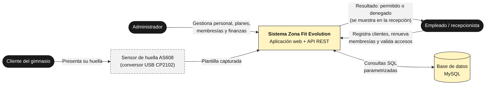
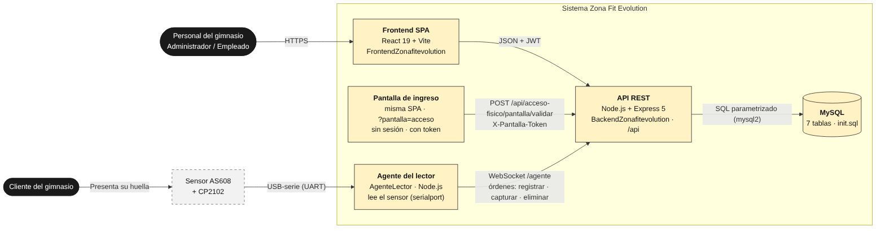
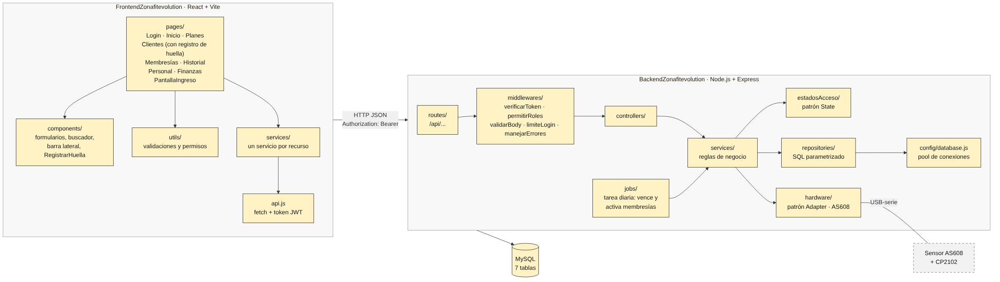
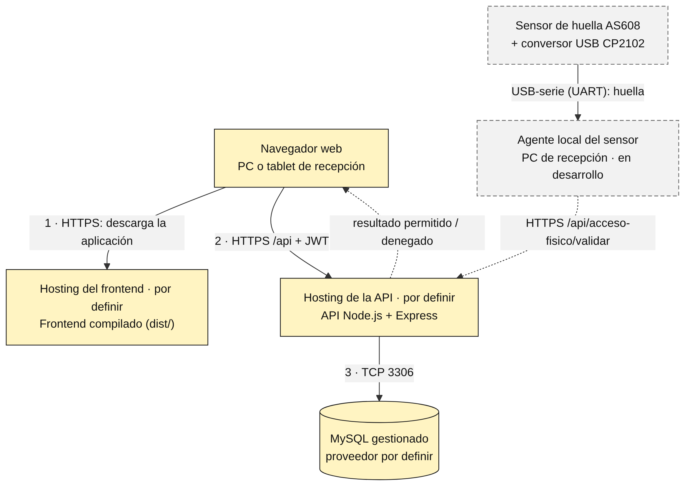

# Arquitectura, datos y diseño técnico

> Proyecto **Zona Fit Evolution** · SENA ADSO · ficha 3223873.  
> Versión formal entregable: [`entregables/03_Diseño/Arquitectura_Datos_y_Diseno_Tecnico_ZonaFitEvolution.pdf`](entregables/03_Diseño/Arquitectura_Datos_y_Diseno_Tecnico_ZonaFitEvolution.pdf). Este Markdown es la versión viva: se actualiza en el mismo PR que cambia el código.

## Control documental

| **Elemento**             | **Detalle**                                                                      |
| ------------------------ | -------------------------------------------------------------------------------- |
| Código documental        | ADSO-ARQ-01                                                                      |
| Nombre                   | Arquitectura, Datos y Diseño Técnico                                             |
| Clasificación            | Documento técnico de diseño, decisión y operación                                |
| Estado                   | En revisión                                                                      |
| Propietario              | Liliana Sofía Panesso Méndez                                                     |
| Revisor funcional        | Liliana Sofía Panesso Méndez (Product Owner)                                     |
| Revisor técnico          | Juan Diego Mejía Llano                                                           |
| Revisor académico        |                                                                                  |
| Ubicación oficial        | Carpeta documentos\_proyecto; diagramas fuente en /docs/architecture (por crear) |
| Periodicidad de revisión | Con cada cambio arquitectónico o al cierre de sprint                             |

### Historial de versiones

| **Versión** | **Fecha**  | **Descripción**                                                                                                                                                                                                   | **Responsable**              | **Aprobado por** |
| ----------- | ---------- | ----------------------------------------------------------------------------------------------------------------------------------------------------------------------------------------------------------------- | ---------------------------- | ---------------- |
| 0.1         | 19/10/2026 | Drivers, capas, patrones, modelo de datos y API (documento maestro v2.0)                                                                                                                                          | Liliana Sofía Panesso Méndez |                  |
| 0.2         | 20/10/2026 | Diagramas, despliegue propuesto y ADR (documento maestro v2.1)                                                                                                                                                    | Liliana Sofía Panesso Méndez |                  |
| 1.0         | 03/11/2026 | Plantilla institucional; sensor AS608 sin apertura de puerta (CR-005) y hosting por definir (CR-006)                                                                                                              | Juan Diego Mejía Llano       |                  |
| 1.1         | 10/11/2026 | Sensor AS608 integrado y simulador eliminado; diccionario de datos con tiqueteras, estado pendiente y template\_hash único; DT-010 aceptada                                                                       | Juan Diego Mejía Llano       |                  |
| 1.2         | 10/11/2026 | Diagramas de contenedores, componentes y despliegue actualizados: el sensor se conecta por USB al PC de la API (sin agente aparte), pantalla de ingreso y nuevos componentes                                      | Juan Diego Mejía Llano       |                  |
| 1.3         | 11/11/2026 | Despliegue en la nube: frontend en Vercel, API y MySQL en Railway, agente local del lector por WebSocket (ADR-008), pantalla de ingreso con token, seguridad y zona horaria; diagramas DIA-002, DIA-003 y DIA-006 | Juan Diego Mejía Llano       |                  |

### Registro de aprobaciones

| **Rol**                    | **Nombre**                   | **Decisión**        | **Fecha** | **Observaciones** |
| -------------------------- | ---------------------------- | ------------------- | --------- | ----------------- |
| Arquitecto / líder técnico | Liliana Sofía Panesso Méndez | Aprobado / Devuelto |           |                   |
| Product Owner              | Liliana Sofía Panesso Méndez | Aprobado / Devuelto |           |                   |
| Responsable de seguridad   |                              | Aprobado / Devuelto |           |                   |
| Instructor                 |                              | Aprobado / Devuelto |           |                   |

## 1\. Propósito, alcance y principios

El documento describe cómo se construirá la solución y por qué la estructura seleccionada es adecuada para el problema, el alcance y los atributos de calidad. Su finalidad es orientar la implementación, reducir decisiones implícitas y permitir que otro equipo comprenda, mantenga, despliegue y evolucione el sistema.

### 1.1 Objetivos específicos

  - Identificar los drivers arquitectónicos y restricciones relevantes.

  - Comparar alternativas antes de seleccionar tecnologías o patrones.

  - Representar la solución mediante vistas coherentes y actualizadas.

  - Definir responsabilidades, límites y dependencias entre componentes.

  - Modelar persistencia, API, integraciones, seguridad y despliegue.

  - Registrar decisiones y riesgos con trazabilidad.

  - Asegurar correspondencia entre documentación, repositorio y producto desplegado.

### 1.2 Alcance del documento

| **Incluye**                                        | **No reemplaza**                                         |
| -------------------------------------------------- | -------------------------------------------------------- |
| Diseño de arquitectura y componentes.              | El código fuente como evidencia final de implementación. |
| Modelos conceptual, lógico y físico de datos.      | La especificación completa de requisitos.                |
| Contratos y convenciones de API e integraciones.   | El plan detallado de pruebas.                            |
| Controles de seguridad, configuración y operación. | El manual técnico de instalación y soporte.              |
| Diagramas, ADR, riesgos técnicos y trazabilidad.   | El prototipo UX/UI ni su sistema de diseño.              |

### 1.3 Principios rectores

  - La arquitectura responde a necesidades reales, no a modas.

  - La complejidad debe justificarse; sobrearquitectura también es una falla.

  - La lógica de negocio debe mantenerse independiente de detalles de infraestructura cuando sea razonable.

  - La configuración y los secretos deben permanecer fuera del código.

  - Los diagramas deben coincidir con la implementación.

  - Las decisiones importantes deben registrar contexto, alternativas y consecuencias.

  - La seguridad, observabilidad y operación se diseñan desde el inicio.

<table>
<tbody>
<tr class="odd">
<td>
<strong>Criterio de calidad</strong>

Una arquitectura es aceptable cuando otro desarrollador puede comprender sus fronteras, componentes, dependencias, datos y operación, y cuando las decisiones técnicas pueden defenderse con requisitos, métricas o riesgos.
</td>
</tr>
</tbody>
</table>

## 2\. Relación con otros artefactos

| **Artefacto**              | **Información recibida**                      | **Información entregada**                           |
| -------------------------- | --------------------------------------------- | --------------------------------------------------- |
| Formulación y constitución | Problema, objetivos, restricciones y riesgos. | Viabilidad técnica y restricciones confirmadas.     |
| Alcance y requisitos       | RF, RNF, reglas, integraciones y criterios.   | Componentes, decisiones y mecanismos técnicos.      |
| Backlog y casos de uso     | Flujos, actores, excepciones y prioridad.     | Secuencias, contratos y dependencias.               |
| Matriz de trazabilidad     | Identificadores y relaciones.                 | CMP, DAT, API, ADR, DEP y evidencias.               |
| Diseño UX/UI               | Pantallas, estados y comportamiento.          | Servicios, datos y restricciones de implementación. |
| Plan de pruebas            | Riesgos y criterios de aceptación.            | Puntos de prueba, ambientes y observabilidad.       |

### 2.1 Convenciones de identificación

| **Elemento**            | **Prefijo** | **Ejemplo**        |
| ----------------------- | ----------- | ------------------ |
| Componente              | CMP         | CMP-AUTH           |
| Entidad / agregado      | DAT         | DAT-USUARIO        |
| Endpoint / integración  | API         | API-AUTH-LOGIN     |
| Decisión arquitectónica | ADR         | ADR-001            |
| Riesgo técnico          | RT          | RT-001             |
| Ambiente / despliegue   | DEP         | DEP-DEV            |
| Evento / mensaje        | EVT         | EVT-RESERVA-CREADA |

## 3\. Drivers arquitectónicos

Los drivers son las condiciones que realmente influyen en la arquitectura: requisitos críticos, atributos de calidad, restricciones, volumen, riesgos e integraciones. Deben identificarse antes de elegir el stack.

### 3.1 Registro de drivers

| **ID**  | **Tipo**    | **Descripción**                                                    | **Fuente**                 | **Prioridad** | **Impacto técnico**                                | **Criterio verificable**                                            |
| ------- | ----------- | ------------------------------------------------------------------ | -------------------------- | ------------- | -------------------------------------------------- | ------------------------------------------------------------------- |
| DRV-001 | RNF         | Autorización validada en el servidor y datos sensibles protegidos. | RNF-001                    | Alta          | JWT, permitirRoles, bcrypt y hash de plantillas.   | 0 endpoints protegidos sin token; 0 datos sensibles en texto plano. |
| DRV-002 | RNF         | Validación de acceso en menos de 2 segundos.                       | RNF-003                    | Alta          | Fachada en una sola petición y pool de conexiones. | p95 \< 2 s con 400 clientes.                                        |
| DRV-003 | RNF         | Mantenibilidad por capas.                                          | RNF-005                    | Media         | Rutas → controladores → servicios → repositorios.  | 0 errores en lint y build.                                          |
| DRV-004 | Restricción | No guardar imágenes de huellas.                                    | RNF-006 / Ley 1581 de 2012 | Alta          | Solo hash de la plantilla; Adapter del sensor.     | Columna template\_hash sin imágenes.                                |
| DRV-005 | Restricción | Cambiar de sensor sin reescribir la aplicación (AS608 hoy).        | RF-004, INT-01             | Media         | Adapter + Factory por TIPO\_LECTOR.                | Nuevo adaptador sin tocar servicios.                                |

### 3.2 Atributos de calidad

| **Atributo**   | **Escenario**                                                 | **Fuente** | **Métrica / umbral**               | **Decisión asociada**        | **Evidencia** |
| -------------- | ------------------------------------------------------------- | ---------- | ---------------------------------- | ---------------------------- | ------------- |
| Rendimiento    | Validación de acceso con 400 clientes registrados             | RNF-003    | \< 2 s (p95)                       | ADR-005, pool Singleton      |               |
| Disponibilidad | Uso durante el horario de atención                            | RNF-004    | 99,9 % mensual                     | Hosting por definir (CR-006) |               |
| Seguridad      | Petición sin token o con rol Empleado a ruta de Administrador | RNF-001    | 401 / 403 en el 100 % de los casos | ADR-003                      |               |
| Mantenibilidad | Agregar un estado de membresía o un sensor nuevo              | RNF-005    | 0 errores de lint y build          | ADR-001, ADR-002, ADR-005    |               |
| Portabilidad   | Cambiar el AS608 por otro modelo de sensor                    | INT-01     | Solo un adaptador nuevo            | ADR-004                      |               |
| Escalabilidad  | Crecimiento de socios                                         |            |                                    |                              |               |

### 3.3 Restricciones técnicas y organizacionales

| **ID**  | **Restricción**                                       | **Origen**               | **Obligatoria** | **Consecuencia**                     | **Validación**             |
| ------- | ----------------------------------------------------- | ------------------------ | --------------- | ------------------------------------ | -------------------------- |
| RST-001 | Stack Node.js, Express, MySQL y React.                | SENA / equipo            | Sí              | Sin ORM ni otros lenguajes.          | Inspección del repositorio |
| RST-002 | No almacenar imágenes de huellas.                     | Legal (Ley 1581 de 2012) | Sí              | Solo hash con sal (BIOMETRIA\_SALT). | Inspección de la base      |
| RST-003 | Sensor AS608 con CP2102 solo para validar el ingreso. | Cliente (CR-005)         | Sí              | Sin relé ni electroimán en el MVP.   | Revisión del alcance       |

### 3.4 Volumen y capacidad esperada

| **Variable**          | **Valor inicial**                  | **Valor esperado**          | **Pico** | **Horizonte** | **Fuente**           |
| --------------------- | ---------------------------------- | --------------------------- | -------- | ------------- | -------------------- |
| Usuarios registrados  | De 300 a 400 clientes              | De 150 a 200 socios activos |          |               | Propietario (STK-01) |
| Usuarios concurrentes |                                    |                             |          |               |                      |
| Transacciones por día |                                    |                             |          |               |                      |
| Tamaño de datos       |                                    |                             |          |               |                      |
| Archivos / multimedia | No aplica (no se guardan imágenes) |                             |          |               | RNF-006              |

## 4\. Contexto y fronteras del sistema

### 4.1 Descripción del contexto

Describa el sistema como una unidad, quién lo usa, con qué sistemas se relaciona y qué queda explícitamente fuera de su responsabilidad.

### 4.2 Catálogo de actores y sistemas externos

| **ID**  | **Actor / sistema**                       | **Tipo**    | **Interacción**                                           | **Datos intercambiados** | **Protocolo / medio**                                             | **Propietario**     |
| ------- | ----------------------------------------- | ----------- | --------------------------------------------------------- | ------------------------ | ----------------------------------------------------------------- | ------------------- |
| EXT-001 | Administrador / Empleado                  | Usuario     | Gestiona clientes, planes, membresías, accesos y finanzas | JSON                     | HTTPS + JWT                                                       | Gimnasio            |
| EXT-002 | Sensor AS608 + CP2102                     | Dispositivo | Captura la huella para registrar y validar                | Plantilla (solo hash)    | USB-serie (UART) al agente del lector; WebSocket (wss) al backend | Gimnasio            |
| EXT-003 | Vercel (frontend) y Railway (API y MySQL) | Sistema     | Publica la aplicación, la API y la base                   | Datos del sistema        | HTTPS / WSS; MySQL por red privada                                | Equipo del proyecto |

### 4.3 Diagrama de contexto

<table>
<tbody>
<tr class="odd">
<td>

<em>Figura 1. Diagrama de contexto (DIA-001).</em>
</td>
</tr>
</tbody>
</table>

| **Elemento del diagrama** | **Identificador** | **Descripción**                               | **Documento fuente** |
| ------------------------- | ----------------- | --------------------------------------------- | -------------------- |
| Sistema principal         | SYS-01            | Aplicación web y API REST Zona Fit Evolution. | Alcance              |
| Actor                     | ACT-01 a ACT-03   | Administrador, Empleado y Cliente (socio).    | Stakeholders         |
| Sistema externo           | EXT-002, EXT-003  | Sensor AS608 (vía agente) y Vercel/Railway.   | Integraciones        |

### 4.4 Límites y responsabilidades

| **Responsabilidad del sistema**                                   | **Fuera de responsabilidad**                  | **Dependencia externa** | **Riesgo asociado** |
| ----------------------------------------------------------------- | --------------------------------------------- | ----------------------- | ------------------- |
| Validar vigencia, registrar huellas, membresías, pagos y accesos. | Apertura física de la puerta; pagos en línea. | Sensor AS608 y hosting  | RSK-05, RSK-06      |
| Autenticar al personal y autorizar por rol.                       | Facturación electrónica.                      | —                       | RSK-01              |

## 5\. Alternativas y patrón arquitectónico

### 5.1 Alternativas evaluadas

| **Alternativa**       | **Descripción**                                 | **Ventajas** | **Desventajas** | **Ajuste a drivers** | **Costo / complejidad** | **Decisión**                        |
| --------------------- | ----------------------------------------------- | ------------ | --------------- | -------------------- | ----------------------- | ----------------------------------- |
| Monolito modular      | Una sola aplicación con módulos internos.       |              |                 | Medio                | Bajo                    | Descartada                          |
| Cliente-servidor      | SPA en el navegador y API en el servidor.       |              |                 | Alto                 | Bajo                    | Seleccionada (combinada)            |
| Arquitectura en capas | Rutas, controladores, servicios y repositorios. |              |                 | Alto                 | Bajo                    | Seleccionada (combinada)            |
| Hexagonal / Clean     | Dominio aislado con puertos y adaptadores.      |              |                 | Medio                | Alto                    | Parcial: solo el Adapter del sensor |
| Microservicios        | Servicios independientes por módulo.            |              |                 | Bajo                 | Muy alto                | Descartada                          |

<table>
<tbody>
<tr class="odd">
<td>
<strong>Regla</strong>

No todas las alternativas deben considerarse viables. Incluya únicamente las que tengan sentido para el alcance. La selección de microservicios, eventos, colas o infraestructura compleja exige una necesidad demostrable.
</td>
</tr>
</tbody>
</table>

### 5.2 Patrón seleccionado

| **Campo**                  | **Contenido**                                                                 |
| -------------------------- | ----------------------------------------------------------------------------- |
| Patrón / estilo            | Cliente-servidor con backend en capas (monorepo).                             |
| Problema que resuelve      | Separar la interfaz del personal de la lógica, los datos y el hardware.       |
| Drivers que satisface      | DRV-001, DRV-002, DRV-003, DRV-005                                            |
| Alternativas descartadas   | Microservicios (complejidad), monolito con vistas en el servidor (CR-003).    |
| Justificación              | Equipo de tres personas, stack conocido y despliegue sencillo.                |
| Consecuencias positivas    | Responsabilidades claras, SQL aislado y cambio de sensor sin tocar servicios. |
| Costos y limitaciones      | Dos aplicaciones que se despliegan por separado; sin migraciones automáticas. |
| Condiciones para revisarlo | Crecimiento a varias sedes o integración con más dispositivos.                |

### 5.3 Stack tecnológico

| **Categoría**   | **Tecnología / versión**                                                                                   | **Propósito**                    | **Justificación**                                                                                                  | **Alternativa considerada**                                                         | **Riesgo / dependencia**                                                           |
| --------------- | ---------------------------------------------------------------------------------------------------------- | -------------------------------- | ------------------------------------------------------------------------------------------------------------------ | ----------------------------------------------------------------------------------- | ---------------------------------------------------------------------------------- |
| Frontend        | React 19 + Vite 8, ESLint 10, CSS propio (Poppins)                                                         | SPA del personal                 | Componentes y servicios por recurso                                                                                | HTML servido por el backend                                                         | Navegación sin React Router (DT-09)                                                |
| Backend         | Node.js (LTS) + Express 5                                                                                  | API REST bajo /api               | Conocido por el equipo                                                                                             | FastAPI                                                                             | —                                                                                  |
| Base de datos   | MySQL + mysql2 3                                                                                           | Persistencia relacional          | Datos relacionales y consultas parametrizadas                                                                      | ORM Sequelize/Prisma                                                                | Sin migraciones (DT-10)                                                            |
| Autenticación   | jsonwebtoken 9 + bcrypt 6                                                                                  | JWT de 8 h y hash de contraseñas | API sin estado                                                                                                     | Sesiones en servidor                                                                | Sin revocación (DT-07)                                                             |
| Pruebas         |                                                                                                            |                                  |                                                                                                                    |                                                                                     | Sin pruebas automatizadas (DT-08)                                                  |
| Infraestructura | Vercel Hobby (frontend); Railway (API Node.js 20 y MySQL 8.4); agente local AgenteLector (Node.js 20 + ws) | Publicación en la nube           | Railway mantiene la API siempre encendida (tarea diaria, WebSocket del agente) y ofrece MySQL en el mismo proyecto | Render + Aiven; Vercel para la API (descartado: funciones sin servidor persistente) | Prueba de Railway de 30 días (RT-004); internet en el portátil del lector (RT-005) |

## 6\. Vistas y diagramas de arquitectura

Se recomienda usar un conjunto pequeño de diagramas que responda preguntas distintas. No repita el mismo diagrama con diferente título.

### 6.1 Catálogo de diagramas

| **ID**  | **Vista**    | **Propósito**                                                     | **Herramienta**                           | **Ubicación**           | **Versión** | **Estado**                                        |
| ------- | ------------ | ----------------------------------------------------------------- | ----------------------------------------- | ----------------------- | ----------- | ------------------------------------------------- |
| DIA-001 | Contexto     | Actores y sistemas externos                                       | Mermaid (contexto.mmd)                    | Figura 1                | 1.1         | Actualizado (CR-005)                              |
| DIA-002 | Contenedores | Aplicaciones, pantalla de ingreso, agente, base de datos y sensor | Mermaid (docs/diagramas/contenedores.mmd) | Figura 2                | 1.3         | Actualizado (agente del lector por WebSocket)     |
| DIA-003 | Componentes  | Capas del frontend y backend                                      | Mermaid (docs/diagramas/componentes.mmd)  | Figura 3                | 1.3         | Actualizado (adaptador remoto y canalAgente)      |
| DIA-004 | Secuencia    | Validar acceso (CU-004)                                           | Mermaid (secuencia.mmd)                   | Documento maestro, 5.10 | 1.0         | Borrador                                          |
| DIA-005 | Datos        | Entidad-relación de las 7 tablas                                  | Mermaid (er.mmd)                          | Documento maestro, 5.10 | 1.0         | Borrador                                          |
| DIA-006 | Despliegue   | Nodos y protocolos                                                | Mermaid (docs/diagramas/despliegue.mmd)   | Figura 4                | 1.3         | Actualizado (Vercel, Railway y agente del lector) |

### 6.2 Vista de contenedores

<table>
<tbody>
<tr class="odd">
<td>

<em>Figura 2. Diagrama de contenedores (DIA-002).</em>
</td>
</tr>
</tbody>
</table>

### 6.3 Vista de componentes

<table>
<tbody>
<tr class="odd">
<td>

<em>Figura 3. Diagrama de componentes (DIA-003).</em>
</td>
</tr>
</tbody>
</table>

### 6.4 Diagramas de secuencia

| **ID**  | **Flujo**                    | **Caso de uso / HU** | **Participantes**                                                                                       | **Condición principal**                           | **Excepciones**                                                                |
| ------- | ---------------------------- | -------------------- | ------------------------------------------------------------------------------------------------------- | ------------------------------------------------- | ------------------------------------------------------------------------------ |
| SEQ-001 | Validar acceso por huella    | CU-004 / HU-006      | Pantalla de ingreso, API, adaptador del sensor AS608, accesoFisico.service, estadosAcceso, repositorios | Membresía activa y vigente                        | Huella no reconocida (404); vencida/cancelada/sin membresía; error de conexión |
| SEQ-002 | Renovar membresía por cédula | CU-005 / HU-004      | Frontend, membresia.service, repositorios                                                               | Membresía vigente se encadena; vencida inicia hoy | Cédula no encontrada; plan inactivo                                            |

### 6.5 Reglas de calidad de diagramas

  - Título, versión y fecha visibles.

  - Nombres consistentes con el dominio y repositorio.

  - Leyenda para símbolos no obvios.

  - Flechas con dirección y significado claro.

  - Sin componentes inexistentes ni tecnologías abandonadas.

  - Archivo fuente editable versionado en el repositorio.

## 7\. Componentes y responsabilidades

### 7.1 Catálogo de componentes

| **ID** | **Componente**       | **Responsabilidad**                                                                                         | **Entradas**            | **Salidas**            | **Dependencias** | **Requisitos** | **Propietario**              |
| ------ | -------------------- | ----------------------------------------------------------------------------------------------------------- | ----------------------- | ---------------------- | ---------------- | -------------- | ---------------------------- |
| CMP-01 | Frontend SPA         | Pantallas del personal, validaciones en el navegador y servicios por recurso.                               | Petición HTTP / llamada | Respuesta JSON / datos |                  |                | Juan Diego Mejía Llano       |
| CMP-02 | Rutas y middlewares  | Endpoints bajo /api; verificarToken, permitirRoles, validarBodyNoVacio y manejo de errores.                 | Petición HTTP / llamada | Respuesta JSON / datos |                  |                | Liliana Sofía Panesso Méndez |
| CMP-03 | Controladores        | Reciben la petición HTTP, llaman al servicio y responden en JSON.                                           | Petición HTTP / llamada | Respuesta JSON / datos |                  |                | Liliana Sofía Panesso Méndez |
| CMP-04 | Servicios de negocio | Reglas de clientes, planes, membresías, usuarios y autenticación.                                           | Petición HTTP / llamada | Respuesta JSON / datos |                  |                | Liliana Sofía Panesso Méndez |
| CMP-05 | Control de acceso    | Fachada que identifica la huella, evalúa el estado (State) y registra el intento.                           | Petición HTTP / llamada | Respuesta JSON / datos |                  |                | Liliana Sofía Panesso Méndez |
| CMP-06 | Adaptador del lector | Interfaz LectorBiometrico, fábrica por TIPO\_LECTOR y adaptador del sensor AS608 (el simulador se eliminó). | Petición HTTP / llamada | Respuesta JSON / datos |                  |                | Liliana Sofía Panesso Méndez |
| CMP-07 | Repositorios         | Consultas SQL parametrizadas.                                                                               | Petición HTTP / llamada | Respuesta JSON / datos |                  |                | Liliana Sofía Panesso Méndez |
| CMP-08 | Base de datos        | Siete tablas: roles, usuarios, clientes, planes, membresias, plantillas\_biometricas, registros\_acceso.    | Petición HTTP / llamada | Respuesta JSON / datos |                  |                | Liliana Sofía Panesso Méndez |

### 7.2 Ficha detallada de componente

| **Campo**                   | **Contenido**                                                                                                                  |
| --------------------------- | ------------------------------------------------------------------------------------------------------------------------------ |
| ID y nombre                 | CMP-05 – Control de acceso                                                                                                     |
| Propósito                   | Decidir si un socio puede ingresar y auditar cada intento.                                                                     |
| Responsabilidades           | Identificar la huella con el adaptador, consultar la membresía más reciente, evaluar el estado (State) y registrar el intento. |
| Responsabilidades excluidas | Abrir la puerta (fuera del MVP, CR-005); registrar huellas (biometria.service).                                                |
| Interfaces públicas         | POST /api/acceso-fisico/validar y GET /api/acceso-fisico/historial.                                                            |
| Dependencias entrantes      | accesoFisico.controller (rutas con verificarToken y permitirRoles).                                                            |
| Dependencias salientes      | CMP-06 adaptador del lector, membresia.repository, registroAcceso.repository.                                                  |
| Datos gestionados           | registros\_acceso (resultado, motivo, fecha\_hora).                                                                            |
| Errores y excepciones       | 404 huella no reconocida (se registra); 400 cuerpo vacío; 401/403.                                                             |
| Seguridad y permisos        | Admin y Empleado; nunca devuelve el hash de la plantilla.                                                                      |
| Observabilidad              | Cada intento queda en registros\_acceso; errores 500 en consola.                                                               |
| Pruebas asociadas           | CP-007 a CP-009, CP-019                                                                                                        |
| Riesgos y limitaciones      | Huellas residuales: el sensor responde 0x17 si no detecta un dedo nuevo.                                                       |
| Ubicación en repositorio    | BackendZonafitevolution/src/services/accesoFisico.service.js; src/estadosAcceso                                                |
| Estado y versión            | Implementado con el sensor AS608 – MVP                                                                                         |

### 7.3 Reglas de separación de responsabilidades

  - Evitar lógica de negocio concentrada en controladores, vistas o componentes UI.

  - Encapsular dependencias externas detrás de interfaces o adaptadores cuando sea útil.

  - Mantener alta cohesión dentro de módulos y bajo acoplamiento entre ellos.

  - No duplicar reglas de negocio en frontend, backend y base de datos sin una estrategia explícita.

  - Definir puntos de extensión sin anticipar escenarios irreales.

### 7.4 Matriz de dependencias

| **Componente origen** | **Componente destino** | **Tipo de dependencia** | **Permitida** | **Justificación**                                            | **Riesgo**        |
| --------------------- | ---------------------- | ----------------------- | ------------- | ------------------------------------------------------------ | ----------------- |
| CMP-02                | CMP-03                 | Llamada                 | Sí            | Las rutas encadenan middlewares y delegan en el controlador. | —                 |
| CMP-03                | CMP-04 / CMP-05        | Llamada                 | Sí            | La lógica vive en los servicios.                             | —                 |
| CMP-04 / CMP-05       | CMP-07                 | Llamada                 | Sí            | El SQL solo está en repositorios.                            | —                 |
| CMP-05                | CMP-06                 | Llamada                 | Sí            | El servicio usa la interfaz, no el sensor concreto.          | Integración AS608 |
| CMP-01                | CMP-07 / CMP-08        | Dato                    | No            | El frontend solo habla con la API.                           | —                 |

## 8\. Datos y persistencia

### 8.1 Estrategia de persistencia

| **Campo**               | **Contenido**                                                                   |
| ----------------------- | ------------------------------------------------------------------------------- |
| Tipo de modelo          | Relacional                                                                      |
| Tecnología              | MySQL (driver mysql2, pool Singleton)                                           |
| Justificación           | Entidades relacionadas con llaves foráneas e integridad (ADR-002).              |
| Consistencia requerida  | Fuerte: una sola membresía activa por cliente (transacción en la renovación).   |
| Volumen y crecimiento   | De 300 a 400 clientes; registros\_acceso crece con cada ingreso.                |
| Disponibilidad          | Según el proveedor de MySQL en la nube (por definir).                           |
| Respaldo y recuperación | mysqldump diario recomendado (sección de respaldo).                             |
| Datos sensibles         | Contraseñas (bcrypt) y plantillas biométricas (solo hash).                      |
| Limitaciones            | Esquema creado con init.sql, sin migraciones; no existe tabla de pagos (DT-01). |

### 8.2 Modelo conceptual

Identifique conceptos del dominio y relaciones sin detalles de implementación. Debe ser comprensible para usuarios del negocio.

### 8.3 Modelo lógico

Defina entidades, atributos, relaciones, cardinalidades y restricciones lógicas. Para NoSQL, identifique agregados, documentos, referencias y patrones de acceso.

### 8.4 Modelo físico

Defina tablas, colecciones, tipos, índices, claves, restricciones, particiones y detalles de implementación.

### 8.5 Catálogo de entidades / colecciones

| **ID**  | **Nombre**              | **Descripción**                      | **Tipo** | **Propietario**              | **Datos sensibles** | **Volumen**            | **Retención**                   |
| ------- | ----------------------- | ------------------------------------ | -------- | ---------------------------- | ------------------- | ---------------------- | ------------------------------- |
| DAT-001 | roles                   | Roles del personal (admin, empleado) | Entidad  | Liliana Sofía Panesso Méndez | No                  | 2 filas                | Permanente                      |
| DAT-002 | usuarios                | Personal con acceso al sistema       | Entidad  | Liliana Sofía Panesso Méndez | Sí (contraseña)     | Decenas                | Mientras trabaje en el gimnasio |
| DAT-003 | clientes                | Socios del gimnasio                  | Entidad  | Liliana Sofía Panesso Méndez | Sí (personales)     | 300 a 400              | Mientras exista (RN-001)        |
| DAT-004 | planes                  | Catálogo de planes                   | Entidad  | Liliana Sofía Panesso Méndez | No                  | 8 iniciales            | Permanente (se desactiva)       |
| DAT-005 | membresias              | Vigencia de cada cliente             | Entidad  | Liliana Sofía Panesso Méndez | No                  | Crece con cada pago    | Permanente                      |
| DAT-006 | plantillas\_biometricas | Hash de la huella                    | Entidad  | Liliana Sofía Panesso Méndez | Sí (biométrico)     | 1 por cliente          | Mientras el cliente esté activo |
| DAT-007 | registros\_acceso       | Auditoría de ingresos                | Entidad  | Liliana Sofía Panesso Méndez | Sí (personales)     | Crece con cada ingreso | Por definir (propuesta: 1 año)  |

### 8.6 Diccionario de datos

| **Entidad**             | **Campo**              | **Tipo**  | **Longitud** | **Nulo** | **Clave / índice**       | **Regla / dominio**                                                                    | **Descripción**          | **Dato sensible** |
| ----------------------- | ---------------------- | --------- | ------------ | -------- | ------------------------ | -------------------------------------------------------------------------------------- | ------------------------ | ----------------- |
| roles                   | id                     | INT       |              | No       | PK                       | Autoincremental                                                                        | Identificador            | No                |
| roles                   | nombre                 | VARCHAR   | 50           | No       | UNIQUE                   | admin / empleado                                                                       | Nombre del rol           | No                |
| usuarios                | id                     | INT       |              | No       | PK                       | Autoincremental                                                                        | Identificador            | No                |
| usuarios                | nombre                 | VARCHAR   | 100          | No       |                          |                                                                                        | Nombre completo          | No                |
| usuarios                | correo                 | VARCHAR   | 100          | No       | UNIQUE                   | Formato de correo                                                                      | Inicio de sesión         | Sí                |
| usuarios                | contrasena             | VARCHAR   | 255          | No       |                          | Hash bcrypt                                                                            | Contraseña protegida     | Sí                |
| usuarios                | rol\_id                | INT       |              | No       | FK → roles.id            |                                                                                        | Rol del usuario          | No                |
| usuarios                | fecha\_creacion        | TIMESTAMP |              | No       |                          | Fecha actual                                                                           | Creación                 | No                |
| clientes                | id                     | INT       |              | No       | PK                       | Autoincremental                                                                        | Identificador            | No                |
| clientes                | nombre                 | VARCHAR   | 100          | No       |                          |                                                                                        | Nombre completo          | Sí                |
| clientes                | cedula                 | VARCHAR   | 20           | No       | UNIQUE                   | 6 a 15 dígitos (RN-007)                                                                | Documento                | Sí                |
| clientes                | correo                 | VARCHAR   | 100          | Sí       |                          | Formato de correo; obligatorio en la aplicación                                        | Contacto                 | Sí                |
| clientes                | telefono               | VARCHAR   | 20           | Sí       |                          | 7 a 15 dígitos                                                                         | Contacto                 | Sí                |
| clientes                | fecha\_registro        | TIMESTAMP |              | No       |                          | Fecha actual                                                                           | Registro                 | No                |
| planes                  | id                     | INT       |              | No       | PK                       | Autoincremental                                                                        | Identificador            | No                |
| planes                  | nombre                 | VARCHAR   | 50           | No       | UNIQUE                   | Sesión, Quincena, Mensualidad, Trimestre, tarifas de estudiantes y tiqueteras x6 y x12 | Nombre                   | No                |
| planes                  | duracion\_dias         | INT       |              | No       |                          | \> 0                                                                                   | Duración                 | No                |
| planes                  | precio                 | DECIMAL   | 10,2         | No       |                          | \> 0                                                                                   | Valor                    | No                |
| planes                  | max\_ingresos          | INT       |              | Sí       |                          | NULL = plan por tiempo; 1 a 365 en tiqueteras                                          | Ingresos incluidos       | No                |
| planes                  | activo                 | BOOLEAN   |              | No       |                          | TRUE por defecto                                                                       | Disponible para asignar  | No                |
| planes                  | fecha\_creacion        | TIMESTAMP |              | No       |                          | Fecha actual                                                                           | Creación                 | No                |
| membresias              | id                     | INT       |              | No       | PK                       | Autoincremental                                                                        | Identificador            | No                |
| membresias              | fecha\_inicio          | DATE      |              | No       |                          | No anterior a hoy al asignar                                                           | Inicio                   | No                |
| membresias              | fecha\_fin             | DATE      |              | Sí       |                          | Inicio + duración; NULL en una tiquetera hasta el primer ingreso (RN-004, RN-013)      | Fin                      | No                |
| membresias              | estado                 | ENUM      |              | No       |                          | pendiente, activa, vencida, cancelada (RN-014)                                         | Estado                   | No                |
| membresias              | cliente\_id            | INT       |              | No       | FK → clientes.id         |                                                                                        | Cliente                  | No                |
| membresias              | plan\_id               | INT       |              | No       | FK → planes.id           |                                                                                        | Plan                     | No                |
| membresias              | fecha\_creacion        | TIMESTAMP |              | No       |                          | Fecha actual                                                                           | Registro                 | No                |
| membresias              | ingresos\_totales      | INT       |              | Sí       |                          | NULL = membresía por tiempo                                                            | Ingresos de la tiquetera | No                |
| membresias              | ingresos\_usados       | INT       |              | No       |                          | 0 por defecto                                                                          | Ingresos consumidos      | No                |
| membresias              | fecha\_primer\_uso     | DATE      |              | Sí       |                          | Primer ingreso de la tiquetera                                                         | Inicio de la duración    | No                |
| membresias              | fecha\_ultimo\_ingreso | DATE      |              | Sí       |                          | Un descuento por día en tiqueteras                                                     | Último ingreso           | No                |
| plantillas\_biometricas | id                     | INT       |              | No       | PK                       | Autoincremental                                                                        | Identificador            | No                |
| plantillas\_biometricas | cliente\_id            | INT       |              | No       | UNIQUE, FK → clientes.id | Una huella por cliente (RN-008)                                                        | Cliente                  | No                |
| plantillas\_biometricas | template\_hash         | VARCHAR   | 255          | No       | UNIQUE                   | Hash de la posición en el sensor                                                       | Hash de la plantilla     | Sí                |
| plantillas\_biometricas | fecha\_registro        | TIMESTAMP |              | No       |                          | Fecha actual                                                                           | Registro                 | No                |
| registros\_acceso       | id                     | INT       |              | No       | PK                       | Autoincremental                                                                        | Identificador            | No                |
| registros\_acceso       | cliente\_id            | INT       |              | Sí       | FK → clientes.id         | Vacío si no se reconoció                                                               | Cliente                  | No                |
| registros\_acceso       | resultado              | ENUM      |              | No       |                          | permitido, denegado                                                                    | Resultado                | No                |
| registros\_acceso       | motivo                 | VARCHAR   | 100          | No       |                          |                                                                                        | Explicación              | No                |
| registros\_acceso       | fecha\_hora            | TIMESTAMP |              | No       |                          | Fecha actual                                                                           | Momento                  | No                |

### 8.7 Relaciones, integridad y restricciones

| **Origen** | **Destino**             | **Cardinalidad** | **FK / referencia**                 | **Regla de borrado** | **Regla de actualización** | **Justificación**                  |
| ---------- | ----------------------- | ---------------- | ----------------------------------- | -------------------- | -------------------------- | ---------------------------------- |
| roles      | usuarios                | 1:N              | usuarios.rol\_id                    | Restringir           |                            | Cada usuario tiene un rol.         |
| clientes   | membresias              | 1:N              | membresias.cliente\_id              | Restringir (RN-001)  |                            | Historial de membresías.           |
| planes     | membresias              | 1:N              | membresias.plan\_id                 | Restringir (RN-006)  |                            | El plan se desactiva, no se borra. |
| clientes   | plantillas\_biometricas | 1:1              | plantillas\_biometricas.cliente\_id |                      |                            | Una huella por cliente.            |
| clientes   | registros\_acceso       | 1:N              | registros\_acceso.cliente\_id       |                      |                            | Auditoría por cliente.             |

### 8.8 Índices y patrones de consulta

| **ID**  | **Entidad**             | **Campos**  | **Tipo** | **Consulta soportada**           | **Costo escritura** | **Evidencia** |
| ------- | ----------------------- | ----------- | -------- | -------------------------------- | ------------------- | ------------- |
| IDX-001 | clientes                | cedula      | Único    | Búsqueda y renovación por cédula | Bajo                | init.sql      |
| IDX-002 | usuarios                | correo      | Único    | Inicio de sesión                 | Bajo                | init.sql      |
| IDX-003 | planes                  | nombre      | Único    | Nombre de plan no repetido       | Bajo                | init.sql      |
| IDX-004 | plantillas\_biometricas | cliente\_id | Único    | Una huella por cliente           | Bajo                | init.sql      |

### 8.9 Política de borrado y retención

| **Entidad**             | **Estrategia**                  | **Retención**                   | **Motivo**                             | **Recuperación**   | **Auditoría**     |
| ----------------------- | ------------------------------- | ------------------------------- | -------------------------------------- | ------------------ | ----------------- |
| clientes                | Lógico (no se eliminan, RN-001) | Permanente                      | Conservar el historial                 | —                  | registros\_acceso |
| planes                  | Lógico (desactivar)             | Permanente                      | Membresías asociadas                   | Reactivar          | —                 |
| plantillas\_biometricas | Físico (Administrador)          | Mientras el cliente esté activo | Solicitud del titular o nuevo registro | Registrar de nuevo |                   |
| registros\_acceso       |                                 | Por definir                     |                                        |                    |                   |

### 8.10 Migraciones y datos semilla

  - Las migraciones deben estar versionadas y ser reproducibles.

  - Una instalación limpia debe crear la estructura completa.

  - Los datos semilla no deben contener datos personales reales ni secretos.

  - Los cambios destructivos requieren respaldo, rollback o plan de transformación.

  - La versión del modelo debe corresponder al código entregado.

### 8.11 Respaldo y recuperación

| **Elemento**                  | **Definición**                                                                                                                        |
| ----------------------------- | ------------------------------------------------------------------------------------------------------------------------------------- |
| Frecuencia                    | Diaria (recomendada)                                                                                                                  |
| Retención                     |                                                                                                                                       |
| Ubicación                     | Fuera del servidor (almacenamiento externo)                                                                                           |
| Cifrado                       |                                                                                                                                       |
| Responsable                   | Liliana Sofía Panesso Méndez                                                                                                          |
| RPO esperado                  |                                                                                                                                       |
| RTO esperado                  |                                                                                                                                       |
| Procedimiento de restauración | mysql -u \<usuario\> -p zonafitevolution \< respaldo\_zonafit\_AAAAMMDD.sql sobre una base vacía; conservar el mismo BIOMETRIA\_SALT. |
| Evidencia de prueba           |                                                                                                                                       |

## 9\. API e integraciones

### 9.1 Principios del contrato

  - Documentar contratos mediante OpenAPI/Swagger o equivalente.

  - Usar métodos HTTP y códigos de estado coherentes cuando aplique.

  - Validar entradas con esquemas o DTO.

  - Mantener un formato consistente de respuestas y errores.

  - Aplicar paginación y límites a colecciones cuando el volumen lo requiera.

  - Versionar cambios incompatibles.

  - Evitar exponer detalles internos o trazas.

### 9.2 Catálogo de endpoints

| **ID** | **Método**        | **Ruta**                                             | **Propósito**                                             | **Autenticación** | **Permiso**     | **Entrada** | **Respuesta**                 | **RF / HU** |
| ------ | ----------------- | ---------------------------------------------------- | --------------------------------------------------------- | ----------------- | --------------- | ----------- | ----------------------------- | ----------- |
| API-01 | POST              | /api/auth/login                                      | Iniciar sesión y obtener el token JWT                     | No                | Público         | JSON        | JSON / { "error": "mensaje" } |             |
| API-02 | POST, GET         | /api/usuarios                                        | Crear y listar usuarios del personal                      | Sí (JWT)          | Admin           | JSON        | JSON / { "error": "mensaje" } |             |
| API-03 | GET, DELETE       | /api/usuarios/:id                                    | Consultar y eliminar un usuario                           | Sí (JWT)          | Admin           | JSON        | JSON / { "error": "mensaje" } |             |
| API-04 | GET               | /api/roles                                           | Listar roles                                              | Sí (JWT)          | Admin           | JSON        | JSON / { "error": "mensaje" } |             |
| API-05 | POST, GET         | /api/clientes                                        | Registrar y listar clientes                               | Sí (JWT)          | Admin, Empleado | JSON        | JSON / { "error": "mensaje" } |             |
| API-06 | GET, PUT          | /api/clientes/:id                                    | Consultar y editar un cliente                             | Sí (JWT)          | Admin, Empleado | JSON        | JSON / { "error": "mensaje" } |             |
| API-07 | DELETE            | /api/clientes/:id                                    | Eliminar cliente (contradice RN-001; se retira en TT-002) | Sí (JWT)          | Admin           | JSON        | JSON / { "error": "mensaje" } |             |
| API-08 | GET               | /api/planes, /api/planes/:id                         | Consultar planes                                          | Sí (JWT)          | Admin, Empleado | JSON        | JSON / { "error": "mensaje" } |             |
| API-09 | POST, PUT, DELETE | /api/planes, /api/planes/:id                         | Crear, editar y eliminar planes                           | Sí (JWT)          | Admin           | JSON        | JSON / { "error": "mensaje" } |             |
| API-10 | PATCH             | /api/planes/:id/desactivar                           | Desactivar un plan                                        | Sí (JWT)          | Admin           | JSON        | JSON / { "error": "mensaje" } |             |
| API-11 | POST, GET         | /api/membresias                                      | Asignar y listar membresías                               | Sí (JWT)          | Admin, Empleado | JSON        | JSON / { "error": "mensaje" } |             |
| API-12 | GET               | /api/membresias/buscar/:cedula                       | Buscar membresía por cédula                               | Sí (JWT)          | Admin, Empleado | JSON        | JSON / { "error": "mensaje" } |             |
| API-13 | POST              | /api/membresias/renovar                              | Renovar por cédula                                        | Sí (JWT)          | Admin, Empleado | JSON        | JSON / { "error": "mensaje" } |             |
| API-14 | GET, PATCH        | /api/membresias/:id, /api/membresias/:id/estado      | Consultar y cambiar estado                                | Sí (JWT)          | Admin, Empleado | JSON        | JSON / { "error": "mensaje" } |             |
| API-15 | DELETE            | /api/membresias/:id                                  | Eliminar membresía                                        | Sí (JWT)          | Admin           | JSON        | JSON / { "error": "mensaje" } |             |
| API-16 | POST              | /api/biometria/registrar, /api/biometria/identificar | Registrar e identificar huella                            | Sí (JWT)          | Admin, Empleado | JSON        | JSON / { "error": "mensaje" } |             |
| API-17 | DELETE            | /api/biometria/:cliente\_id                          | Eliminar huella                                           | Sí (JWT)          | Admin           | JSON        | JSON / { "error": "mensaje" } |             |
| API-18 | POST              | /api/acceso-fisico/validar                           | Validar el ingreso                                        | Sí (JWT)          | Admin, Empleado | JSON        | JSON / { "error": "mensaje" } |             |
| API-19 | GET               | /api/acceso-fisico/historial                         | Consultar el historial de accesos                         | Sí (JWT)          | Admin, Empleado | JSON        | JSON / { "error": "mensaje" } |             |

### 9.3 Contrato de respuesta y error

| **Elemento**    | **Regla**                                                                                                              |
| --------------- | ---------------------------------------------------------------------------------------------------------------------- |
| Código HTTP     | 200/201 éxito; 400 datos inválidos; 401 sin token; 403 rol sin permiso; 404 no encontrado; 409 duplicado; 500 interno. |
| Cuerpo de éxito | Objeto o lista en JSON.                                                                                                |
| Código de error | El mismo código HTTP (no hay códigos internos).                                                                        |
| Mensaje         | { "error": "mensaje" } en español.                                                                                     |
| Detalles        | No se envían detalles internos; 500 responde «Error interno del servidor».                                             |
| Trazabilidad    | Errores 500 impresos en la consola del backend.                                                                        |

### 9.4 Integraciones externas

| **ID**  | **Sistema**                               | **Propósito**                          | **Protocolo**                                                   | **Autenticación**                         | **Timeout**                            | **Reintentos**                                                              | **Fallback**                                                      | **Propietario**     |
| ------- | ----------------------------------------- | -------------------------------------- | --------------------------------------------------------------- | ----------------------------------------- | -------------------------------------- | --------------------------------------------------------------------------- | ----------------------------------------------------------------- | ------------------- |
| INT-001 | Sensor AS608 + CP2102 (vía AgenteLector)  | Capturar, registrar y eliminar huellas | USB-serie (UART) al agente; WebSocket wss://…/agente al backend | AGENTE\_TOKEN (encabezado X-Agente-Token) | 90 s por orden; 15 s esperando el dedo | El agente se reconecta solo (1 a 30 s); el cliente vuelve a poner la huella | Validación manual por cédula; respuesta 503 «Lector desconectado» | Gimnasio            |
| INT-002 | Vercel (frontend) y Railway (API y MySQL) | Publicar el sistema                    | HTTPS; MySQL por la red privada de Railway (TCP 3306)           | Variables de entorno de Railway y Vercel  | Healthcheck /api/salud                 | Railway reinicia el servicio si falla (hasta 10 veces)                      | Ambiente local (TIPO\_LECTOR=as608)                               | Equipo del proyecto |

### 9.5 Eventos y mensajería

| **ID** | **Evento**                                     | **Productor** | **Consumidor** | **Payload** | **Entrega** | **Idempotencia** | **Observación** |
| ------ | ---------------------------------------------- | ------------- | -------------- | ----------- | ----------- | ---------------- | --------------- |
| —      | No aplica: el sistema no usa eventos ni colas. |               |                |             |             |                  |                 |

## 10\. Seguridad y privacidad

### 10.1 Activos y amenazas

| **ID**  | **Activo**                                  | **Amenaza**                       | **Probabilidad** | **Impacto** | **Control**                                                               | **Responsable**              | **Estado** |
| ------- | ------------------------------------------- | --------------------------------- | ---------------- | ----------- | ------------------------------------------------------------------------- | ---------------------------- | ---------- |
| SEC-001 | Credenciales del personal                   | Robo o fuerza bruta               | Media            | Alta        | bcrypt; límite de 5 intentos cada 15 minutos (TT-003)                     | Liliana Sofía Panesso Méndez | Mitigado   |
| SEC-002 | Plantillas biométricas                      | Fuga de datos sensibles           | Media            | Alta        | Solo hash con sal; la API no devuelve el hash                             | Liliana Sofía Panesso Méndez | Mitigado   |
| SEC-003 | Base de datos                               | Inyección SQL                     | Media            | Alta        | Consultas parametrizadas                                                  | Liliana Sofía Panesso Méndez | Mitigado   |
| SEC-004 | Rutas de Administrador                      | Escalamiento de privilegios       | Media            | Alta        | permitirRoles en cada ruta; regla del último admin en el backend (TT-001) | Liliana Sofía Panesso Méndez | Abierto    |
| SEC-005 | Secretos (JWT\_SECRET, BD, BIOMETRIA\_SALT) | Exposición en Git                 | Baja             | Alta        | .env fuera de Git; .env.example                                           | Liliana Sofía Panesso Méndez | Mitigado   |
| SEC-006 | API pública                                 | Peticiones desde cualquier origen | Media            | Media       | Restringir CORS (TT-004)                                                  | Liliana Sofía Panesso Méndez | Abierto    |

### 10.2 Autenticación y sesión

| **Aspecto**                   | **Definición**                                          |
| ----------------------------- | ------------------------------------------------------- |
| Mecanismo de autenticación    | Correo y contraseña; token JWT firmado con JWT\_SECRET. |
| Almacenamiento de contraseñas | bcrypt                                                  |
| Duración de sesión / token    | 8 horas (JWT\_EXPIRES\_IN)                              |
| Renovación                    | No hay; se vuelve a iniciar sesión.                     |
| Revocación                    | No hay revocación antes de expirar (DT-07).             |
| Cierre de sesión              | Se borran token y usuario del localStorage.             |
| Recuperación de acceso        |                                                         |
| Protección contra enumeración | Mensaje genérico ante credenciales inválidas.           |
| MFA, si aplica                | No aplica en el MVP.                                    |

### 10.3 Autorización y mínimo privilegio

| **Rol / servicio**       | **Recurso**                              | **Acción**                              | **Permiso** | **Validación servidor** | **Evidencia**          |
| ------------------------ | ---------------------------------------- | --------------------------------------- | ----------- | ----------------------- | ---------------------- |
| Administrador            | Planes, personal, roles, eliminaciones   | Crear, editar, desactivar y eliminar    | Permitir    | Sí                      | CP-004, CP-018         |
| Empleado                 | Planes, personal y registro financiero   | Modificar o consultar                   | Denegar     | Sí (403)                | CP-006, CP-015, CP-021 |
| Administrador / Empleado | Clientes, membresías, biometría y acceso | Registrar, consultar, renovar y validar | Permitir    | Sí                      | CP-001, CP-012, CP-007 |
| Sin token                | Toda la API salvo /auth/login            | Cualquiera                              | Denegar     | Sí (401)                | CP-020                 |

### 10.4 Gestión de secretos

  - No almacenar claves, tokens o credenciales reales en el repositorio.

  - Mantener un archivo .env.example sin valores sensibles.

  - Separar secretos por ambiente.

  - Definir rotación y revocación cuando aplique.

  - Evitar registrar secretos en logs o errores.

  - En la nube, los secretos (JWT\_SECRET, BIOMETRIA\_SALT, AGENTE\_TOKEN, PANTALLA\_TOKEN y la contraseña de MySQL) viven solo en las variables de Railway y en AgenteLector/.env; ninguno se sube al repositorio.

  - VITE\_API\_URL se publica como variable de configuración en Vercel: no es un secreto, porque queda incluida en el código del navegador.

### 10.5 Protección de datos personales

| **Dato**             | **Finalidad**                | **Base / autorización**              | **Acceso**               | **Retención**        | **Eliminación**                  | **Riesgo**            |
| -------------------- | ---------------------------- | ------------------------------------ | ------------------------ | -------------------- | -------------------------------- | --------------------- |
| Datos del cliente    | Identificación y contacto    | Autorización del titular             | Administrador y Empleado | Mientras exista      | Anonimización (por implementar)  | Fuga                  |
| Plantilla biométrica | Identificación en el ingreso | Autorización expresa (dato sensible) | Solo el sistema          | Mientras esté activo | Eliminación por el Administrador | Fuga de dato sensible |
| Registros de acceso  | Auditoría                    | Interés legítimo                     | Administrador y Empleado | Por definir          | Por definir                      | Retención excesiva    |

### 10.6 Controles técnicos mínimos

| **Control**                         | **Aplica**                         | **Implementación**                                  | **Prueba** | **Estado**   |
| ----------------------------------- | ---------------------------------- | --------------------------------------------------- | ---------- | ------------ |
| HTTPS en ambientes públicos         | Sí                                 | Lo provee el hosting (por definir)                  | CP-\_\_\_  | Pendiente    |
| Prevención de inyección             | Sí                                 | Consultas parametrizadas con mysql2                 |            | Implementado |
| Protección XSS                      | Sí                                 | React escapa el contenido por defecto               |            | Implementado |
| CSRF, si aplica                     | No (token en cabecera, no cookies) | —                                                   |            | No aplica    |
| Cabeceras de seguridad              | Sí                                 |                                                     |            | Pendiente    |
| Rate limiting / protección de abuso | Sí                                 | express-rate-limit en POST /api/auth/login (TT-003) |            | Implementado |
| Auditoría de dependencias           | Sí                                 | npm audit                                           |            | Pendiente    |
| Auditoría de acciones sensibles     | Sí                                 | registros\_acceso para accesos                      |            | Parcial      |

## 11\. Manejo de errores, logging y observabilidad

### 11.1 Estrategia de errores

| **Categoría**   | **Ejemplo**                           | **Tratamiento**                         | **Respuesta al cliente**             | **Registro**      |
| --------------- | ------------------------------------- | --------------------------------------- | ------------------------------------ | ----------------- |
| Validación      | Cédula con letras o campo vacío       | Rechazar antes de lógica                | 400 con el mensaje del campo         | Nivel info / warn |
| Negocio         | Cédula duplicada; plan con membresías | Código estable y mensaje seguro         | 409 o 400 con el mensaje de la regla | Nivel warn        |
| Infraestructura | MySQL no disponible                   | Reintento / fallback / fallo controlado | 500 «Error interno del servidor»     | Nivel error       |
| Inesperado      | Error no controlado                   | Captura global y correlation ID         | 500 «Error interno del servidor»     | Nivel error       |

### 11.2 Estándar de logging

| **Campo**      | **Regla**                                       |
| -------------- | ----------------------------------------------- |
| Fecha y hora   | Formato consistente y zona horaria definida.    |
| Nivel          | Debug / info / warn / error según ambiente.     |
| Módulo         | Componente o servicio origen.                   |
| Contexto       | Identificadores útiles sin datos sensibles.     |
| Correlation ID | Permite seguir una solicitud entre componentes. |
| Mensaje        | Describe evento, no secretos ni contraseñas.    |
| Retención      | Definida según operación y privacidad.          |

### 11.3 Métricas y health checks

| **ID**  | **Métrica / chequeo** | **Objetivo**                                    | **Umbral**                                           | **Fuente**                        | **Alerta**                      | **Responsable**        |
| ------- | --------------------- | ----------------------------------------------- | ---------------------------------------------------- | --------------------------------- | ------------------------------- | ---------------------- |
| OBS-001 | Disponibilidad        | 99,9 % en horario de atención (RNF-004)         | /api/salud responde estado ok                        | Healthcheck de Railway            | Estado del servicio en Railway  | Juan Diego Mejía Llano |
| OBS-002 | Latencia p95          | \< 2 s en la validación de acceso (RNF-003)     |                                                      |                                   |                                 |                        |
| OBS-003 | Tasa de errores       |                                                 |                                                      |                                   |                                 |                        |
| OBS-004 | Uso de recursos       | Mantener el consumo dentro del crédito del plan | \~$5 USD/mes (alerta en $5, límite en $10 con Hobby) | Railway: Metrics y Usage          | Correo de Railway               | Juan Diego Mejía Llano |
| OBS-005 | Conexión del lector   | El agente conectado durante la operación        | /api/salud: lector conectado                         | Ruta /api/salud y logs \[agente\] | Pantalla: «Lector desconectado» | Personal del gimnasio  |

### 11.4 Trazas y auditoría

  - Definir qué acciones requieren auditoría y por cuánto tiempo.

  - Registrar actor, acción, fecha, recurso y resultado.

  - Distinguir auditoría funcional de logs técnicos.

  - Proteger registros contra modificación no autorizada.

  - No usar logs como sustituto de controles de seguridad.

## 12\. Ambientes, despliegue y operación

### 12.1 Matriz de ambientes

| **Ambiente** | **Propósito**                   | **Datos**             | **Configuración**             | **Acceso**                                                   | **Despliegue**                                    | **Responsable**                                                                 |
| ------------ | ------------------------------- | --------------------- | ----------------------------- | ------------------------------------------------------------ | ------------------------------------------------- | ------------------------------------------------------------------------------- |
| Desarrollo   | Construcción local              | Sintéticos            | Local / .env                  | Equipo                                                       | Manual (npm start / npm run dev)                  | Juan Diego Mejía Llano, Liliana Sofía Panesso Méndez y Maileth Begambre Movilla |
| Pruebas      |                                 |                       |                               |                                                              |                                                   |                                                                                 |
| Producción   | Uso del gimnasio y sustentación | Reales / demostración | Variables de Railway y Vercel | Personal autorizado; pantalla de ingreso con PANTALLA\_TOKEN | Automático al fusionar en main (Railway y Vercel) | Juan Diego Mejía Llano y Liliana Sofía Panesso Méndez                           |

### 12.2 Diagrama de despliegue

<table>
<tbody>
<tr class="odd">
<td>

<em>Figura 4. Diagrama de despliegue en la nube (DIA-006).</em>
</td>
</tr>
</tbody>
</table>

### 12.3 Configuración por ambiente

| **Variable / grupo**                                 | **Desarrollo**                             | **Pruebas** | **Producción**                                                                   | **Secreto**          | **Propietario**              |
| ---------------------------------------------------- | ------------------------------------------ | ----------- | -------------------------------------------------------------------------------- | -------------------- | ---------------------------- |
| DB\_HOST, DB\_PORT, DB\_USER, DB\_PASSWORD, DB\_NAME | localhost, 3306, root, —, zonafitevolution |             | Referencias ${{MySQL.MYSQL…}} de Railway (base railway)                          | Sí (DB\_PASSWORD)    | Liliana Sofía Panesso Méndez |
| JWT\_SECRET, JWT\_EXPIRES\_IN                        | Valor local (mínimo 32 caracteres), 8h     |             | 64 caracteres aleatorios, 8h                                                     | Sí (JWT\_SECRET)     | Liliana Sofía Panesso Méndez |
| BIOMETRIA\_SALT, TIPO\_LECTOR                        | Valor local, as608 (PUERTO\_LECTOR=COM3)   |             | El mismo BIOMETRIA\_SALT de siempre; remoto                                      | Sí (BIOMETRIA\_SALT) | Liliana Sofía Panesso Méndez |
| AGENTE\_TOKEN, PANTALLA\_TOKEN                       | Vacíos (modo local)                        |             | 64 caracteres aleatorios cada uno                                                | Sí                   | Juan Diego Mejía Llano       |
| ORIGEN\_FRONTEND, TZ                                 | http://localhost:5173, America/Bogota      |             | https://zona-fit-evolution03.vercel.app, America/Bogota                          | No                   | Juan Diego Mejía Llano       |
| VITE\_API\_URL                                       | http://localhost:3000/api                  |             | https://zonafitevolution03-production.up.railway.app/api (tipo Config en Vercel) | No                   | Juan Diego Mejía Llano       |

### 12.4 Despliegue y rollback

| **Paso** | **Acción**       | **Herramienta**                                                                                          | **Validación**                                | **Rollback**                                                     |
| -------- | ---------------- | -------------------------------------------------------------------------------------------------------- | --------------------------------------------- | ---------------------------------------------------------------- |
| 1        | Construcción     | Vercel: npm run build (FrontendZonafitevolution); Railway: Railpack con npm ci (BackendZonafitevolution) | Build exitoso                                 | Volver a desplegar el despliegue anterior desde Vercel o Railway |
| 2        | Esquema de datos | init.sql ejecutado una sola vez en MySQL de Railway (sin migraciones, DT-010)                            | 7 tablas, 2 roles y 8 planes                  | Recrear la base desde el respaldo (mysqldump)                    |
| 3        | Despliegue       | Merge en main: Railway (Watch Paths /BackendZonafitevolution/\*\*) y Vercel se redespliegan solos        | Healthcheck /api/salud                        | Railway mantiene la versión anterior si el healthcheck falla     |
| 4        | Smoke test       | Login, cliente, membresía, registro de huella y pantalla de ingreso                                      | Flujos críticos                               | Revertir el PR en GitHub                                         |
| 5        | Liberación       | Agente del lector conectado (npm start en AgenteLector)                                                  | /api/salud: lector conectado; logs de Railway | Modo local (TIPO\_LECTOR=as608)                                  |

### 12.5 Continuidad y recuperación

  - Definir responsables y contactos de soporte.

  - Documentar restauración y reversión.

  - Mantener copias de seguridad cuando el riesgo lo exija.

  - Probar al menos una restauración o recuperación controlada.

  - Registrar dependencias cuyo fallo degrade el servicio.

  - Respaldar la base de Railway con mysqldump antes de la sustentación y antes de que venza la prueba de Railway; el archivo de respaldo no se sube al repositorio.

  - Si falla internet en el portátil del lector, solo se detienen las funciones de huella; el resto del sistema sigue disponible.

## 13\. Calidad técnica y mantenibilidad

### 13.1 Convenciones del repositorio

| **Aspecto**   | **Convención**                                                                                                                |
| ------------- | ----------------------------------------------------------------------------------------------------------------------------- |
| Estructura    | Backend en capas (routes, middlewares, controllers, services, repositories); frontend en pages, components, services y utils. |
| Nombres       | Archivos con mayúsculas exactas; servicios \*.service.js; componentes con mayúscula inicial.                                  |
| Configuración | Variables en .env; plantilla .env.example.                                                                                    |
| Dependencias  | package.json y package-lock.json por aplicación.                                                                              |
| Estilo        | ESLint en el frontend.                                                                                                        |
| Revisión      | Pull Request feature → develop → main.                                                                                        |
| Documentación | README del monorepo y documentos del proyecto.                                                                                |

### 13.2 Aseguramiento automatizado

| **Control**            | **Herramienta**       | **Ejecución** | **Criterio de aceptación**   | **Evidencia** |
| ---------------------- | --------------------- | ------------- | ---------------------------- | ------------- |
| Lint                   | ESLint (npm run lint) | Local         | Sin errores críticos         |               |
| Pruebas                |                       |               | Suite aprobada               |               |
| Build                  | Vite (npm run build)  | Local         | Construcción reproducible    |               |
| Auditoría dependencias | npm audit             | Local         | Sin críticas sin tratamiento |               |
| Análisis estático      |                       |               |                              |               |

### 13.3 Deuda técnica

| **ID** | **Descripción**                                                                                                                               | **Origen**          | **Impacto**                                                    | **Prioridad** | **Plan**                                                                                       | **Fecha objetivo** | **Estado** |
| ------ | --------------------------------------------------------------------------------------------------------------------------------------------- | ------------------- | -------------------------------------------------------------- | ------------- | ---------------------------------------------------------------------------------------------- | ------------------ | ---------- |
| DT-001 | No existe tabla de pagos: el registro financiero estima con el precio actual del plan.                                                        | Revisión del código | Histórico financiero inexacto; no se guarda el método de pago. |               | Crear la tabla pagos (TT-005).                                                                 |                    | Abierto    |
| DT-002 | Resuelto: el sensor AS608 está integrado y el simulador se eliminó (PR \#53).                                                                 | Revisión del código | —                                                              |               | —                                                                                              |                    | Cerrado    |
| DT-003 | Vencimiento marcado desde el frontend, no con tarea programada.                                                                               | Revisión del código | Estado guardado desactualizado.                                |               | Tarea programada en el backend (TT-006).                                                       |                    | Abierto    |
| DT-004 | La ruta DELETE /api/clientes/:id sigue en main (contradice RN-001).                                                                           | Revisión del código | Contradicción regla–API.                                       |               | Integrar TT-002.                                                                               |                    | Abierto    |
| DT-005 | La regla del último administrador solo se valida en el frontend.                                                                              | Revisión del código | Se puede saltar llamando la API.                               |               | Integrar TT-001.                                                                               |                    | Abierto    |
| DT-006 | Resuelto: límite de intentos de inicio de sesión (limiteLogin) y CORS restringido a ORIGEN\_FRONTEND, con trust proxy para Railway (PR \#59). | Revisión del código | —                                                              |               | —                                                                                              |                    | Cerrado    |
| DT-007 | Token JWT en localStorage sin revocación.                                                                                                     | Revisión del código | Exposición ante XSS.                                           |               | Evaluar cookies httpOnly.                                                                      |                    | Abierto    |
| DT-008 | Sin pruebas automatizadas ni pipeline de integración continua.                                                                                | Revisión del código | Regresiones dependen de pruebas manuales.                      |               | TT-007 y TT-008.                                                                               |                    | Abierto    |
| DT-009 | Navegación por estado, sin React Router.                                                                                                      | Revisión del código | Pantallas sin URL propia.                                      |               | Incorporar React Router.                                                                       |                    | Abierto    |
| DT-010 | Esquema creado con init.sql, sin migraciones.                                                                                                 | Revisión del código | Actualizar una base con datos exige scripts manuales.          |               | Decisión del equipo: init.sql es el único script; ante un cambio de esquema se recrea la base. |                    | Aceptado   |
| DT-011 | Resuelto: frontend en Vercel, API y MySQL en Railway y agente local del lector (PR \#59 a \#62).                                              | Revisión del código | —                                                              |               | —                                                                                              |                    | Cerrado    |
| DT-012 | Archivos vacíos cd y npm en la raíz del backend.                                                                                              | Revisión del código | Ruido en el repositorio.                                       |               | Eliminarlos con un commit chore.                                                               |                    | Abierto    |

### 13.4 Criterios de mantenibilidad

  - Otro desarrollador puede instalar y ejecutar el proyecto con la documentación.

  - Los módulos pueden modificarse con impacto controlado.

  - No hay lógica crítica duplicada sin razón.

  - Las dependencias externas se pueden reemplazar razonablemente.

  - La arquitectura real coincide con diagramas y ADR vigentes.

## 14\. Decisiones arquitectónicas (ADR)

Las decisiones relevantes deben registrarse como archivos breves y versionados en el repositorio. Este documento mantiene su índice, pero no reemplaza los ADR.

### 14.1 Registro de ADR

| **ID**  | **Título**                                       | **Estado** | **Fecha**  | **Driver**      | **Decisión**                                                                                                                                                                                                                                   | **Consecuencia**                                                                                                                           | **Ubicación**                |
| ------- | ------------------------------------------------ | ---------- | ---------- | --------------- | ---------------------------------------------------------------------------------------------------------------------------------------------------------------------------------------------------------------------------------------------- | ------------------------------------------------------------------------------------------------------------------------------------------ | ---------------------------- |
| ADR-001 | Monorepo con frontend y backend separados        | Aceptado   |            |                 | Monorepo con BackendZonafitevolution y FrontendZonafitevolution, cada uno con su package.json.                                                                                                                                                 | Un solo historial y flujo de Pull Requests; el frontend necesita VITE\_API\_URL.                                                           | Documento maestro, 5.12      |
| ADR-002 | API REST con Express y MySQL sin ORM             | Aceptado   |            |                 | Express 5 con mysql2 y consultas parametrizadas en repositorios.                                                                                                                                                                               | SQL explícito; sin migraciones automáticas (init.sql).                                                                                     | Documento maestro, 5.12      |
| ADR-003 | JWT y autorización por rol en el backend         | Aceptado   |            |                 | JWT de 8 horas, bcrypt y permitirRoles en cada ruta.                                                                                                                                                                                           | El token no se revoca antes de expirar; se guarda en localStorage.                                                                         | Documento maestro, 5.12      |
| ADR-004 | Lector biométrico detrás de un adaptador         | Aceptado   |            |                 | Interfaz LectorBiometrico, adaptador del sensor AS608 y fábrica por TIPO\_LECTOR; otro sensor se integra como un adaptador nuevo.                                                                                                              | Cambiar de sensor solo exige un adaptador; el AS608 compara en el propio sensor, no por igualdad de hashes.                                | Documento maestro, 5.12      |
| ADR-005 | Patrón State y fachada para validar el acceso    | Aceptado   |            |                 | Estados activo, vencido, cancelado y sin membresía; accesoFisico.service coordina.                                                                                                                                                             | Todo intento queda en registros\_acceso.                                                                                                   | Documento maestro, 5.12      |
| ADR-006 | Registro financiero calculado con las membresías | Aceptado   |            |                 | Cálculo en el frontend con el precio actual del plan.                                                                                                                                                                                          | Cifras estimadas; pendiente TT-005.                                                                                                        | Documento maestro, 5.12      |
| ADR-007 | Marcado de vencidas al consultar                 | Aceptado   |            |                 | El frontend hace PATCH del estado al listar.                                                                                                                                                                                                   | Estado guardado puede quedar desactualizado; se moverá al servidor (TT-006).                                                               | Documento maestro, 5.12      |
| ADR-008 | Lector remoto mediante un agente WebSocket       | Aceptado   | 11/11/2026 | INT-01, RNF-005 | Con TIPO\_LECTOR=remoto, el adaptador remoto envía las órdenes registrar, capturar y eliminar al agente AgenteLector por WebSocket (/agente), autenticado con AGENTE\_TOKEN; el agente reutiliza el adaptador AS608 en el portátil del lector. | La API puede estar en la nube sin acceso al USB; los servicios no cambian; el portátil del lector necesita internet y el agente encendido. | Este documento, 14.1; README |

### 14.2 Plantilla mínima de ADR

| **Campo**                                   | **Contenido**                                                                                                                     |
| ------------------------------------------- | --------------------------------------------------------------------------------------------------------------------------------- |
| Título                                      | ADR-004 – Lector biométrico detrás de un adaptador                                                                                |
| Estado                                      | Aceptado (actualizado por CR-005)                                                                                                 |
| Contexto                                    | Hardware por integrar y prohibición de guardar imágenes de huellas.                                                               |
| Drivers                                     | DRV-004, DRV-005                                                                                                                  |
| Alternativas                                | Programar directamente contra el sensor; interfaz y adaptadores.                                                                  |
| Decisión                                    | Interfaz LectorBiometrico, adaptador del sensor AS608 y fábrica por TIPO\_LECTOR; otro sensor se integra como un adaptador nuevo. |
| Justificación                               | Aísla el hardware y protege la privacidad (solo hash).                                                                            |
| Consecuencias positivas                     | Cambiar de sensor solo exige un adaptador.                                                                                        |
| Consecuencias negativas                     | Sin el lector conectado no se pueden registrar ni validar huellas (ya no hay simulador).                                          |
| Riesgos                                     | RSK-06 cerrado: el AS608 quedó integrado en el sprint 11.                                                                         |
| Fecha y responsables                        | Liliana Sofía Panesso Méndez                                                                                                      |
| Decisión que reemplaza / es reemplazada por |                                                                                                                                   |

<table>
<tbody>
<tr class="odd">
<td>
<strong>Ejemplos de ADR</strong>

Selección de base de datos, estrategia de autenticación, arquitectura modular, forma de integración, política de borrado, proveedor de almacenamiento, uso de eventos o decisión de no usar microservicios.
</td>
</tr>
</tbody>
</table>

## 15\. Riesgos técnicos y deuda

### 15.1 Registro de riesgos técnicos

| **ID** | **Riesgo**                             | **Causa**                               | **Probabilidad** | **Impacto** | **Exposición** | **Respuesta**                                                          | **Responsable**              | **Estado**                         |
| ------ | -------------------------------------- | --------------------------------------- | ---------------- | ----------- | -------------- | ---------------------------------------------------------------------- | ---------------------------- | ---------------------------------- |
| RT-001 | Integración del AS608 fuera de tiempo  | Comunicación serie probada con el AS608 | Media            | Alta        | Alta           | Mitigar                                                                | Liliana Sofía Panesso Méndez | Cerrado                            |
| RT-002 | Despliegue tardío                      | Hosting por definir                     | Media            | Alta        | Alta           | Mitigar                                                                | Liliana Sofía Panesso Méndez | Cerrado (desplegado el 11/11/2026) |
| RT-004 | Vence la prueba de Railway             | Prueba de 30 días o $5 de crédito       | Alta             | Alta        | Alta           | Mitigar: pasar a Hobby antes del 10/12/2026 y respaldar la base        | Juan Diego Mejía Llano       | Abierto                            |
| RT-005 | Sin internet en el portátil del lector | Red de la sala de sustentación          | Media            | Alta        | Alta           | Mitigar: datos del celular como respaldo; validación manual por cédula | Juan Diego Mejía Llano       | Abierto                            |
| RT-003 | Regresiones sin pruebas automatizadas  | No hay pruebas ni CI                    | Alta             | Media       | Alta           | Mitigar                                                                |                              | Abierto                            |

### 15.2 Disparadores y contingencias

| **Riesgo** | **Disparador** | **Indicador** | **Contingencia** | **Escalamiento** |
| ---------- | -------------- | ------------- | ---------------- | ---------------- |
| RT-\_\_\_  |                |               |                  |                  |
| RT-\_\_\_  |                |               |                  |                  |

## 16\. Trazabilidad, validación y aprobación

### 16.1 Matriz técnica resumida

| **Requisito / driver** | **Componente**  | **Dato**         | **API / integración** | **ADR**          | **Prueba**                      | **Evidencia**                              | **Estado**   |
| ---------------------- | --------------- | ---------------- | --------------------- | ---------------- | ------------------------------- | ------------------------------------------ | ------------ |
| RF-003 / DRV-002       | CMP-05          | DAT-005, DAT-007 | API-18                | ADR-005          | CP-007 a CP-009                 |                                            | Implementado |
| RF-004 / DRV-005       | CMP-06          | DAT-006          | API-16, INT-001       | ADR-004          | CP-010, CP-011, CP-022          | Pruebas manuales con el AS608 (10/11/2026) | Implementado |
| RF-005                 | CMP-04          | DAT-005          | API-13                | —                | CP-012, CP-013                  |                                            | Implementado |
| RF-006                 | CMP-01          | DAT-004, DAT-005 | API-08, API-11        | ADR-006          | CP-014, CP-015                  |                                            | Parcial      |
| RF-007 / DRV-001       | CMP-02, CMP-04  | DAT-001, DAT-002 | API-01 a API-04       | ADR-003          | CP-016 a CP-018, CP-020, CP-021 |                                            | Implementado |
| RNF-005 / DRV-003      | CMP-02 a CMP-07 | —                | —                     | ADR-001, ADR-002 | Inspección                      |                                            | Implementado |

### 16.2 Criterios de aprobación técnica

| **N.°** | **Criterio**                                                    | **Cumple**     | **Evidencia / observación** |
| ------- | --------------------------------------------------------------- | -------------- | --------------------------- |
| 1       | Los drivers arquitectónicos están identificados y priorizados.  | Sí / No        |                             |
| 2       | La alternativa seleccionada está justificada.                   | Sí / No        |                             |
| 3       | Los diagramas coinciden con la implementación.                  | Sí / No        |                             |
| 4       | Los componentes tienen responsabilidades claras.                | Sí / No        |                             |
| 5       | El modelo de datos representa el dominio y mantiene integridad. | Sí / No        |                             |
| 6       | Las migraciones son reproducibles.                              | Sí / No        |                             |
| 7       | La API o integraciones tienen contrato documentado.             | Sí / No / N.A. |                             |
| 8       | La seguridad se verifica en servidor y por mínimo privilegio.   | Sí / No        |                             |
| 9       | No existen secretos en el repositorio.                          | Sí / No        |                             |
| 10      | Errores, logs y observabilidad están definidos.                 | Sí / No        |                             |
| 11      | Los ambientes y despliegue son reproducibles.                   | Sí / No        |                             |
| 12      | Las decisiones relevantes tienen ADR.                           | Sí / No        |                             |
| 13      | Los riesgos técnicos tienen tratamiento.                        | Sí / No        |                             |
| 14      | Existe trazabilidad con requisitos y pruebas.                   | Sí / No        |                             |

### 16.3 Registro de observaciones

| **ID**  | **Revisor** | **Sección** | **Observación** | **Severidad** | **Acción** | **Responsable** | **Estado** |
| ------- | ----------- | ----------- | --------------- | ------------- | ---------- | --------------- | ---------- |
| OBS-001 |             |             |                 | Alta          |            |                 | Abierto    |
| OBS-002 |             |             |                 |               |            |                 |            |

### 16.4 Aprobación final

| **Rol**                    | **Nombre**                   | **Decisión**        | **Fecha** | **Firma / evidencia** |
| -------------------------- | ---------------------------- | ------------------- | --------- | --------------------- |
| Arquitecto / líder técnico | Liliana Sofía Panesso Méndez | Aprobado / Devuelto |           |                       |
| Product Owner              | Liliana Sofía Panesso Méndez | Aprobado / Devuelto |           |                       |
| Líder del proyecto         | Juan Diego Mejía Llano       | Aprobado / Devuelto |           |                       |
| Responsable de seguridad   |                              | Aprobado / Devuelto |           |                       |
| Instructor                 |                              | Aprobado / Devuelto |           |                       |

## Anexo A. Estructura recomendada del repositorio

Ejemplo adaptable al stack y alcance:

docs/

arquitectura/

diagramas/

adr/

datos/

seguridad/

despliegue/

api/

src/

tests/

migrations/

seeds/

.github/workflows/

.env.example

README.md

CHANGELOG.md

## Anexo B. Entregables técnicos mínimos

| **Elemento**               | **Formato recomendado**               | **Obligación**                         |
| -------------------------- | ------------------------------------- | -------------------------------------- |
| Diagramas fuente           | Draw.io / PlantUML / Mermaid          | Obligatorio                            |
| ADR                        | Markdown en /docs/adr                 | Obligatorio para decisiones relevantes |
| Modelo de datos            | Diagrama + migraciones                | Obligatorio                            |
| Diccionario de datos       | Tabla / Markdown / herramienta        | Obligatorio                            |
| Contrato API               | OpenAPI / Swagger                     | Condicionado                           |
| Variables de ejemplo       | .env.example                          | Obligatorio                            |
| Pipeline                   | GitHub Actions / GitLab CI            | Según estándar                         |
| Docker / guía reproducible | Dockerfile / Compose / manual         | Condicionado                           |
| Reporte de seguridad       | Auditoría de dependencias y controles | Obligatorio                            |
| Diagramas de despliegue    | Fuente editable                       | Obligatorio                            |

## Anexo C. Errores frecuentes

  - Elegir tecnologías antes de analizar requisitos y riesgos.

  - Confundir patrón arquitectónico con framework.

  - Dibujar una arquitectura que no existe en el código.

  - Usar microservicios para un proyecto pequeño sin necesidad.

  - Depender de variables, URLs o secretos escritos en el código.

  - Crear un DER sin tipos, restricciones, índices ni migraciones.

  - Documentar API con capturas en lugar de un contrato ejecutable.

  - Validar permisos solo ocultando botones en frontend.

  - Registrar datos sensibles en logs.

  - No actualizar el documento después de cambios técnicos.

## Anexo D. Lista final del equipo

| **Responsable**              | **Sección asignada**                  | **Fecha de revisión** | **Estado**     | **Observaciones** |
| ---------------------------- | ------------------------------------- | --------------------- | -------------- | ----------------- |
| Liliana Sofía Panesso Méndez | Arquitectura, datos, API y seguridad  |                       | En elaboración |                   |
| Juan Diego Mejía Llano       | Frontend, convenciones y trazabilidad |                       | En elaboración |                   |
| Maileth Begambre Movilla     | Revisión de interfaces de usuario     |                       | Pendiente      |                   |
