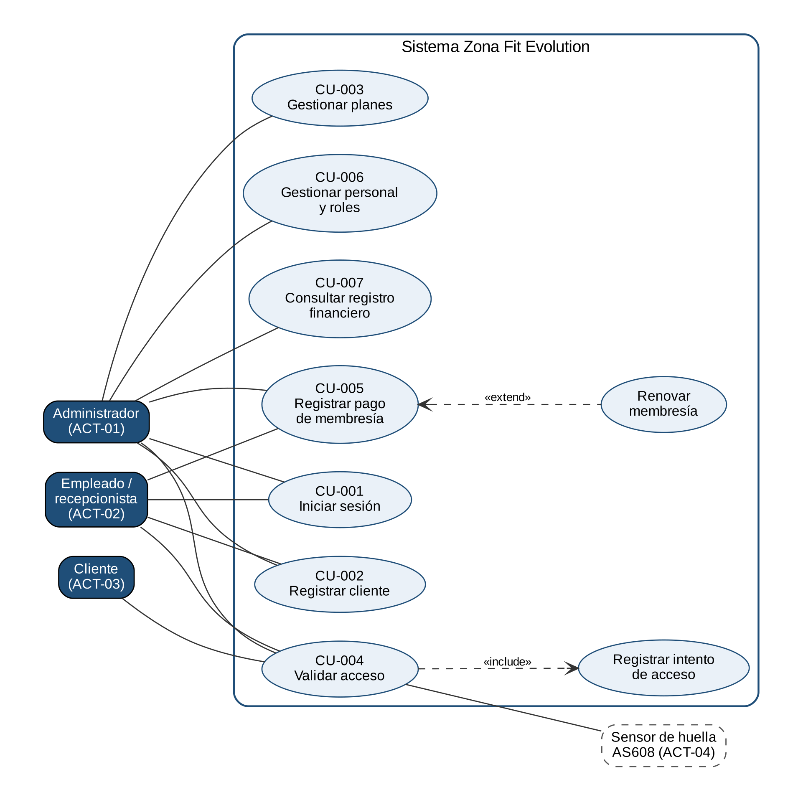

# Casos de uso

> Proyecto **Zona Fit Evolution** · SENA ADSO · ficha 3223873.  
> Extraído del documento [Backlog, historias de usuario y casos de uso](../03b-backlog-hu-casos-uso.md). Versión formal: [PDF](../entregables/02_Requerimientos/Backlog_HU_y_Casos_de_Uso_ZonaFitEvolution.pdf).

## 9\. Casos de uso

### 9.1 Cuándo elaborar un caso de uso

| **Sí conviene**                                | **No suele ser necesario**                                    |
| ---------------------------------------------- | ------------------------------------------------------------- |
| Proceso con varios actores o sistemas.         | Consulta o formulario simple cubierto por una historia clara. |
| Flujos alternativos y excepciones relevantes.  | Operación CRUD sin reglas especiales.                         |
| Reglas de negocio complejas.                   | Tarea puramente técnica.                                      |
| Operación transaccional o de alto riesgo.      | Cambio visual menor.                                          |
| Integración, autorización o auditoría crítica. | Historia ya pequeña y completamente verificable.              |

### 9.2 Catálogo de casos de uso

| **ID** | **Nombre**                    | **Actor principal** | **Objetivo**                                 | **Historias / requisitos**                      | **Prioridad** | **Estado**                     |
| ------ | ----------------------------- | ------------------- | -------------------------------------------- | ----------------------------------------------- | ------------- | ------------------------------ |
| CU-001 | Iniciar sesión                | ACT-01, ACT-02      | Acceder a los módulos según el rol.          | HU-002 / RF-007                                 | Alta          | Implementado                   |
| CU-002 | Registrar cliente             | ACT-01, ACT-02      | Incorporar un socio al sistema.              | HU-001 / RF-001                                 | Alta          | Implementado                   |
| CU-003 | Gestionar planes de membresía | ACT-01              | Mantener el catálogo de tarifas.             | HU-003 / RF-002                                 | Alta          | Implementado                   |
| CU-004 | Validar acceso                | ACT-02, ACT-03      | Permitir el ingreso solo a socios vigentes.  | HU-005, HU-006, HU-007 / RF-003, RF-004, RF-008 | Alta          | Implementado (lector simulado) |
| CU-005 | Registrar pago de membresía   | ACT-01, ACT-02      | Asignar o renovar una membresía con su pago. | HU-004, HU-008 / RF-005, RF-006                 | Alta          | Implementado                   |
| CU-006 | Gestionar personal y roles    | ACT-01              | Controlar quién usa el sistema.              | HU-002 / RF-007                                 | Alta          | Implementado                   |
| CU-007 | Consultar registro financiero | ACT-01              | Conocer los ingresos por cliente.            | HU-008 / RF-006                                 | Alta          | Implementado parcialmente      |

### 9.3 Ficha detallada de caso de uso

**CU-001 – Iniciar sesión**

| **Campo**                           | **Contenido**                                                    |
| ----------------------------------- | ---------------------------------------------------------------- |
| ID y nombre                         | CU-001 – Iniciar sesión                                          |
| Objetivo                            | Autenticarse para usar los módulos permitidos por su rol.        |
| Alcance / nivel                     | Usuario                                                          |
| Actor principal                     | ACT-01 Administrador, ACT-02 Empleado                            |
| Actores secundarios                 | Servicio de autenticación (JWT)                                  |
| Stakeholders e intereses            | STK-01: que solo el personal autorizado acceda.                  |
| Disparador                          | El usuario abre la aplicación.                                   |
| Precondiciones                      | El usuario está registrado.                                      |
| Garantías mínimas                   | Ante un error no se revela si el correo existe.                  |
| Postcondición de éxito              | Sesión iniciada con token de 8 horas y menú según el rol.        |
| Flujo principal                     | Ver la tabla de flujo de CU-001 en la sección 9.4.               |
| Flujos alternativos                 | A1, E1, E2 (ver sección 9.4)                                     |
| Excepciones                         | Servidor sin conexión.                                           |
| Reglas de negocio                   | RN-011                                                           |
| Datos de entrada y salida           | Entrada: correo y contraseña. Salida: token y datos del usuario. |
| Requisitos especiales               | RNF-001                                                          |
| Frecuencia / volumen                | Varias veces al día por usuario.                                 |
| Historias y requisitos relacionados | HU-002 / RF-007                                                  |
| Pantallas / interfaces              | UI-01                                                            |
| Casos de prueba                     | CP-016, CP-017                                                   |
| Responsable de validación           | Liliana Sofía Panesso Méndez (Product Owner)                     |
| Estado y versión                    | Implementado – MVP                                               |

**CU-002 – Registrar cliente**

| **Campo**                           | **Contenido**                                                       |
| ----------------------------------- | ------------------------------------------------------------------- |
| ID y nombre                         | CU-002 – Registrar cliente                                          |
| Objetivo                            | Registrar un nuevo cliente con sus datos personales.                |
| Alcance / nivel                     | Usuario                                                             |
| Actor principal                     | ACT-02 Empleado (también ACT-01)                                    |
| Actores secundarios                 | Base de datos                                                       |
| Stakeholders e intereses            | STK-02: registro rápido; STK-03: tratamiento correcto de sus datos. |
| Disparador                          | Un socio nuevo se inscribe.                                         |
| Precondiciones                      | Usuario autenticado; la cédula no existe.                           |
| Garantías mínimas                   | No se guardan registros incompletos.                                |
| Postcondición de éxito              | Cliente registrado y disponible para membresía y huella.            |
| Flujo principal                     | Ver la tabla de flujo de CU-002 en la sección 9.4.                  |
| Flujos alternativos                 | A1, E1 (ver sección 9.4)                                            |
| Excepciones                         | Cédula repetida; datos inválidos.                                   |
| Reglas de negocio                   | RN-001, RN-007                                                      |
| Datos de entrada y salida           | Entrada: nombre, cédula, correo, teléfono. Salida: cliente creado.  |
| Requisitos especiales               | RNF-002, RNF-006                                                    |
| Frecuencia / volumen                | Varias inscripciones diarias; de 300 a 400 clientes registrados.    |
| Historias y requisitos relacionados | HU-001 / RF-001                                                     |
| Pantallas / interfaces              | UI-03                                                               |
| Casos de prueba                     | CP-001 a CP-003                                                     |
| Responsable de validación           | Liliana Sofía Panesso Méndez (Product Owner)                        |
| Estado y versión                    | Implementado – MVP                                                  |

**CU-003 – Gestionar planes de membresía**

| **Campo**                           | **Contenido**                                                         |
| ----------------------------------- | --------------------------------------------------------------------- |
| ID y nombre                         | CU-003 – Gestionar planes de membresía                                |
| Objetivo                            | Crear, editar, desactivar y eliminar planes.                          |
| Alcance / nivel                     | Usuario                                                               |
| Actor principal                     | ACT-01 Administrador                                                  |
| Actores secundarios                 | Base de datos                                                         |
| Stakeholders e intereses            | STK-01: ajustar tarifas sin depender del equipo técnico.              |
| Disparador                          | El propietario cambia o crea una tarifa.                              |
| Precondiciones                      | Administrador autenticado.                                            |
| Garantías mínimas                   | No se pierde el historial de membresías.                              |
| Postcondición de éxito              | Catálogo actualizado.                                                 |
| Flujo principal                     | Ver la tabla de flujo de CU-003 en la sección 9.4.                    |
| Flujos alternativos                 | E1, E2 (ver sección 9.4)                                              |
| Excepciones                         | Plan con membresías asociadas; nombre duplicado.                      |
| Reglas de negocio                   | RN-006                                                                |
| Datos de entrada y salida           | Entrada: nombre, duración, precio. Salida: plan creado o actualizado. |
| Requisitos especiales               | RNF-001 (solo Administrador)                                          |
| Frecuencia / volumen                | Ocasional.                                                            |
| Historias y requisitos relacionados | HU-003 / RF-002                                                       |
| Pantallas / interfaces              | UI-04                                                                 |
| Casos de prueba                     | CP-004 a CP-006                                                       |
| Responsable de validación           | Liliana Sofía Panesso Méndez (Product Owner)                          |
| Estado y versión                    | Implementado – MVP                                                    |

**CU-004 – Validar acceso**

| **Campo**                           | **Contenido**                                                              |
| ----------------------------------- | -------------------------------------------------------------------------- |
| ID y nombre                         | CU-004 – Validar acceso                                                    |
| Objetivo                            | Decidir si el cliente puede ingresar.                                      |
| Alcance / nivel                     | Sistema                                                                    |
| Actor principal                     | ACT-03 Cliente; ACT-02 Empleado supervisa                                  |
| Actores secundarios                 | ACT-04 Sensor de huella AS608                                              |
| Stakeholders e intereses            | STK-01: cero ingresos vencidos; STK-02: sin filas; STK-03: ingreso rápido. |
| Disparador                          | El cliente pone su huella en el lector.                                    |
| Precondiciones                      | Cliente con huella registrada; lector operativo.                           |
| Garantías mínimas                   | Ante cualquier error se niega el acceso y el intento queda registrado.     |
| Postcondición de éxito              | Acceso permitido, resultado visible en la recepción e intento registrado.  |
| Flujo principal                     | Ver la tabla de flujo de CU-004 en la sección 9.4.                         |
| Flujos alternativos                 | A1, E1, E2 (ver sección 9.4)                                               |
| Excepciones                         | Huella no reconocida; error de conexión.                                   |
| Reglas de negocio                   | RN-002, RN-009, RN-010                                                     |
| Datos de entrada y salida           | Entrada: captura de huella. Salida: cliente, permitido/denegado y motivo.  |
| Requisitos especiales               | RNF-003 (\< 2 s), RNF-006                                                  |
| Frecuencia / volumen                | Cada ingreso; picos en la mañana y la noche.                               |
| Historias y requisitos relacionados | HU-005, HU-006, HU-007 / RF-003, RF-004, RF-008                            |
| Pantallas / interfaces              | UI-06, UI-07; INT-01                                                       |
| Casos de prueba                     | CP-007 a CP-009                                                            |
| Responsable de validación           | Liliana Sofía Panesso Méndez (Product Owner)                               |
| Estado y versión                    | Implementado (lector simulado) – MVP                                       |

**CU-005 – Registrar pago de membresía**

| **Campo**                           | **Contenido**                                                                        |
| ----------------------------------- | ------------------------------------------------------------------------------------ |
| ID y nombre                         | CU-005 – Registrar pago de membresía                                                 |
| Objetivo                            | Registrar la membresía pagada por el cliente.                                        |
| Alcance / nivel                     | Usuario                                                                              |
| Actor principal                     | ACT-02 Empleado (también ACT-01)                                                     |
| Actores secundarios                 | Base de datos                                                                        |
| Stakeholders e intereses            | STK-01: control de ingresos; STK-03: no perder días pagados.                         |
| Disparador                          | El cliente paga un plan en la recepción.                                             |
| Precondiciones                      | Cliente registrado; plan activo.                                                     |
| Garantías mínimas                   | Nunca quedan dos membresías activas (transacción).                                   |
| Postcondición de éxito              | Membresía activa con fecha de fin calculada; pago visible en el registro financiero. |
| Flujo principal                     | Ver la tabla de flujo de CU-005 en la sección 9.4.                                   |
| Flujos alternativos                 | A1, E1 (ver sección 9.4)                                                             |
| Excepciones                         | Cliente con membresía activa (se usa renovación); plan inactivo.                     |
| Reglas de negocio                   | RN-003, RN-004, RN-005, RN-006                                                       |
| Datos de entrada y salida           | Entrada: cliente o cédula, plan, fecha de inicio. Salida: membresía creada.          |
| Requisitos especiales               | RNF-002                                                                              |
| Frecuencia / volumen                | Diaria.                                                                              |
| Historias y requisitos relacionados | HU-004, HU-008 / RF-005, RF-006                                                      |
| Pantallas / interfaces              | UI-05                                                                                |
| Casos de prueba                     | CP-012 a CP-014                                                                      |
| Responsable de validación           | Liliana Sofía Panesso Méndez (Product Owner)                                         |
| Estado y versión                    | Implementado – MVP                                                                   |

**CU-006 – Gestionar personal y roles**

| **Campo**                           | **Contenido**                                                          |
| ----------------------------------- | ---------------------------------------------------------------------- |
| ID y nombre                         | CU-006 – Gestionar personal y roles                                    |
| Objetivo                            | Crear y eliminar usuarios del personal con su rol.                     |
| Alcance / nivel                     | Usuario                                                                |
| Actor principal                     | ACT-01 Administrador                                                   |
| Actores secundarios                 | Base de datos                                                          |
| Stakeholders e intereses            | STK-01: control del personal.                                          |
| Disparador                          | Ingresa o se retira un empleado.                                       |
| Precondiciones                      | Administrador autenticado.                                             |
| Garantías mínimas                   | Siempre existe al menos un administrador.                              |
| Postcondición de éxito              | Usuario creado o eliminado.                                            |
| Flujo principal                     | Ver la tabla de flujo de CU-006 en la sección 9.4.                     |
| Flujos alternativos                 | E1, E2 (ver sección 9.4)                                               |
| Excepciones                         | Correo duplicado; eliminar la propia cuenta o al último administrador. |
| Reglas de negocio                   | RN-011, RN-012                                                         |
| Datos de entrada y salida           | Entrada: nombre, correo, contraseña, rol. Salida: usuario creado.      |
| Requisitos especiales               | RNF-001                                                                |
| Frecuencia / volumen                | Ocasional.                                                             |
| Historias y requisitos relacionados | HU-002 / RF-007                                                        |
| Pantallas / interfaces              | UI-08                                                                  |
| Casos de prueba                     | CP-018                                                                 |
| Responsable de validación           | Liliana Sofía Panesso Méndez (Product Owner)                           |
| Estado y versión                    | Implementado – MVP                                                     |

**CU-007 – Consultar registro financiero**

| **Campo**                           | **Contenido**                                                     |
| ----------------------------------- | ----------------------------------------------------------------- |
| ID y nombre                         | CU-007 – Consultar registro financiero                            |
| Objetivo                            | Consultar el resumen de pagos de cada cliente.                    |
| Alcance / nivel                     | Usuario                                                           |
| Actor principal                     | ACT-01 Administrador                                              |
| Actores secundarios                 | Membresías y planes                                               |
| Stakeholders e intereses            | STK-01: reportes financieros reales.                              |
| Disparador                          | El Administrador abre el registro financiero.                     |
| Precondiciones                      | Administrador autenticado; existen membresías.                    |
| Garantías mínimas                   | La consulta no modifica datos.                                    |
| Postcondición de éxito              | Resumen mostrado con los filtros aplicados.                       |
| Flujo principal                     | Ver la tabla de flujo de CU-007 en la sección 9.4.                |
| Flujos alternativos                 | A1, E1 (ver sección 9.4)                                          |
| Excepciones                         | Sin datos para el filtro; fechas inválidas.                       |
| Reglas de negocio                   | RN-004, RN-011                                                    |
| Datos de entrada y salida           | Entrada: filtros. Salida: totales, resumen y detalle por cliente. |
| Requisitos especiales               | RNF-001                                                           |
| Frecuencia / volumen                | Diaria o semanal.                                                 |
| Historias y requisitos relacionados | HU-008 / RF-006                                                   |
| Pantallas / interfaces              | UI-09                                                             |
| Casos de prueba                     | CP-014, CP-015                                                    |
| Responsable de validación           | Liliana Sofía Panesso Méndez (Product Owner)                      |
| Estado y versión                    | Implementado parcialmente – MVP                                   |

### 9.4 Plantilla de flujo principal y alternativos

**CU-001 – Iniciar sesión**

| **Paso** | **Actor** | **Acción del actor**         | **Respuesta del sistema**                               | **Regla / dato** |
| -------- | --------- | ---------------------------- | ------------------------------------------------------- | ---------------- |
| 1        | Usuario   | Ingresa correo y contraseña. | Valida los campos en el navegador.                      | —                |
| 2        | Usuario   | Pulsa Iniciar sesión.        | Verifica las credenciales en el servidor.               | bcrypt           |
| 3        | Sistema   | —                            | Emite el token y muestra el Inicio con el menú del rol. | RN-011           |

| **ID alternativo** | **Paso origen** | **Condición**             | **Flujo alternativo**            | **Resultado**           |
| ------------------ | --------------- | ------------------------- | -------------------------------- | ----------------------- |
| A1                 | 1               | Campos vacíos o inválidos | Muestra el error junto al campo. | No se envía la petición |
| E1                 | 2               | Credenciales incorrectas  | Muestra un mensaje genérico.     | Sin sesión              |
| E2                 | 2               | Servidor sin conexión     | Informa que no hay conexión.     | Sin sesión              |

**CU-002 – Registrar cliente**

| **Paso** | **Actor** | **Acción del actor**             | **Respuesta del sistema**                  | **Regla / dato** |
| -------- | --------- | -------------------------------- | ------------------------------------------ | ---------------- |
| 1        | Usuario   | Abre Clientes y elige registrar. | Muestra el formulario.                     | —                |
| 2        | Usuario   | Ingresa los datos del cliente.   | Valida formatos en el navegador.           | RN-007           |
| 3        | Usuario   | Guarda.                          | Verifica que la cédula no exista y guarda. | RN-007           |
| 4        | Sistema   | —                                | Confirma el registro.                      | —                |

| **ID alternativo** | **Paso origen** | **Condición**              | **Flujo alternativo**          | **Resultado** |
| ------------------ | --------------- | -------------------------- | ------------------------------ | ------------- |
| A1                 | 2               | Datos con formato inválido | Marca el campo con su error.   | No se guarda  |
| E1                 | 3               | Cédula ya registrada       | Informa que el cliente existe. | No se guarda  |

**CU-003 – Gestionar planes de membresía**

| **Paso** | **Actor**     | **Acción del actor**             | **Respuesta del sistema** | **Regla / dato** |
| -------- | ------------- | -------------------------------- | ------------------------- | ---------------- |
| 1        | Administrador | Abre Planes.                     | Muestra el catálogo.      | —                |
| 2        | Administrador | Crea, edita o desactiva un plan. | Valida los datos.         | RN-006           |
| 3        | Sistema       | —                                | Guarda los cambios.       | —                |

| **ID alternativo** | **Paso origen** | **Condición**                   | **Flujo alternativo**                         | **Resultado**    |
| ------------------ | --------------- | ------------------------------- | --------------------------------------------- | ---------------- |
| E1                 | 2               | Eliminar un plan con membresías | Impide la eliminación y sugiere desactivarlo. | Plan sin cambios |
| E2                 | 2               | Empleado intenta modificar      | Responde 403.                                 | Sin cambios      |

**CU-004 – Validar acceso**

| **Paso** | **Actor** | **Acción del actor**         | **Respuesta del sistema**                                 | **Regla / dato** |
| -------- | --------- | ---------------------------- | --------------------------------------------------------- | ---------------- |
| 1        | Cliente   | Pone su huella en el lector. | Captura la plantilla.                                     | —                |
| 2        | Sistema   | —                            | Identifica al cliente.                                    | RN-008           |
| 3        | Sistema   | —                            | Consulta la membresía más reciente y evalúa su estado.    | RN-009           |
| 4        | Sistema   | —                            | Permite el acceso y muestra el resultado en la recepción. | —                |
| 5        | Sistema   | —                            | Registra el intento.                                      | RN-010           |

| **ID alternativo** | **Paso origen** | **Condición**                              | **Flujo alternativo**                | **Resultado**                               |
| ------------------ | --------------- | ------------------------------------------ | ------------------------------------ | ------------------------------------------- |
| A1                 | 3               | Membresía vencida, cancelada o inexistente | Niega el acceso y muestra el motivo. | Acceso negado; intento registrado           |
| E1                 | 2               | Huella no reconocida                       | Niega el acceso (404).               | Intento registrado                          |
| E2                 | 3               | Error de conexión                          | Muestra el error.                    | Acceso negado; validación manual por cédula |

**CU-005 – Registrar pago de membresía**

| **Paso** | **Actor** | **Acción del actor**                  | **Respuesta del sistema**                                        | **Regla / dato** |
| -------- | --------- | ------------------------------------- | ---------------------------------------------------------------- | ---------------- |
| 1        | Usuario   | Busca al cliente por nombre o cédula. | Muestra el cliente y su membresía.                               | —                |
| 2        | Usuario   | Elige el plan y la fecha de inicio.   | Valida que el plan esté activo y la fecha no sea anterior a hoy. | RN-006           |
| 3        | Usuario   | Confirma.                             | Calcula la fecha de fin y guarda la membresía.                   | RN-004           |
| 4        | Sistema   | —                                     | Muestra la confirmación.                                         | —                |

| **ID alternativo** | **Paso origen** | **Condición**                        | **Flujo alternativo**                   | **Resultado** |
| ------------------ | --------------- | ------------------------------------ | --------------------------------------- | ------------- |
| A1                 | 1               | El cliente ya tiene membresía activa | Ofrece renovar por cédula (encadenada). | RN-005        |
| E1                 | 2               | Faltan datos                         | Solicita completarlos.                  | No se guarda  |

**CU-006 – Gestionar personal y roles**

| **Paso** | **Actor**     | **Acción del actor**       | **Respuesta del sistema**     | **Regla / dato** |
| -------- | ------------- | -------------------------- | ----------------------------- | ---------------- |
| 1        | Administrador | Abre Personal.             | Lista los usuarios.           | RN-011           |
| 2        | Administrador | Crea o elimina un usuario. | Valida datos y restricciones. | RN-012           |
| 3        | Sistema       | —                          | Guarda el cambio.             | —                |

| **ID alternativo** | **Paso origen** | **Condición**                                       | **Flujo alternativo** | **Resultado** |
| ------------------ | --------------- | --------------------------------------------------- | --------------------- | ------------- |
| E1                 | 2               | Correo ya registrado                                | Informa el duplicado. | Sin cambios   |
| E2                 | 2               | Eliminar la propia cuenta o al último administrador | Lo impide.            | Sin cambios   |

**CU-007 – Consultar registro financiero**

| **Paso** | **Actor**     | **Acción del actor**          | **Respuesta del sistema**              | **Regla / dato** |
| -------- | ------------- | ----------------------------- | -------------------------------------- | ---------------- |
| 1        | Administrador | Abre Registro financiero.     | Calcula totales y resumen por cliente. | RN-011           |
| 2        | Administrador | Aplica filtros.               | Valida las fechas y filtra.            | —                |
| 3        | Administrador | Abre Ver pagos de un cliente. | Muestra el detalle de cada pago.       | RN-004           |

| **ID alternativo** | **Paso origen** | **Condición**            | **Flujo alternativo**           | **Resultado** |
| ------------------ | --------------- | ------------------------ | ------------------------------- | ------------- |
| A1                 | 2               | Sin datos para el filtro | Muestra un mensaje informativo. | —             |
| E1                 | 2               | Rango de fechas inválido | Muestra el error.               | Sin consulta  |

### 9.5 Ejemplo resumido

<table>
<tbody>
<tr class="odd">
<td>
<strong>CU-004: Validar acceso</strong>

Actor: cliente (supervisa la recepción). Disparador: el cliente pone su huella en el lector. Precondición: cliente con huella registrada y lector operativo. Flujo: el sistema identifica al cliente, consulta su membresía más reciente, evalúa su estado, permite o niega el acceso mostrando el resultado en la recepción, y registra el intento. Alternativos: membresía vencida, cancelada o inexistente; huella no reconocida; error de conexión. Postcondición: intento registrado; el acceso solo se permite si la membresía está activa y vigente.
</td>
</tr>
</tbody>
</table>

## 10\. Diagramas y relaciones UML

### 10.1 Diagrama de contexto de casos de uso

Incluya un diagrama legible con actores externos y casos de uso de alto nivel. No convierta el diagrama en una lista de cada botón o pantalla.

*Figura 1. Diagrama general de casos de uso (DIA-CU-01).*

| **Elemento**       | **Criterio**                                                  |
| ------------------ | ------------------------------------------------------------- |
| Actores            | Representan roles o sistemas externos, no personas concretas. |
| Casos de uso       | Se nombran con verbo y resultado.                             |
| Límite del sistema | Muestra qué pertenece al producto.                            |
| Asociaciones       | Indican interacción real.                                     |
| include            | Reutilización obligatoria de comportamiento común.            |
| extend             | Comportamiento opcional o condicionado.                       |
| Generalización     | Especialización real entre actores o casos.                   |

### 10.2 Registro de diagramas

| **ID**     | **Nombre**                             | **Herramienta / fuente**         | **Versión** | **Ubicación**                   | **Artefactos relacionados**      |
| ---------- | -------------------------------------- | -------------------------------- | ----------- | ------------------------------- | -------------------------------- |
| DIA-CU-01  | Diagrama general de casos de uso       | Graphviz (fuente casos\_uso.dot) | 1.0         | /docs/analisis/casos-uso/       | CU-001 a CU-007, ACT-01 a ACT-04 |
| DIA-ACT-01 | Actores y sistemas externos (contexto) | Mermaid (fuente contexto.mmd)    | 1.0         | Documento maestro, sección 5.10 | ACT-01 a ACT-04, INT-01, INT-02  |
| DIA-SEC-01 | Secuencia: validar acceso              | Mermaid (fuente secuencia.mmd)   | 1.0         | Documento maestro, sección 5.10 | CU-004, RF-003                   |
