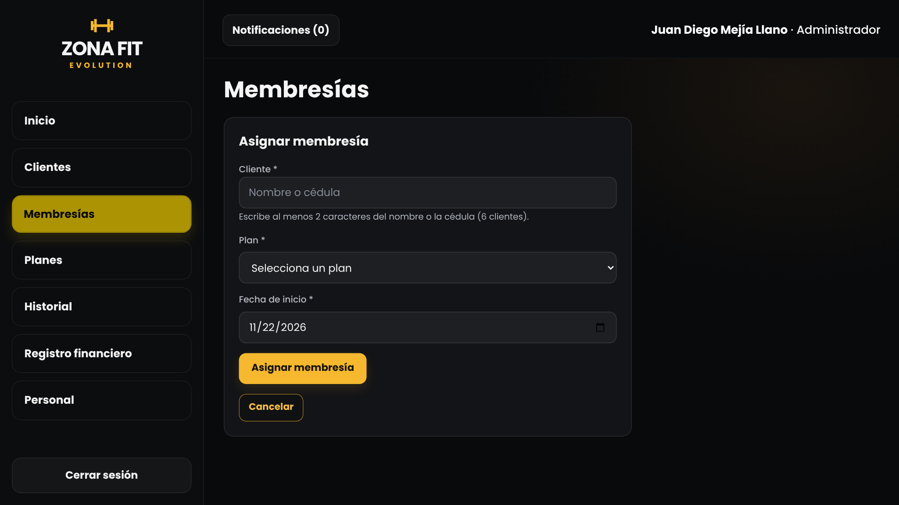
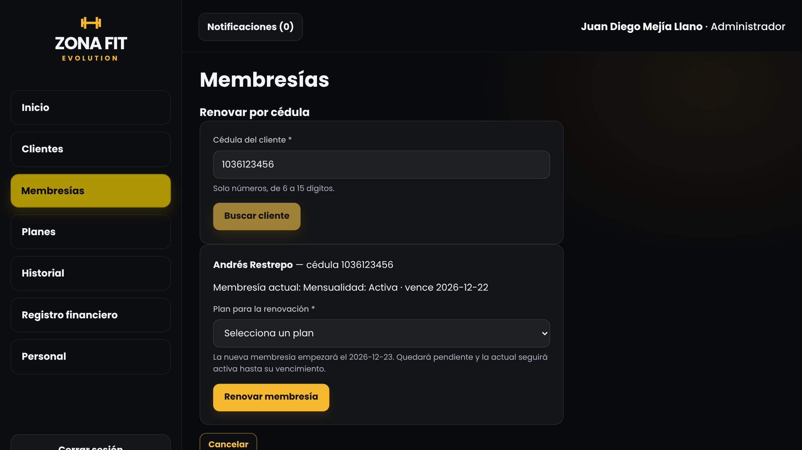
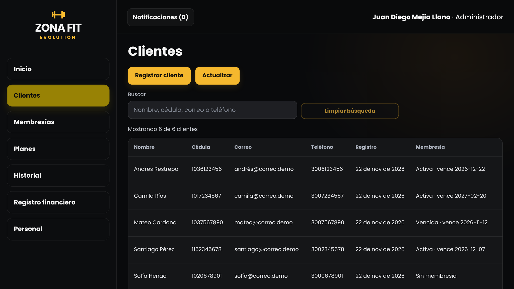
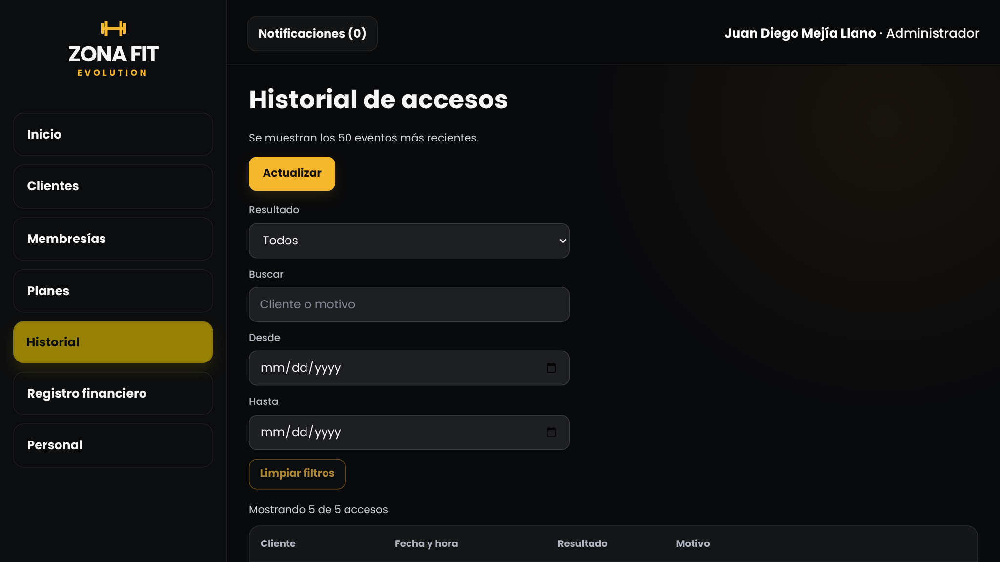
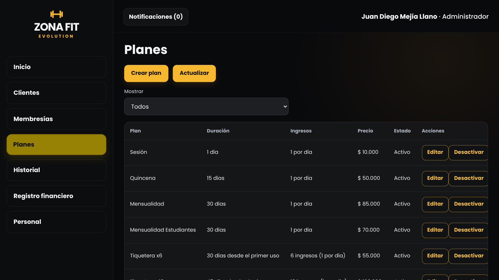
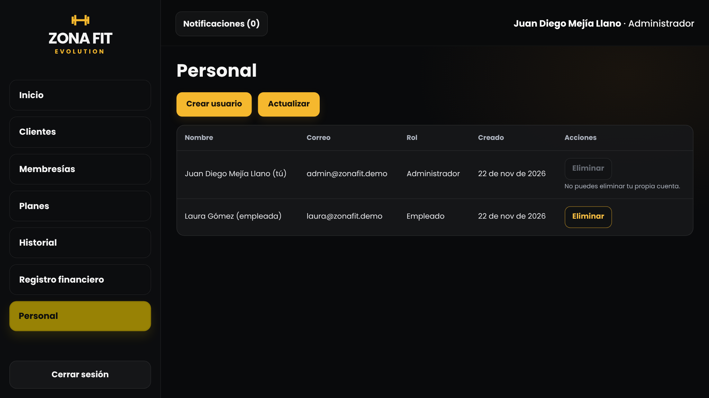
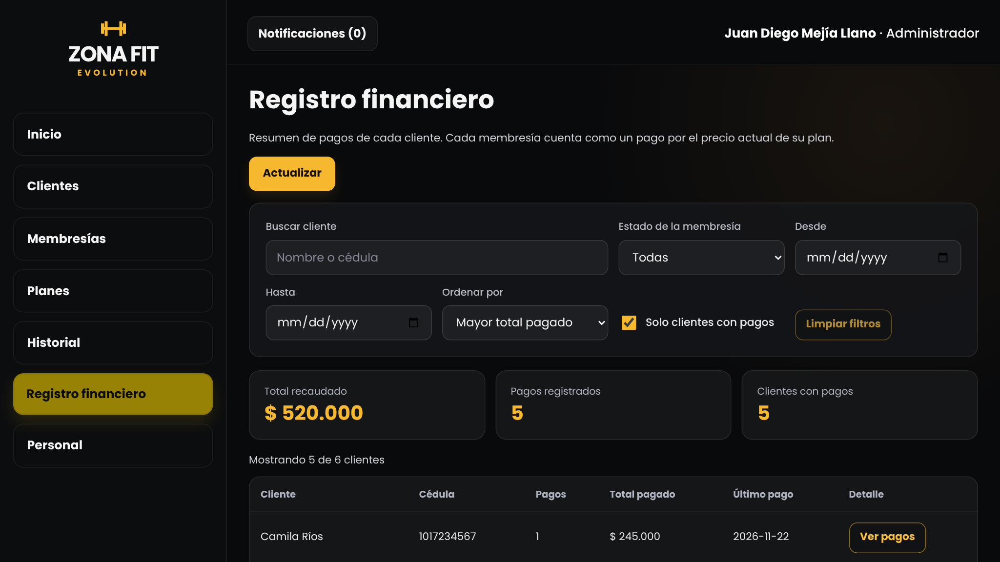

# Manual de usuario

> Proyecto **Zona Fit Evolution** · SENA ADSO · ficha 3223873.  
> Versión formal entregable: [`entregables/05_Manuales/Manual_de_Usuario_ZonaFitEvolution.pdf`](entregables/05_Manuales/Manual_de_Usuario_ZonaFitEvolution.pdf). Este Markdown es la versión viva: se actualiza en el mismo PR que cambia el código.

## Control documental

| **Versión** | **Fecha**  | **Cambio realizado**                                                                                 | **Elaboró**              | **Revisó** | **Aprobó** | **Estado** |
| ----------- | ---------- | ---------------------------------------------------------------------------------------------------- | ------------------------ | ---------- | ---------- | ---------- |
| 1.0         | 03/11/2026 | Borrador del manual con los módulos implementados en local                                           | Maileth Begambre Movilla |            |            | Borrador   |
| 1.1         | 10/11/2026 | Huella desde Clientes, pantalla de ingreso, correo obligatorio, un ingreso por día y nuevos mensajes | Juan Diego Mejía Llano   |            |            | Borrador   |
| 1.2         | 11/11/2026 | Acceso en la nube, pantalla de ingreso con token, agente del lector y mensaje «Lector desconectado»  | Juan Diego Mejía Llano   |            |            | Borrador   |
| 1.3 | 22/11/2026 | Pantalla de ingreso: apertura automática en recepción, textos de espera, aviso de huella no registrada y reconexión; mensajes nuevos | Juan Diego Mejía Llano |  |  | Borrador |
| 1.4 | 22/11/2026 | Procedimientos PRU-02 a PRU-09 redactados con capturas de la aplicación (datos ficticios); inicio, recuperación de acceso y cierre de sesión ajustados a la interfaz real | Juan Diego Mejía Llano |  |  | Borrador |
| 1.5 | 22/11/2026 | PRU-02 y MSG-04 ajustados a la regla actual: con una membresía activa la nueva queda pendiente; solo se permite una pendiente | Juan Diego Mejía Llano |  |  | Borrador |
| 1.6 | 23/11/2026 | Un solo ingreso por día en cualquier plan: mensaje MSG-15 y lecturas repetidas dentro de 30 minutos | Juan Diego Mejía Llano |  |  | Borrador |

### Aprobaciones

| **Rol**                | **Nombre**                                   | **Aspecto validado**            | **Fecha** | **Firma / aprobación** |
| ---------------------- | -------------------------------------------- | ------------------------------- | --------- | ---------------------- |
| Responsable funcional  | Liliana Sofía Panesso Méndez (Product Owner) | Exactitud de los procedimientos |           |                        |
| Responsable UX/UI      | Maileth Begambre Movilla                     | Correspondencia con la interfaz |           |                        |
| Líder del proyecto     | Juan Diego Mejía Llano                       | Versión y alcance documentados  |           |                        |
| Instructor / evaluador |                                              | Suficiencia y claridad          |           |                        |

## 1\. Propósito y alcance

Este manual explica cómo utilizar el sistema de acuerdo con los roles y funcionalidades disponibles. Debe redactarse con lenguaje comprensible para el usuario final y mantenerse sincronizado con la interfaz publicada.

### 1.1 Objetivos

  - Explicar cómo acceder al sistema y recuperar el acceso.

  - Describir la navegación y los elementos comunes de la interfaz.

  - Guiar paso a paso cada procedimiento relevante por perfil.

  - Aclarar mensajes, validaciones, estados y errores frecuentes.

  - Indicar canales de soporte y mecanismos de reporte.

  - Facilitar el uso autónomo y seguro del producto.

### 1.2 Audiencia

| **Perfil**           | **Necesidad principal**                                                             | **Secciones recomendadas**                        |
| -------------------- | ----------------------------------------------------------------------------------- | ------------------------------------------------- |
| Usuario final        | Recepcionista (Empleado): registrar clientes, renovar membresías y validar accesos. | Secciones 4 a 6                                   |
| Administrador        | Propietario: planes, personal y registro financiero.                                | Secciones 4 a 6 (procedimientos de Administrador) |
| Supervisor / auditor | Propietario: revisión del historial de accesos.                                     | Historial de accesos                              |
| Soporte              | Equipo de desarrollo: dudas de uso y errores.                                       | Mensajes y soporte                                |

### 1.3 Fuera de alcance

|                                                                                                                                                                                 |
| ------------------------------------------------------------------------------------------------------------------------------------------------------------------------------- |
| No cubre la instalación ni la configuración técnica (ver Manual Técnico), la administración del hosting, la apertura automática de la puerta (fuera del MVP) ni pagos en línea. |

## 2\. Identificación del sistema

| **Campo**                         | **Información**                                                                                                                                     |
| --------------------------------- | --------------------------------------------------------------------------------------------------------------------------------------------------- |
| Nombre del sistema                | Zona Fit Evolution                                                                                                                                  |
| Versión                           | v1.0.0 (candidata)                                                                                                                                  |
| URL o medio de acceso             | Producción: https://zona-fit-evolution03.vercel.app. Pantalla de ingreso: la misma dirección con ?pantalla=acceso. En local: http://localhost:5173. |
| Tipo de aplicación                | Aplicación web (navegador)                                                                                                                          |
| Organización responsable          | Gimnasio Zona Fit                                                                                                                                   |
| Horario de disponibilidad         | Horario de atención del gimnasio                                                                                                                    |
| Canal de soporte                  |                                                                                                                                                     |
| Fecha de actualización del manual |                                                                                                                                                     |

### 2.1 Descripción general

|                                                                                                                                                                                                                                                                                   |
| --------------------------------------------------------------------------------------------------------------------------------------------------------------------------------------------------------------------------------------------------------------------------------- |
| Zona Fit Evolution permite al personal del gimnasio registrar clientes, asignar y renovar membresías, registrar la huella de cada socio y validar su ingreso con el sensor de huella. El Administrador además gestiona los planes, el personal y consulta el registro financiero. |

### 2.2 Módulos funcionales

| **Código** | **Módulo**          | **Objetivo**                                                                                                                                                                                                                                                          | **Perfiles con acceso**                      |
| ---------- | ------------------- | --------------------------------------------------------------------------------------------------------------------------------------------------------------------------------------------------------------------------------------------------------------------- | -------------------------------------------- |
| MOD-01     | Inicio              | Acciones rápidas, actividad reciente y membresías por vencer.                                                                                                                                                                                                         | Administrador, Empleado                      |
| MOD-02     | Clientes            | Registrar, buscar y editar clientes, registrar su huella y ver el estado de su membresía.                                                                                                                                                                             | Administrador, Empleado                      |
| MOD-03     | Membresías          | Asignar y renovar por cédula.                                                                                                                                                                                                                                         | Administrador, Empleado                      |
| MOD-04     | Planes              | Consultar el catálogo (cada plan permite un ingreso por día); el Administrador crea, edita y desactiva.                                                                                                                                                               | Administrador (gestión), Empleado (consulta) |
| MOD-05     | Pantalla de ingreso | Validar el ingreso del socio con su huella en una ventana aparte, sin sesión; el resultado se muestra 2 segundos (4 segundos si la huella no está registrada). En el portátil de recepción se abre sola al encender el equipo. La primera vez en cada navegador se abre con el token que entrega el administrador (?pantalla=acceso\&token=…); después basta con ?pantalla=acceso. | Administrador, Empleado                      |
| MOD-06     | Historial           | Consultar intentos de acceso con filtros.                                                                                                                                                                                                                             | Administrador, Empleado                      |
| MOD-07     | Personal            | Crear y eliminar usuarios del personal.                                                                                                                                                                                                                               | Administrador                                |
| MOD-08     | Registro financiero | Resumen de pagos por cliente (solo lectura).                                                                                                                                                                                                                          | Administrador                                |

## 3\. Requisitos para el usuario

| **Requisito**           | **Mínimo**                          | **Recomendado**       | **Observaciones** |
| ----------------------- | ----------------------------------- | --------------------- | ----------------- |
| Dispositivo             | Computador o tablet                 | Computador            |                   |
| Navegador / versión     | Chrome, Edge o Firefox actualizados | Última versión        |                   |
| Conectividad            | Internet estable                    |                       |                   |
| Resolución de pantalla  | 360 px de ancho                     | 1366 × 768 o superior |                   |
| Permisos de usuario     | Usuario creado por el Administrador |                       |                   |
| Correo o identificación | Correo registrado en el sistema     |                       |                   |

### 3.1 Accesibilidad

  - El manual debe indicar si el sistema puede utilizarse con teclado.

  - Las imágenes deben tener una explicación textual.

  - Los pasos no deben depender únicamente de colores.

  - Los mensajes y nombres de botones deben coincidir con la interfaz.

  - Se deben documentar atajos o ajustes de accesibilidad, cuando existan.

## 4\. Roles y permisos

| **Rol** | **Descripción** | **Funciones permitidas**                                                          | **Restricciones**                                              |
| ------- | --------------- | --------------------------------------------------------------------------------- | -------------------------------------------------------------- |
| ROL-01  | Administrador   | Todas las funciones del sistema.                                                  | No puede eliminar su propia cuenta ni al último administrador. |
| ROL-02  | Empleado        | Clientes (con el registro de huella), membresías, consulta de planes e historial. | No ve Personal ni Registro financiero; no modifica planes.     |
| ROL-03  | Cliente (socio) | Presenta su huella en el sensor.                                                  | No usa la aplicación.                                          |

<table>
<tbody>
<tr class="odd">
<td><strong>Regla de seguridad 
</strong>No se debe afirmar que una función está restringida solo porque el botón está oculto. El manual describe permisos funcionales, pero el sistema debe verificarlos técnicamente en el servidor o componente autorizado.</td>
</tr>
</tbody>
</table>

## 5\. Acceso al sistema

### 5.1 Inicio de sesión

1.  Abra https://zona-fit-evolution03.vercel.app en Chrome o Edge.

2.  Escriba su correo en «Correo».

3.  Escriba la contraseña.

4.  Seleccione «Iniciar sesión».

5.  Espere la validación y confirme que aparece la pantalla principal correspondiente a su rol.

| **Elemento**     | **Descripción**                                              | **Validación esperada**                   |
| ---------------- | ------------------------------------------------------------ | ----------------------------------------- |
| Usuario / correo | Correo del usuario del personal.                             | Formato de correo válido.                 |
| Contraseña       | Contraseña asignada.                                         | Obligatoria.                              |
| Iniciar sesión   | Envía las credenciales.                                      | Se bloquea mientras se valida.            |
| Recordar sesión  | La sesión se conserva al recargar la página (hasta 8 horas). | No hay casilla; cerrar sesión la termina. |

### 5.2 Recuperación de acceso

6.  Pida al Administrador que restablezca su acceso: el sistema no tiene recuperación de contraseña por correo.

7.  El Administrador abre «Personal», elimina el usuario y lo crea de nuevo con el mismo correo y una contraseña temporal.

8.  El Administrador le entrega la contraseña temporal por un medio privado.

9.  Inicie sesión con esa contraseña.

10. Si un Administrador olvida su contraseña, otro Administrador hace el mismo proceso.

11. Si no queda ningún Administrador con acceso, el responsable técnico crea uno con npm run crear-admin (Manual técnico).

|                                                                |
| -------------------------------------------------------------- |
| *No hay opción «¿Olvidó su contraseña?»: el restablecimiento lo hace un Administrador desde «Personal».* |

### 5.3 Cierre de sesión

12. Ubique el botón «Cerrar sesión» al final del menú lateral.

13. Pulse «Cerrar sesión».

14. Confirme que el sistema regresa a la pantalla de acceso.

15. En equipos compartidos, cierre también el navegador cuando corresponda.

### 5.4 Sesión expirada o bloqueada

| **Situación**            | **Mensaje esperado**                                                 | **Acción del usuario**         |
| ------------------------ | -------------------------------------------------------------------- | ------------------------------ |
| Sesión expirada          | Tu sesión expiró. Inicia sesión nuevamente.                          | Volver a iniciar sesión.       |
| Cuenta bloqueada         |                                                                      |                                |
| Credenciales incorrectas | Credenciales incorrectas o error en el servidor. Inténtalo de nuevo. | Revisar correo y contraseña.   |
| Sin permisos             | No tienes permisos para realizar esta acción                         | Ingresar con un Administrador. |

## 6\. Navegación e interfaz general

| **Elemento**      | **Función**                            | **Ubicación**                                      | **Observaciones** |
| ----------------- | -------------------------------------- | -------------------------------------------------- | ----------------- |
| Menú principal    | Opciones según el rol                  | Barra lateral izquierda (botón de menú en celular) |                   |
| Barra superior    | Usuario autenticado y cierre de sesión | Parte superior                                     |                   |
| Breadcrumb / ruta | No aplica                              | —                                                  |                   |
| Botón principal   | Acción principal de cada formulario    | Debajo del formulario                              |                   |
| Filtros           | Historial y registro financiero        | Encima de la lista                                 |                   |
| Paginación        | No aplica                              | —                                                  |                   |
| Mensajes          | Éxito y error                          | Encima del formulario                              |                   |

### 6.1 Convenciones visuales

| **Convención** | **Significado**                            | **Ejemplo de uso**                                     |
| -------------- | ------------------------------------------ | ------------------------------------------------------ |
| Éxito          | La operación terminó correctamente         | «Cliente registrado correctamente.»                    |
| Advertencia    | Existe una condición que requiere atención | «Este cliente ya tiene una membresía pendiente…»          |
| Error          | La operación no pudo completarse           | «La cédula solo puede tener números.»                  |
| Información    | Mensaje de orientación                     | «No hay membresías por vencer en los próximos 7 días.» |
| Deshabilitado  | La acción no está disponible               | Botón mientras guarda                                  |

## 7\. Procedimientos funcionales por módulo

Esta sección debe repetirse para cada módulo y operación importante. Los nombres de botones, menús y campos deben coincidir exactamente con la interfaz.

### 7.1 Plantilla de procedimiento

| **Campo**               | **Contenido**                                                |
| ----------------------- | ------------------------------------------------------------ |
| ID y nombre             | PRU-01 – Registrar cliente                                   |
| Rol autorizado          | Administrador, Empleado                                      |
| Objetivo                | Inscribir un nuevo socio.                                    |
| Precondiciones          | Sesión iniciada; la cédula no está registrada.               |
| Ruta de acceso          | Menú lateral → Clientes → Registrar cliente                  |
| Datos requeridos        | Nombre, cédula y correo (obligatorios); teléfono (opcional). |
| Resultado esperado      | Mensaje «Cliente "\<nombre\>" registrado correctamente.»     |
| Requisitos relacionados | RF-001, HU-001                                               |

### 7.2 Pasos del procedimiento

| **Paso** | **Acción del usuario**                      | **Respuesta del sistema**                         | **Captura / evidencia** |
| -------- | ------------------------------------------- | ------------------------------------------------- | ----------------------- |
| 1        | Abrir Clientes en el menú.                  | Muestra la lista de clientes.                     |                         |
| 2        | Pulsar Registrar cliente.                   | Muestra el formulario.                            |                         |
| 3        | Escribir nombre, cédula, correo y teléfono. | Marca los errores junto a cada campo.             |                         |
| 4        | Pulsar Guardar.                             | Valida en el servidor y guarda.                   |                         |
| 5        | Revisar el mensaje.                         | Muestra la confirmación y el cliente en la lista. |                         |

### 7.3 Variaciones y excepciones

| **Condición**      | **Comportamiento esperado**                       | **Acción recomendada**         |
| ------------------ | ------------------------------------------------- | ------------------------------ |
| Datos inválidos    | El campo muestra su error y no se envía.          | Corregir el campo.             |
| Registro duplicado | «Ya existe un cliente registrado con esa cédula». | Buscar al cliente existente.   |
| Sin resultados     | «Aún no hay clientes registrados.»                | Registrar el primer cliente.   |
| Sin permisos       | «No tienes permisos para realizar esta acción»    | Ingresar con un Administrador. |
| Error de conexión  | «No se pudo conectar con el servidor»             | Avisar a soporte y reintentar. |

### 7.4 Catálogo de procedimientos

| **ID** | **Módulo**          | **Procedimiento**                 | **Rol**                 | **Prioridad** | **Estado**   |
| ------ | ------------------- | --------------------------------- | ----------------------- | ------------- | ------------ |
| PRU-01 | Clientes            | Registrar cliente                 | Administrador, Empleado | Alta          | Redactado (7.5) |
| PRU-02 | Membresías          | Asignar membresía                 | Administrador, Empleado | Alta          | Redactado (7.5) |
| PRU-03 | Membresías          | Renovar por cédula                | Administrador, Empleado | Alta          | Redactado (7.5) |
| PRU-04 | Clientes            | Registrar huella                  | Administrador, Empleado | Alta          | Redactado (7.5) |
| PRU-05 | Pantalla de ingreso | Validar acceso                    | Administrador, Empleado | Alta          | Redactado (7.5) |
| PRU-06 | Historial           | Filtrar accesos                   | Administrador, Empleado | Media         | Redactado (7.5) |
| PRU-07 | Planes              | Crear, editar y desactivar planes | Administrador           | Media         | Redactado (7.5) |
| PRU-08 | Personal            | Crear y eliminar usuarios         | Administrador           | Media         | Redactado (7.5) |
| PRU-09 | Registro financiero | Consultar pagos por cliente       | Administrador           | Media         | Redactado (7.5) |

### 7.5 Procedimientos por módulo

Las capturas se tomaron de la aplicación con datos ficticios; los nombres de botones y mensajes coinciden con la interfaz.

**PRU-02 – Asignar membresía** · Rol autorizado: Administrador, Empleado.

1. Abra «Membresías» en el menú lateral y pulse «Asignar membresía».
2. En «Cliente *» escriba al menos 2 caracteres del nombre o de la cédula y elija al cliente de la lista.
3. Elija el «Plan *» y la «Fecha de inicio *» (no puede ser anterior a hoy).
4. Pulse «Asignar membresía». El sistema muestra «Membresía asignada correctamente a <cliente>.»
5. Si el cliente ya tiene una membresía activa, la fecha de inicio pasa al día siguiente de su fin y la nueva queda pendiente. Si ya tiene una pendiente aparece «Este cliente ya tiene una membresía pendiente que inicia el <fecha>.»

*Figura 1. Asignar membresía (PRU-02).*

**PRU-03 – Renovar por cédula** · Rol autorizado: Administrador, Empleado.

1. En «Membresías» pulse «Renovar por cédula».
2. Escriba la «Cédula del cliente *» y pulse «Buscar cliente»: aparecen el cliente y su membresía actual.
3. Elija el «Plan para la renovación *». El sistema indica la fecha en que empezará la nueva membresía: si la actual sigue vigente, la nueva queda pendiente hasta que la actual venza.
4. Pulse «Renovar membresía». El sistema muestra «Membresía renovada correctamente para <cliente>.»
5. Si el cliente ya tiene una membresía pendiente, el sistema lo impide: solo se permite una pendiente.

*Figura 2. Renovar por cédula (PRU-03).*

**PRU-04 – Registrar huella** · Rol autorizado: Administrador, Empleado.

1. Abra «Clientes». La columna «Huella» indica «Registrada» o «Pendiente».
2. En la fila del cliente pulse «Registrar huella».
3. Pida al socio que ponga el dedo en el lector y lo mantenga hasta que la pantalla indique retirarlo.
4. Cuando aparezca «Vuelve a colocar el mismo dedo en el lector», pida que lo ponga otra vez.
5. El sistema muestra «Huella registrada correctamente para <cliente>.» Si ese dedo ya pertenece a otro socio aparece «Esta huella ya está registrada para otro cliente».

*Figura 3. Registrar huella (PRU-04).*

**PRU-05 – Validar acceso en la pantalla de ingreso** · Rol autorizado: Socio (la pantalla no requiere sesión).

1. En el portátil de recepción la pantalla de ingreso se abre sola al encender el equipo; también se abre con el acceso «Pantalla de ingreso ZonaFit» del escritorio.
2. Con la pantalla en «Tu entrenamiento empieza aquí», el socio pone el dedo en el lector.
3. La pantalla muestra durante 2 segundos «Acceso permitido» o «Acceso denegado» con el motivo, y vuelve a la espera.
4. Si la huella no está registrada aparece «Acércate a recepción para registrar tu huella» durante 4 segundos.
5. Si aparece «Conectando con el lector…», la pantalla reintenta sola cada 5 segundos; si no cambia, revise internet y el cable del lector.

*Figura 4. Validar acceso en la pantalla de ingreso (PRU-05).*

**PRU-06 – Filtrar el historial de accesos** · Rol autorizado: Administrador, Empleado.

1. Abra «Historial». Se muestran los 50 eventos más recientes.
2. Elija el «Resultado»: «Todos», «Acceso permitido» o «Acceso denegado».
3. En «Buscar» escriba el nombre del cliente o una parte del motivo.
4. Si lo necesita, limite las fechas con «Desde» y «Hasta» (no pueden ser futuras).
5. Pulse «Limpiar filtros» para volver a ver todos los eventos.

*Figura 5. Filtrar el historial de accesos (PRU-06).*

**PRU-07 – Crear, editar y desactivar planes** · Rol autorizado: Administrador (el Empleado solo consulta).

1. Abra «Planes» y pulse «Crear plan».
2. Escriba «Nombre del plan *», «Duración en días *» y «Precio (COP) *». Para una tiquetera, llene «Ingresos incluidos (solo tiqueteras)»; déjelo vacío si el plan es por tiempo.
3. Pulse «Crear plan». El sistema muestra «Plan "<nombre>" creado correctamente.»
4. Para cambiar un plan pulse «Editar» en su fila, corrija los datos y pulse «Guardar cambios».
5. Para dejar de ofrecerlo pulse «Desactivar» y confirme; las membresías existentes no cambian. «Activar» lo vuelve a ofrecer.

*Figura 6. Crear, editar y desactivar planes (PRU-07).*

**PRU-08 – Crear y eliminar usuarios del personal** · Rol autorizado: Administrador.

1. Abra «Personal» y pulse «Crear usuario».
2. Escriba nombre, correo y contraseña (8 o más caracteres, con letras y números), confírmela y elija el «Rol *».
3. Pulse «Crear usuario». El sistema muestra «Usuario "<nombre>" creado correctamente.»
4. Para eliminar a alguien pulse «Eliminar» en su fila y confirme; la acción no se puede deshacer.
5. No se puede eliminar la propia cuenta ni al último Administrador: el botón aparece deshabilitado y el servidor también lo impide.

*Figura 7. Crear y eliminar usuarios del personal (PRU-08).*

**PRU-09 – Consultar pagos por cliente** · Rol autorizado: Administrador.

1. Abra «Registro financiero». Arriba se ven «Total recaudado», «Pagos registrados» y «Clientes con pagos».
2. Filtre con «Buscar cliente», «Estado de la membresía», «Desde» y «Hasta», y ordene con «Ordenar por».
3. Pulse «Ver pagos» en la fila de un cliente para ver cada pago con su plan, monto y vigencia.
4. Tenga en cuenta que cada membresía cuenta como un pago por el precio actual de su plan (el sistema aún no guarda el monto pagado).

*Figura 8. Consultar pagos por cliente (PRU-09).*

## 8\. Formularios y gestión de registros

### 8.1 Crear un registro

16. Ingrese al módulo correspondiente.

17. Seleccione «Nuevo», «Crear» o la opción equivalente.

18. Diligencie los campos obligatorios.

19. Revise validaciones y datos.

20. Seleccione «Guardar».

21. Confirme el mensaje de éxito y verifique el registro.

### 8.2 Consultar, editar y eliminar o desactivar

| **Acción** | **Procedimiento general**                                            | **Advertencia**                           |
| ---------- | -------------------------------------------------------------------- | ----------------------------------------- |
| Consultar  | Buscar por nombre o cédula en la lista.                              |                                           |
| Editar     | Abrir el cliente o plan y guardar los cambios.                       | La cédula no se puede editar.             |
| Eliminar   | Clientes: no se eliminan. Usuarios del personal: solo Administrador. | Pide confirmación y no se puede deshacer. |
| Desactivar | Planes: botón Desactivar.                                            | Pide confirmación.                        |
| Restaurar  | Planes: botón Activar.                                               |                                           |

### 8.3 Campos y validaciones

| **Campo** | **Tipo** | **Obligatorio** | **Formato / regla**                                                | **Mensaje de error**                |
| --------- | -------- | --------------- | ------------------------------------------------------------------ | ----------------------------------- |
| Nombre    | Texto    | Sí              | 3 a 100 caracteres; letras, espacios, apóstrofes, puntos y guiones | El nombre es obligatorio.           |
| Cédula    | Número   | Sí              | 6 a 15 dígitos                                                     | La cédula solo puede tener números. |
| Correo    | Correo   | Sí              | Formato de correo; máx. 100                                        | El formato del correo no es válido. |
| Teléfono  | Teléfono | No              | 7 a 15 dígitos; puede iniciar con +                                |                                     |

## 9\. Búsquedas, filtros y reportes

### 9.1 Buscar y filtrar

22. Ingrese al listado correspondiente.

23. Escriba un término de búsqueda o seleccione filtros.

24. Seleccione «Buscar», «Aplicar» o espere la actualización automática.

25. Revise los resultados.

26. Limpie los filtros para recuperar la vista completa.

### 9.2 Ordenamiento y paginación

  - Seleccione el encabezado de una columna para ordenar cuando esté habilitado.

  - Use los controles de página para avanzar o retroceder.

  - Cambie el número de registros por página cuando el sistema lo permita.

  - Los filtros deben conservarse al navegar entre páginas, salvo indicación contraria.

### 9.3 Generar o exportar reportes

| **Paso** | **Acción**                       | **Resultado esperado**            |
| -------- | -------------------------------- | --------------------------------- |
| 1        | Seleccione el módulo de reportes | Se muestran opciones disponibles  |
| 2        | Defina filtros y periodo         | Se delimita la información        |
| 3        | Seleccione formato               | PDF / Excel / CSV u otro          |
| 4        | Genere el reporte                | Archivo o vista creada            |
| 5        | Verifique datos y permisos       | Información coherente con filtros |

## 10\. Notificaciones, archivos y acciones complementarias

### 10.1 Notificaciones

| **Tipo**           | **Cuándo aparece**                                     | **Acción del usuario**       |
| ------------------ | ------------------------------------------------------ | ---------------------------- |
| Interna            | Membresías por vencer en los próximos 7 días (Inicio). | Renovar la membresía.        |
| Correo             | No aplica en esta versión.                             | —                            |
| Alerta del sistema | Mensajes de éxito o error en cada pantalla.            | Leer y seguir la indicación. |
| Recordatorio       | No aplica.                                             | —                            |

### 10.2 Carga y descarga de archivos

| **Aspecto**          | **Regla / instrucción**                  |
| -------------------- | ---------------------------------------- |
| Formatos permitidos  | No aplica: el sistema no carga archivos. |
| Tamaño máximo        |                                          |
| Nombre recomendado   |                                          |
| Validación antivirus |                                          |
| Descarga             |                                          |
| Privacidad           | No se guardan imágenes de huellas.       |

## 11\. Mensajes, estados y errores frecuentes

| **Código** | **Mensaje o situación**                                               | **Significado**                                                         | **Acción recomendada**                                                                 | **Escalar**                            |
| ---------- | --------------------------------------------------------------------- | ----------------------------------------------------------------------- | -------------------------------------------------------------------------------------- | -------------------------------------- |
| MSG-01     | No se pudo conectar con el servidor                                   | La aplicación no llega a la API.                                        | Revisar internet y reintentar.                                                         | Si persiste                            |
| MSG-02     | Tu sesión expiró. Inicia sesión nuevamente.                           | Pasaron más de 8 horas.                                                 | Iniciar sesión.                                                                        | No                                     |
| MSG-03     | No tienes permisos para realizar esta acción                          | El rol no permite la acción.                                            | Ingresar con un Administrador.                                                         | No                                     |
| MSG-04     | Este cliente ya tiene una membresía pendiente que inicia el <fecha>. | Solo se permite una membresía pendiente por cliente.                                          | Esperar a que se active o cancelar la pendiente.                                                               | No                                     |
| MSG-05     | La fecha de inicio no puede ser anterior a hoy.                       | Fecha inválida.                                                         | Corregir la fecha.                                                                     | No                                     |
| MSG-06     | Acceso denegado (con el motivo)                                       | Membresía vencida, cancelada o inexistente.                             | Renovar o asignar membresía.                                                           | No                                     |
| MSG-07     | Huella no reconocida                                                  | La huella no está registrada.                                           | Repetir o validar por cédula.                                                          | Si persiste                            |
| MSG-08     | Esta huella ya está registrada para otro cliente                      | El mismo dedo ya pertenece a otro socio.                                | Usar otro dedo o revisar el cliente.                                                   | Si el socio no tiene huella registrada |
| MSG-09     | El lector no detectó un dedo nuevo                                    | Huella residual o dedo sin retirar.                                     | Retirar el dedo, limpiar el lector y repetir.                                          | Si persiste                            |
| MSG-10     | Lector desconectado: inicia el agente en el portátil del lector       | El agente del lector no está encendido o el portátil no tiene internet. | Revisar internet y el cable USB del lector; abrir «Verificar lector ZonaFit» en el escritorio o reiniciar el portátil.                  | Si persiste                            |
| MSG-11     | Pantalla de ingreso no autorizada                                     | El navegador no tiene guardado el token de la pantalla.                 | Abrir una vez la dirección con ?pantalla=acceso\&token=… que entrega el administrador. | Si no se tiene el token                |
| MSG-12 | Tu entrenamiento empieza aquí. Coloca tu dedo en el lector para ingresar | La pantalla de ingreso está lista para leer la huella. | Poner el dedo en el lector. | No |
| MSG-13 | Acércate a recepción para registrar tu huella | La huella leída no está registrada (se muestra 4 segundos). | Registrar la huella del socio desde Clientes. | No |
| MSG-14 | Conectando con el lector… | El agente o el servidor aún no responden; la pantalla reintenta sola cada 5 segundos. | Esperar; si no cambia, revisar internet y el cable del lector. | Si persiste |
| MSG-15 | Ya ingresó hoy a las <hora>: solo se permite un ingreso por día | El socio ya entró hoy hace más de 30 minutos. Si vuelve a poner el dedo antes de 30 minutos, se muestra «Ingreso ya registrado hoy a las <hora>» y se permite. | Explicar la regla al socio. | No |

### 11.1 Cómo reportar un error

  - Indique fecha y hora.

  - Especifique el módulo y la acción realizada.

  - Describa los pasos para reproducir.

  - Adjunte captura sin exponer contraseñas ni datos sensibles.

  - Incluya el mensaje o código mostrado.

  - Informe el navegador, dispositivo o aplicación.

  - No comparta credenciales con soporte.

## 12\. Seguridad y protección de la información

  - No comparta su contraseña ni códigos de recuperación.

  - Cierre sesión en equipos compartidos.

  - No cargue información personal que el proceso no requiera.

  - Verifique destinatarios antes de exportar o enviar información.

  - No intente acceder a funciones no autorizadas.

  - Reporte comportamientos sospechosos o accesos indebidos.

  - Use únicamente enlaces y aplicaciones oficiales.

### 12.1 Buenas prácticas de contraseña

| **Práctica**  | **Recomendación**                                   |
| ------------- | --------------------------------------------------- |
| Longitud      | Use la longitud mínima definida por la organización |
| Reutilización | No reutilice contraseñas de otros servicios         |
| Contenido     | Evite datos personales o palabras predecibles       |
| Gestión       | Use un gestor de contraseñas cuando esté autorizado |
| Cambio        | Cambie la contraseña si sospecha compromiso         |

## 13\. Accesibilidad y ayuda de uso

| **Función**            | **Cómo utilizarla** | **Disponible**    |
| ---------------------- | ------------------- | ----------------- |
| Navegación por teclado |                     | Sí / No / Parcial |
| Foco visible           |                     | Sí / No           |
| Aumento de texto       |                     | Sí / No           |
| Lector de pantalla     |                     | Sí / No / Parcial |
| Contraste              |                     | Sí / No           |
| Atajos                 |                     | Sí / No           |
| Idioma                 |                     | Sí / No           |

### 13.1 Atajos de teclado

| **Atajo**   | **Acción**                                                                    | **Contexto**         |
| ----------- | ----------------------------------------------------------------------------- | -------------------- |
| Tab         | Siguiente campo o botón                                                       | Formularios          |
| Shift + Tab | Campo anterior                                                                | Formularios          |
| Enter       | Elegir el cliente cuando solo queda una coincidencia (no envía el formulario) | Buscador de clientes |
| Esc         |                                                                               |                      |
|             |                                                                               |                      |

## 14\. Preguntas frecuentes

| **Pregunta**                         | **Respuesta**                                                                         |
| ------------------------------------ | ------------------------------------------------------------------------------------- |
| ¿Qué hago si olvidé mi contraseña?   | Pedir al Administrador que cree un usuario nuevo (no hay recuperación de contraseña). |
| ¿Por qué no veo una opción?          | Tu rol no tiene permiso; las opciones de Administrador no aparecen para el Empleado.  |
| ¿Cómo corrijo información guardada?  | Abrir el cliente y editar sus datos (la cédula no se edita).                          |
| ¿Cómo descargo un reporte?           | No hay descarga de reportes en esta versión.                                          |
| ¿Qué hago si el sistema no responde? | Revisar el mensaje y avisar a soporte.                                                |
| ¿Cómo solicito un cambio de rol?     | Solicitarlo al Product Owner.                                                         |

### 14.1 Canales de soporte

| **Canal**            | **Uso** | **Horario** | **Tiempo estimado** | **Datos requeridos** |
| -------------------- | ------- | ----------- | ------------------- | -------------------- |
| Correo               |         |             |                     |                      |
| Mesa de ayuda        |         |             |                     |                      |
| Teléfono / extensión |         |             |                     |                      |
| Formulario           |         |             |                     |                      |

### 14.2 Niveles de prioridad

| **Prioridad** | **Descripción**                                   | **Ejemplo**                     |
| ------------- | ------------------------------------------------- | ------------------------------- |
| Crítica       | El sistema o un flujo esencial no está disponible | Nadie puede ingresar            |
| Alta          | Función principal afectada sin alternativa        | No se puede guardar información |
| Media         | Existe afectación con alternativa temporal        | Reporte no disponible           |
| Baja          | Consulta o problema menor                         | Texto o apariencia              |

## 15\. Cambios entre versiones

| **Versión** | **Fecha** | **Cambios visibles para el usuario** | **Impacto** | **Acción requerida** |
| ----------- | --------- | ------------------------------------ | ----------- | -------------------- |
| 1.0         |           |                                      |             |                      |
|             |           |                                      |             |                      |
|             |           |                                      |             |                      |

<table>
<tbody>
<tr class="odd">
<td><strong>Actualización obligatoria 
</strong>Cada cambio de interfaz, nombre de campo, rol, permiso o procedimiento debe reflejarse en este manual. Las capturas desactualizadas reducen la confiabilidad del documento y pueden inducir errores.</td>
</tr>
</tbody>
</table>

## 16\. Lista de verificación del manual de usuario

| **N.°** | **Verificación**                                                  | **Cumple**     | **Evidencia** | **Observaciones** |
| ------- | ----------------------------------------------------------------- | -------------- | ------------- | ----------------- |
| 1       | El manual corresponde a la versión actual del producto.           | Sí / No / N.A. |               |                   |
| 2       | La portada identifica proyecto y versión.                         | Sí / No / N.A. |               |                   |
| 3       | La audiencia y los roles están definidos.                         | Sí / No / N.A. |               |                   |
| 4       | Los requisitos de acceso están explicados.                        | Sí / No / N.A. |               |                   |
| 5       | El inicio, recuperación y cierre de sesión están documentados.    | Sí / No / N.A. |               |                   |
| 6       | La navegación general está descrita.                              | Sí / No / N.A. |               |                   |
| 7       | Los nombres de botones y campos coinciden con la interfaz.        | Sí / No / N.A. |               |                   |
| 8       | Cada flujo crítico tiene un procedimiento paso a paso.            | Sí / No / N.A. |               |                   |
| 9       | Los procedimientos indican rol y precondiciones.                  | Sí / No / N.A. |               |                   |
| 10      | Se documentan estados de éxito, error, vacío y permisos.          | Sí / No / N.A. |               |                   |
| 11      | Las validaciones de formularios están explicadas.                 | Sí / No / N.A. |               |                   |
| 12      | Búsquedas, filtros y reportes están documentados.                 | Sí / No / N.A. |               |                   |
| 13      | Las capturas corresponden a la versión final.                     | Sí / No / N.A. |               |                   |
| 14      | Las imágenes no exponen datos personales ni secretos.             | Sí / No / N.A. |               |                   |
| 15      | Los mensajes frecuentes tienen acciones recomendadas.             | Sí / No / N.A. |               |                   |
| 16      | Se incluyen recomendaciones de seguridad.                         | Sí / No / N.A. |               |                   |
| 17      | Se documentan funciones de accesibilidad aplicables.              | Sí / No / N.A. |               |                   |
| 18      | Las preguntas frecuentes responden dudas reales.                  | Sí / No / N.A. |               |                   |
| 19      | Los canales de soporte están definidos.                           | Sí / No / N.A. |               |                   |
| 20      | Una persona usuaria pudo seguir el manual sin asistencia técnica. | Sí / No / N.A. |               |                   |

### 16.1 Criterios de aprobación

| **Criterio**    | **Condición mínima**                                                     |
| --------------- | ------------------------------------------------------------------------ |
| Claridad        | Un usuario comprende las instrucciones sin lenguaje técnico innecesario. |
| Correspondencia | Pantallas, nombres y pasos coinciden con la aplicación.                  |
| Cobertura       | Incluye los flujos críticos de todos los roles definidos.                |
| Seguridad       | No expone datos personales, secretos ni prácticas inseguras.             |
| Accesibilidad   | No depende únicamente de imágenes o colores.                             |
| Validación      | Fue revisado por un representante funcional o usuario.                   |

## 17\. Registro de revisión y aprobación

| **Revisor** | **Rol**                | **Aspecto**                 | **Resultado** | **Observaciones** | **Fecha** |
| ----------- | ---------------------- | --------------------------- | ------------- | ----------------- | --------- |
|             | Usuario representante  | Comprensión y utilidad      |               |                   |           |
|             | Responsable funcional  | Exactitud de procedimientos |               |                   |           |
|             | UX/UI                  | Correspondencia visual      |               |                   |           |
|             | Instructor / evaluador | Suficiencia documental      |               |                   |           |

### 17.1 Declaración de conformidad

Se declara que el manual corresponde a la versión indicada del producto y que los procedimientos principales han sido revisados con la interfaz y los permisos vigentes.

| **Nombre**                   | **Rol**                    | **Firma / aceptación** | **Fecha** |
| ---------------------------- | -------------------------- | ---------------------- | --------- |
| Liliana Sofía Panesso Méndez | Product Owner              |                        |           |
|                              | Representante del gimnasio |                        |           |
|                              | Instructor                 |                        |           |

## Anexo A. Plantilla rápida de procedimiento de usuario

| **Campo**          | **Contenido** |
| ------------------ | ------------- |
| ID y nombre        |               |
| Rol                |               |
| Objetivo           |               |
| Precondiciones     |               |
| Ruta               |               |
| Datos requeridos   |               |
| Pasos              |               |
| Resultado esperado |               |
| Errores posibles   |               |
| Capturas           |               |
| Soporte            |               |

## Anexo B. Reglas para capturas de pantalla

| **Regla**     | **Aplicación**                                             |
| ------------- | ---------------------------------------------------------- |
| Actualización | La captura debe corresponder a la versión documentada.     |
| Privacidad    | Use datos ficticios o anonimizados.                        |
| Enfoque       | Recorte solo el área necesaria sin perder contexto.        |
| Legibilidad   | El texto debe poder leerse al tamaño normal del documento. |
| Anotación     | Use números o llamadas simples cuando sea necesario.       |
| Consistencia  | Mantenga una misma resolución y estilo visual.             |
| Accesibilidad | Incluya una descripción textual del contenido relevante.   |

## Anexo C. Errores frecuentes al elaborar el manual

| **Error**                            | **Problema**                                      | **Corrección**                            |
| ------------------------------------ | ------------------------------------------------- | ----------------------------------------- |
| Copiar capturas antiguas             | El usuario encuentra una interfaz diferente       | Actualizar con la versión final           |
| Usar lenguaje técnico                | Dificulta la comprensión                          | Redactar desde la perspectiva del usuario |
| Omitir errores y excepciones         | El usuario no sabe cómo reaccionar                | Documentar mensajes y acciones            |
| Describir funciones no implementadas | Genera expectativas falsas                        | Documentar solo el producto real          |
| No diferenciar roles                 | Confunde permisos y procedimientos                | Separar flujos por perfil                 |
| Exponer datos reales                 | Riesgo de privacidad                              | Usar datos ficticios                      |
| Depender solo de imágenes            | Falla la accesibilidad                            | Agregar instrucciones textuales           |
| No validar con usuarios              | Puede ser claro para el autor, no para el usuario | Realizar una prueba de comprensión        |
